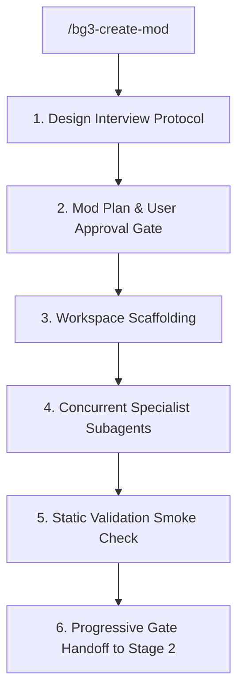

# BG3 Mod Creation Orchestrator (Stage 1) (`bg3-create-mod`)

Stage 1 orchestrator and parallel subagent pipeline for designing, scaffolding, authoring, and smoke-validating custom *Baldur's Gate 3* mods in `my_mods/<ModSlug>`.

Refer to specifications:
- Interview Protocol: [Design Interview Protocol](./references/grill_me_interview_protocol.md)
- Subagent Specs: [Subagent Launch Templates](./resources/subagent_templates.md)

---

> [!TIP]
> Query the studio tool registry with `python3 scripts/bg3.py tools search "<intent>" --json`.

## Workflow



### 1. Design Interview & Plan Approval
Conduct structured design interview following [Design Interview Protocol](./references/grill_me_interview_protocol.md). Formulate technical specification and await explicit user approval before scaffolding.

### 2. Workspace Scaffolding
After approval, run the scaffolding script:
```bash
python3 scripts/bg3.py mod create "<ModName>" [--slug "<slug>"] --author "MTGHillGiant" --description "<Desc>" [--unlock-level-curve] --json
```

### 3. Concurrent Subagent Dispatch
Launch the 4 specialist subagents in parallel following [Subagent Launch Templates](./resources/subagent_templates.md) (Stats & Spells, Progression & Lists, Localization, Documentation). Await reactive completion notifications without polling.

---

## Verification Gate

Once subagents complete, run read-only static verification before handoff:
```bash
python3 scripts/bg3.py mod validate <mod-slug> --json
python3 scripts/bg3.py mod sync-localization --mod <mod-slug> --check --json
python3 scripts/bg3.py mod conflict <mod-slug> --against-library --json
```

Verify:
- XML/LSX schema adherence and valid localization handles.
- Zero collisions with [`mods/library.md`](../../../mods/library.md).

After clean validation, prompt user to transition to **Stage 2 Diagnostics** ([`bg3-diagnose-mod`](../bg3-diagnose-mod/SKILL.md)).
