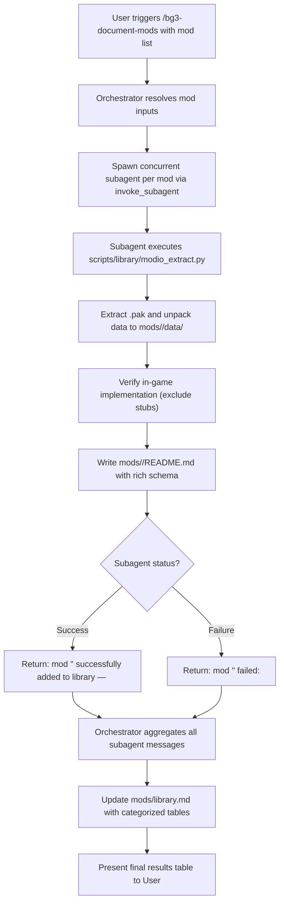

# BG3 Mod Documentation Orchestrator (`bg3-document-mods`)

This skill defines the **Orchestrator Persona** and automated subagent pipeline for fetching, unpacking, validating, and documenting *Baldur's Gate 3* mods from `https://mod.io/g/baldursgate3`.

The Orchestrator coordinates concurrent subagents so that multiple mods can be analyzed in parallel without blocking the main workflow, ensuring all features are validated against in-game implementation and cataloged in [`mods/library.md`](../../../mods/library.md) and individual specs in [`mods/`](../../../mods).

---

## Orchestrator Persona & Responsibilities

When triggered via `/bg3-document-mods` or when requested to document one or more BG3 mods, the agent acts as the **Mod Documentation Orchestrator**:

1. **Intake & Decompose**: Accepts a list of one or more mod queries (names, slugs, mod.io IDs, or full mod.io URLs) and spawns an isolated subagent for each mod.
2. **Concurrently Supervise**: Dispatches tasks to subagents in parallel via `invoke_subagent` and waits reactively for notifications (no polling loops).
3. **Aggregate & Catalog**: Once all subagents report back, runs the catalog generator to populate the six columns in [`mods/library.md`](../../../mods/library.md): Mod Id, Mod Name, Mod Slug, Description, Features Documented, and Spec Link.
4. **Report Final Status**: Presents the user with a consolidated summary table detailing mod name, status (Success/Failed), category, and description/failure reason.

---

## Workflow Overview



---

## Step 1: Input Resolution & Batch Breakdown

The Orchestrator accepts one or more mods specified as:
* Mod title or search term (e.g., `Elemental Eldritch Blast`, `Sets of Faerun`)
* Mod slug (e.g., `elemental-eldritch-blast`)
* Numerical mod.io ID (e.g., `6234921`)
* Mod.io URL (e.g., `https://mod.io/g/baldursgate3/m/elemental-eldritch-blast`)

If the user does not provide any mods in the prompt, ask the user which mods they would like documented before proceeding.

---

## Step 2: Spawning Concurrent Subagents

For each mod in the batch, the Orchestrator launches an individual subagent using `invoke_subagent`.

### Subagent Launch Template
```json
{
  "Subagents": [
    {
      "TypeName": "self",
      "Role": "Mod Documenter - <Mod_Name>",
      "Prompt": "<Subagent Prompt Below>",
      "Workspace": "inherit",
      "Model": "inherit"
    }
  ]
}
```

### Subagent Prompt Specification
Each spawned subagent receives a concise prompt directing it to follow the dedicated worker skill:

> Document the Baldur's Gate 3 mod: `<MOD_QUERY>`.
>
> 1. Read and follow all instructions in the worker skill [`bg3-document-single-mod`](../bg3-document-single-mod/SKILL.md).
> 2. Run `python3 scripts/library/modio_extract.py --query "<MOD_QUERY>" --write-spec --json` to download, unpack, and validate in-game features.
> 3. Confirm that `mods/<mod_slug>/README.md` adheres to the Rich Features Schema (including detailed descriptions of what granted abilities/spells/passives actually do).
> 4. Return the standardized status message:
>    - **On Success**: `mod '<Mod Name>' successfully added to library — <Brief 1-2 sentence description of what the mod does>`
>    - **On Failure**: `mod '<Mod Name>' failed: <Brief explanation of the failure>`

---

## Step 3: Reactive Orchestration (No Polling)

After launching the subagents, the Orchestrator stops calling tools and waits for the reactive wakeups. The AGY runtime delivers completion messages automatically as each subagent finishes.

---

## Step 4: Cataloging in `mods/library.md`

Once all subagents have reported back, the Orchestrator executes `scripts/library/update_library_catalog.py`:

```bash
# 1. Update markdown catalog
python3 scripts/bg3.py library update-catalog --write

# 2. Warm the mechanics & gear database cache
python3 scripts/bg3.py query --reindex
```

This automatically scans all specifications under `mods/`, extracts verified mod.io IDs, titles, slugs, descriptions, and implemented-feature counts, categorizes them into standard tables (**Gear**, **Spells**, **Classes & Subclasses**, **Progression & Rules**, **Utilities & Cheats**), and writes six-column rows with relative README spec links. Existing verified IDs are preserved during migration; unknown IDs remain blank until verified. It then rebuilds the high-speed query cache in `.cache/mod_database.json` for [`bg3-query-gear`](../bg3-query-gear/SKILL.md).

> [!TIP]
> **Tool Discovery & Schema Inspection (bg3 tools)**:
> To inspect catalog updater or database indexing flags dynamically:
> ```bash
> python3 scripts/bg3.py tools info update-catalog --json
> python3 scripts/bg3.py tools info query-db --json
> python3 scripts/bg3.py tools search "catalog" --json
> ```

---

## Step 5: Overall Results Presentation

Finally, the Orchestrator presents the user with an execution summary table in the chat:

```markdown
### BG3 Mod Documentation Batch Results

| Mod Name | Status | Category | Details / Failure Reason | Spec Link |
| :--- | :---: | :--- | :--- | :--- |
| **Cantrip Mastery** | ✅ Success | Classes & Subclasses | 13 elemental cantrips & passives documented | [README](../../../mods/cantrip-mastery/README.md) |
| **Sets of Faerun** | ✅ Success | Gear | 45 pieces of Thalindra & class sets documented | [README](../../../mods/sets-of-faerun/README.md) |
| **Example Invalid Mod** | ❌ Failed | — | No active release found on mod.io | — |
```

---

## Security & Environment Guidelines

1. **Environment Variables**: The mod.io REST API requires authentication. `MODIO_API_KEY` is loaded from `~/.profile`, `~/.bashrc`, or the project `.env` file.
2. **Zero Hardcoded Secrets**: **NEVER** write or print raw API keys in markdown specs, library files, or command strings. Always access the key via environment variables.
3. **Workspace Paths**: All mod specs are written to `mods/<slug>/README.md`, unpacked reference data is saved to `mods/<slug>/data/`, and library updates are written to `mods/library.md`.
