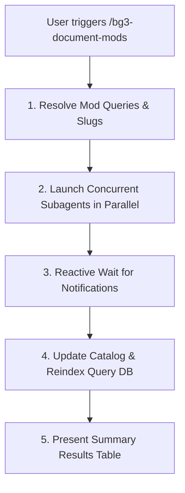

# BG3 Mod Documentation Orchestrator (`bg3-document-mods`)

Coordinates concurrent worker subagents to fetch, unpack, validate, and document *Baldur's Gate 3* mods from `https://mod.io/g/baldursgate3`.

Refer to specifications:
- Subagent Launch Schema: [Subagent Launch Template](./resources/document_subagent_template.json)
- Catalog Columns & Categories: [Catalog Specification](./references/library_catalog_spec.md)

---

> [!TIP]
> Query the studio tool registry with `uv run bg3 tools search "<intent>" --json`.

## Workflow



### 1. Query Resolution & Subagent Dispatch
Resolve mod titles, slugs, or numeric IDs. Launch one worker subagent per mod in parallel using the schema defined in [Subagent Launch Template](./resources/document_subagent_template.json), directing each worker to follow [`bg3-document-single-mod`](../bg3-document-single-mod/SKILL.md).

Stop calling tools and await reactive completion notifications without polling.

### 2. Catalog & Reindex
Once all subagents report status, update the centralized catalog and warm the query cache:
```bash
# Update mods/library.md
uv run bg3 library update-catalog --write

# Reindex high-speed query database
uv run bg3 query --reindex
```

### 3. Summary Presentation
Deliver an executive summary table detailing mod name, status (Success/Failed), category, and relative spec link.

---

## Verification Gate

Always verify catalog and cache updates before concluding:
1. Verify `update-catalog` and `query --reindex` exit with code 0.
2. Confirm all documented mods appear in `Mods/subscribed/library.md` under correct categories.
3. Validate that relative links to `mods/<slug>/README.md` resolve to existing files.
