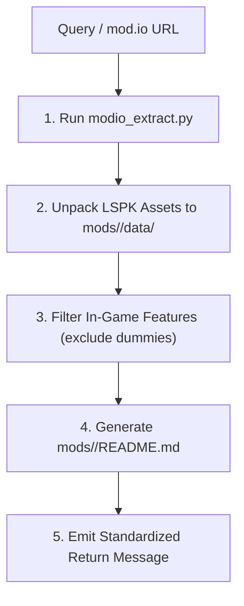

# BG3 Single Mod Documenter (`bg3-document-single-mod`)

Worker procedure for fetching, extracting, validating, and generating specifications for an individual *Baldur's Gate 3* mod from `https://mod.io/g/baldursgate3`.

Refer to resources:
- README Schema & Rules: [README Template](./resources/single_mod_readme_template.md)
- Status Format: [Return Message Templates](./resources/return_message_templates.md)

---

> [!TIP]
> Query the studio tool registry with `python3 scripts/bg3.py tools search "<intent>" --json`.

## Workflow



### 1. Extraction & Data Unpacking
Verify `MODIO_API_KEY` is set in the environment, then run extraction:
```bash
python3 scripts/bg3.py modio extract --query "<MOD_QUERY>" --write-spec --json
```
This downloads the package, unpacks LSPK v18 assets into `mods/<slug>/data/`, and scaffolds an initial markdown specification at `mods/<slug>/README.md`.

### 2. Feature Filtering & Schema Verification
Cross-check extracted features against the criteria in [README Template](./resources/single_mod_readme_template.md). Exclude dummy templates or WIP stubs. Confirm that all granted abilities and passives detail full mechanical formulas and effects.

### 3. Return Status
Emit standardized status per [Return Message Templates](./resources/return_message_templates.md).

---

## Verification Gate

Always verify document generation before concluding:
1. Verify `modio extract` command exits with code 0.
2. Confirm `mods/<slug>/README.md` exists and contains the complete Rich Features table.
3. Confirm dummy entries (`IsDummy "1"`) are excluded from documented features.
4. Validate that return string matches standard success/failure schema.
