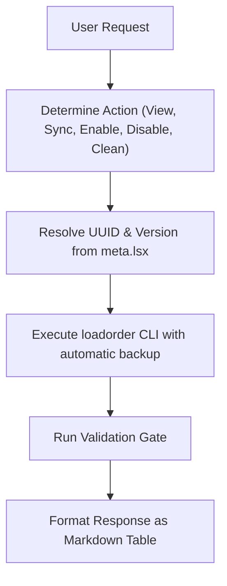

# BG3 Load Order Management Skill (`bg3-manage-load-order`)

Inspects and manages the active *Baldur's Gate 3* load order directly through natural language or slash command, modifying `modsettings.lsx`.

---

> [!TIP]
> Query the studio tool registry with `python3 scripts/bg3.py tools search "<intent>" --json`.

## Workflow



### 1. View & Sync Load Order
```bash
# List current profile load order
python3 scripts/bg3.py loadorder list --json

# Synchronize local mods into active load order profile
python3 scripts/bg3.py loadorder sync --yes --json

# Clean missing or removed mods from active profile
python3 scripts/bg3.py loadorder clean --yes --json
```

### 2. Mod Activation & Deactivation
```bash
# Enable at end of load order with dependencies
python3 scripts/bg3.py loadorder --enable "<mod_slug_or_UUID>" --with-deps --json

# Disable a mod safely
python3 scripts/bg3.py loadorder --disable "<mod_slug_or_UUID>" --json
```

### 3. Output Presentation
Present active mods as a table:
```markdown
| # | Mod Name | Folder / Module | UUID |
|---|:---|:---|:---|
| 1 | GustavDev (Base Game) | GustavDev | 28ac9e5a-3ded-4247-aa72-46603a11b8fd |
```

---

## Verification Gate

Always verify load order integrity before concluding:
1. Validate profile rules:
   ```bash
   python3 scripts/bg3.py loadorder --validate --json
   ```
2. Confirm command exits with code 0 and valid JSON.
3. Confirm `GustavDev` is at position 1.
4. Verify automatic backup was created at `modsettings.lsx.<timestamp>.bak`.
