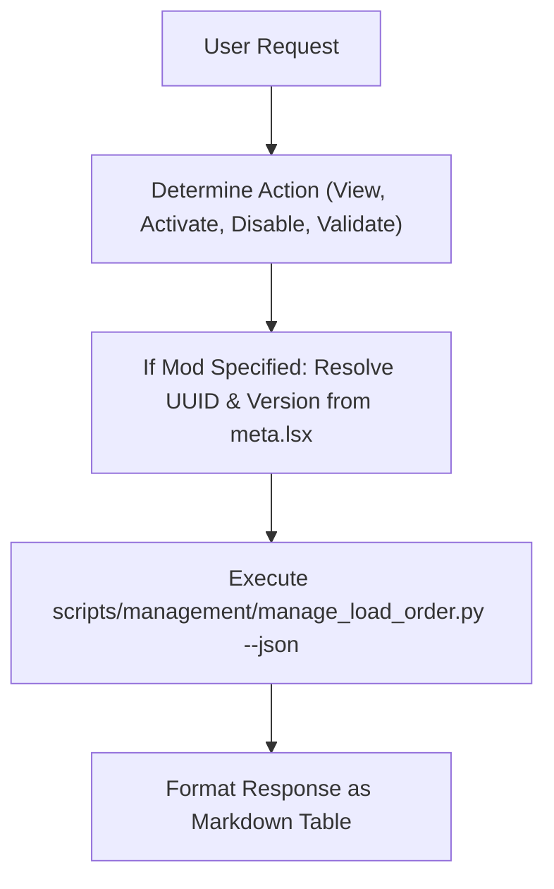

# BG3 Load Order Management Skill (`bg3-manage-load-order`)

This skill enables users to inspect and manage their active *Baldur's Gate 3* load order directly through natural language chat, backed by `scripts/management/manage_load_order.py`.

---

## Trigger Conditions

Activate this skill when:
- The user runs `/bg3-manage-load-order` or `/load_order`.
- The user asks:
  - *"Show me my current active load order."*
  - *"Enable my mod in-game."*
  - *"Disable Paladin's Call."*
  - *"Check if GustavDev is correctly loaded first."*

---

## Workflow



---

## Command Reference

### 1. View Current Load Order
```bash
python3 scripts/bg3.py loadorder list --json
```

### 2. Synchronize & Clean Load Order
```bash
# Sync local mods into active load order profile:
python3 scripts/bg3.py loadorder sync --yes --json

# Clean missing or invalid mods from active profile:
python3 scripts/bg3.py loadorder clean --yes --json
```

### 3. Detailed Mod Activation / Deactivation
For fine-grained position or dependency control, use the unified CLI:
```bash
# Enable at end of load order with dependencies:
python3 scripts/bg3.py loadorder --enable "<mod_slug_or_UUID>" --with-deps --json

# Disable a mod safely:
python3 scripts/bg3.py loadorder --disable "<mod_slug_or_UUID>" --json

# Validate profile rules:
python3 scripts/bg3.py loadorder --validate --json
```

> [!TIP]
> **Tool Discovery & Schema Inspection (bg3 tools)**:
> To inspect all load order management and save audit options:
> ```bash
> python3 scripts/bg3.py loadorder --help
> python3 scripts/bg3.py tools info load-order --json
> python3 scripts/bg3.py tools search "modsettings" --json
> ```

---

## Output Presentation

When presenting the load order to the user, render an orderly markdown table:

```markdown
### 📋 Active BG3 Load Order

| # | Mod Name | Folder / Module | UUID |
|---|:---|:---|:---|
| 1 | GustavDev (Base Game) | GustavDev | 28ac9e5a-3ded-4247-aa72-46603a11b8fd |
| 2 | UnlockLevelCurve | UnlockLevelCurve | ... |
| 3 | ArcaneProgression | ArcaneProgression_cfef8d1a... | ... |

*(Backup created at `modsettings.lsx.<timestamp>.bak`)*
```
