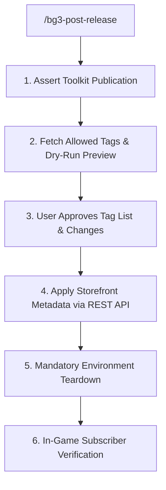

# Storefront Governance & Consumer Subscriber Transition (Stage 5) (`bg3-post-release`)

Governs mod.io storefront profile metadata, tags, and transitions authors to consumer subscribers following User-Action Gate 3 Toolkit publication.

Refer to specifications:
- Storefront Flags & Teardown: [Storefront Guide](./references/storefront_metadata_guide.md)

---

> [!TIP]
> Query the studio tool registry with `python3 scripts/bg3.py tools search "<intent>" --json`.

## Workflow



### 1. Pre-Flight Assertion & Tag Preview
Assert mod has been published via the official Toolkit (`Glasses.exe`). Require `MODIO_PAT` in environment. Fetch allowed tags and preview changes:
```bash
python3 scripts/bg3.py modio update-metadata --mod "<slug>" --json
```

### 2. User Approval & Live API Writes
Present tag recommendations and profile changes. Upon explicit user confirmation, execute writes with `--confirm`:
```bash
python3 scripts/bg3.py modio update-metadata --mod "<slug>" --tags "<approved-tags>" --confirm --json
```

### 3. Mandatory Teardown
Clean loose authoring assets per [Storefront Guide](./references/storefront_metadata_guide.md) before launching the game:
```bash
python3 scripts/bg3.py mod sync-data --clean-mod <mod-slug> --json
python3 scripts/bg3.py mod pack --mod <mod-slug> --clean-local --json
python3 scripts/bg3.py loadorder --disable <mod-slug> --json
```

---

## Verification Gate

Always verify post-release execution:
1. Verify `update-metadata` exits with code 0 and operations report success.
2. Provide admin settings confirmation URL: `https://mod.io/g/baldursgate3/m/<slug>/admin/settings`.
3. Verify teardown commands exit with code 0.
4. Instruct user to subscribe and verify in the in-game Mod Manager.
