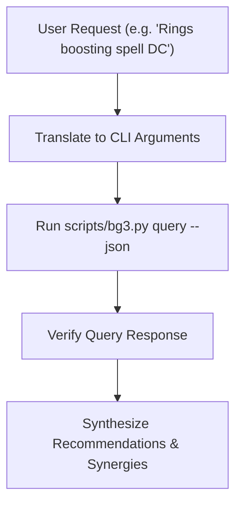

# BG3 Mod Equipment & Mechanics Advisor (`bg3-query-gear`)

Intelligent gear and build advisor, translating natural language requests into high-speed queries against the cataloged community mod database ([`mods/`](../../../mods)).

---

> [!TIP]
> Query the studio tool registry with `python3 scripts/bg3.py tools search "<intent>" --json`.

## Workflow

### 1. Query Translation

| User Intent | CLI Command |
| :--- | :--- |
| Boosts specific stat | `python3 scripts/bg3.py query --boost "SpellSaveDC" --json` |
| Specific equipment slot | `python3 scripts/bg3.py query --slot "Amulet" --json` |
| Specific passive | `python3 scripts/bg3.py query --passive "ExtraAttack" --json` |
| Slot + Rarity combination | `python3 scripts/bg3.py query --slot "Boots" --rarity "Legendary" --json` |
| Thematic keyword search | `python3 scripts/bg3.py query --search "necrotic" --json` |

### 2. Synthesize Advice
Structure recommendations with Item Name, Slot, Mod Source, Key Effects, and Build Synergies. Note early-game container drop mechanics via `scripts/bg3.py mod inject-treasure`.

---

## Verification Gate

Always verify query results before presenting to user:
1. Verify `scripts/bg3.py query` exits with code 0.
2. If the query database is empty or missing, rebuild it with `python3 scripts/bg3.py query --reindex`.
3. Confirm returned items exist in [`mods/library.md`](../../../mods/library.md) or [`mods/`](../../../mods).
