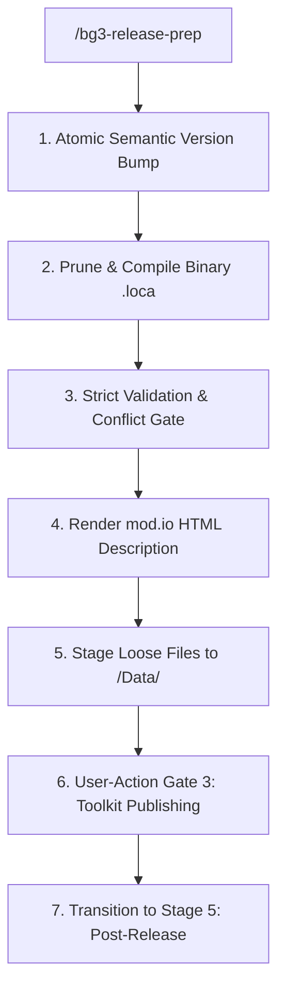

# BG3 Mod Release Preparation Assistant (Stage 4) (`bg3-release-prep`)

Stage 4 pipeline for *Baldur's Gate 3* mods, preparing loose development files and HTML descriptions for User-Action Gate 3 (`Glasses.exe` publishing).

Refer to specifications:
- Publishing & Versioning: [Release Pipeline Specs](./references/release_pipeline_specs.md)

---

> [!TIP]
> Query the studio tool registry with `uv run bg3 tools search "<intent>" --json`.

## Workflow



### 1. Semantic Bump & Localization Compilation
```bash
uv run bg3 mod bump-version --mod <mod-slug> --patch --json
uv run bg3 mod sync-localization --mod <mod-slug> --prune --compile --json
```

### 2. Strict Validation & Description Rendering
```bash
uv run bg3 mod validate --mod <mod-slug> --strict --json
uv run bg3 mod conflict --candidate <mod-slug> --against-library --json
uv run bg3 mod render-description --mod <mod-slug> --write --json
```

### 3. Game Data Staging & Packaging
Sync loose development files and `.loca` to `<Game>/Data/`:
```bash
uv run bg3 mod sync-data --mods <mod-slug> --json

# Optional package for Nexus Mods
uv run bg3 mod pack --mod <mod-slug> --out "dist/<mod-slug>.pak" --json
```

---

## Verification Gate

Verify release preparation before Toolkit publishing:
1. Confirm validation and conflict commands exit with code 0.
2. Confirm `my_mods/<mod-slug>/modio_description.html` exists and is non-empty.
3. Confirm 512×512 PNG icons exist and binary `.loca` is compiled.
4. Guide user through [Release Pipeline Specs](./references/release_pipeline_specs.md) and transition to [`bg3-post-release`](../bg3-post-release/SKILL.md).
