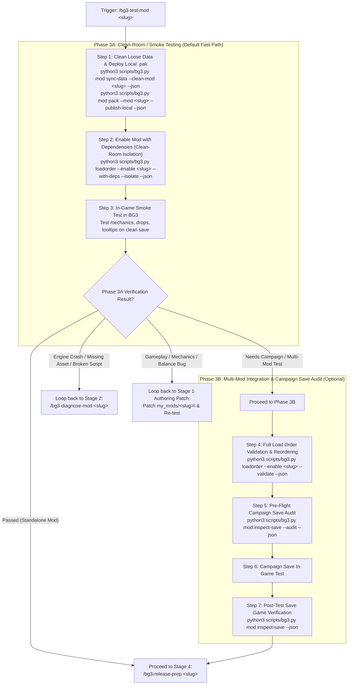

# BG3 Mod In-Game Testing & Verification (Stage 3) (`bg3-test-mod`)

This skill defines the **Stage 3 (In-Game Testing)** workflow of the custom mod lifecycle, governing **User-Action Gate 2 (In-Game Playtesting)**. It purges loose files from `Data/` (preventing VFS loose-file shadowing), deploys a clean local test `.pak` to `AppData/Mods/`, isolates load order in `modsettings.lsx`, and guides playtesting with **Dual-Track Defect Routing**. It follows a **two-tier progressive gating architecture**:
- **Phase 3A: Clean-Room / Smoke Testing (Default)** — Packages the mod, activates it alongside declared dependencies (`--with-deps`), and guides fast functional verification on a clean/new game.
- **Phase 3B: Multi-Mod Integration & Save Audit (Optional Gate)** — Validates full profile load order rules and audits complex campaign save games for mods requiring extensive third-party integration.

## Discovery & Tooling

Inspect tool arguments, flags, and schema definitions with:

```bash
python3 scripts/bg3.py tools info sync-game
python3 scripts/bg3.py tools info pack-pak
python3 scripts/bg3.py tools info load-order
python3 scripts/bg3.py tools info inspect-save
```

---

## Workflow Overview



---

## Execution Steps

### Step 1: Clean Loose Data Files & Deploy Local Test `.pak`

Before packing and testing in-game, purge any unpacked development files from the game's `Data/` directory. Because Larian's Virtual File System (VFS) prioritizes loose files over `.pak` archives, cleaning loose files ensures the game engine tests **strictly against the packaged `.pak` file** without stale file shadowing:

```bash
# 1. Purge loose Toolkit development files from Data/
python3 scripts/bg3.py mod sync-data --clean-mod <mod-slug> --json

# 2. Build clean .pak archive and deploy directly to AppData Mods/
python3 scripts/bg3.py mod pack --mod <mod-slug> --publish-local --json
```

Verify in the JSON output:
- Loose `Projects/`, `Mods/`, `Public/`, and `Editor/Mods/` folders purged from `Data/`
- Source directories packaged (`Mods/`, `Public/`, compiled `Localization/`)
- Repository-only files excluded (`README.md`, `modio_description.*`, root thumbnails, `.gitkeep`)
- Destination `.pak` created in game's `Mods/` directory

---

## Phase 3A: Clean-Room / Smoke Testing (Default Fast Path)

### Step 2: Configure Dependency-Aware Load Order & Clean-Room Isolation (QuickEnable)

Phase 3A is clean-room smoke testing: activate the mod while strictly isolating the load order so that **ONLY the target mod, its declared prerequisites (e.g. `UnlockLevelCurve`), and test companions are enabled**:

```bash
python3 scripts/bg3.py loadorder --enable <mod-slug> --with-deps --isolate --json
```

To include temporary testing companions, cheat patches (e.g. `UnlockLevelCurve - Instant XP`), or fast-progression helpers on the CLI:
```bash
python3 scripts/bg3.py loadorder --enable <mod-slug> --with-deps --isolate --test-dep "UnlockLevelCurve - Instant XP" --json
```
*(Or record them permanently for testing in `my_mods/<mod-slug>/.test_deps.json` via `python3 scripts/bg3.py mod add-dependency --mod <mod-slug> --dep "UnlockLevelCurve - Instant XP" --test-only`, which are automatically picked up by `--with-deps`)*

Verify in JSON output:
- `isolated_count`: confirms number of unrelated mods disabled to maintain clean test isolation.
- `enable.status`: `enabled`, `reordered`, or `already_active`.
- `enable.pak_sync`: confirms all dependency `.pak` files exist or were synchronized/downloaded into Steam `Data/Mods/` and AppData `Mods/`.
- `enable.dependencies`: list of resolved prerequisites enabled ahead of the mod in topological sequence.
- `enable.test_dependencies`: list of active temporary test companions enabled ahead of the mod.
- `enable.missing_dependencies`: must be empty. If any dependencies are missing locally, halt and notify the user before launching the game.

---

### Step 3: Guided In-Game Verification (Smoke Test)

Instruct the user:
1. Launch **Baldur's Gate 3** (`bg3.exe`).
2. Start a new test game or load a clean minimal test save.
3. Check the targeted features:
   - **Acquisition**: Check container drops (Tutorial Chest / Camp Chest) or vendor inventory.
   - **Tooltips**: Verify item/spell names and descriptions display properly (no `Not Found` or raw string handles).
   - **Mechanics**: Cast spells, verify passives activate on turn start/hit, test level-up progression screens.
   - **Save & Reload**: Save the game, reload, and verify persistence.

---

### Step 4: Phase 3A Gate Handoff

Present the smoke test summary and ask the user for their in-game verification outcome via `ask_question`:

- **(Recommended) All tests passed! Ready for Release: Proceed to Stage 4 (/bg3-release-prep <slug>)**: Proceed directly to **Stage 4: Release Preparation** ([`bg3-release-prep`](../bg3-release-prep/SKILL.md)).
- **Proceed to Phase 3B (Integration & Save Audit)**: For mods requiring complex multi-mod load order tuning or verification in heavily modded campaign saves.
- **Engine crash or missing asset detected: Loop back to Stage 2 Diagnostics (/bg3-diagnose-mod <slug>)**: Loop back to **Stage 2: Diagnostics** ([`bg3-diagnose-mod`](../bg3-diagnose-mod/SKILL.md)).
- **Gameplay mechanics or balance bug detected: Apply authoring patch to my_mods/<slug>/, re-deploy local .pak, and re-test**: Apply authoring patch to `my_mods/<slug>/`, re-deploy local `.pak` (Step 1), and re-test.

---

## Phase 3B: Multi-Mod Integration & Save Audit (Optional Gate)

### Step 5: Full Load Order Validation & Placement

Validate load order integrity across the entire active player profile:

```bash
python3 scripts/bg3.py loadorder --enable <mod-slug> --validate --json
```

If the mod requires specific positioning relative to other community mods (e.g., after framework mods):
```bash
python3 scripts/bg3.py loadorder --enable <mod-slug> --order <index> --validate --json
```

---

### Step 6: Pre-Flight Campaign Save Game Audit

Inspect the player's target campaign save to ensure compatibility across all installed mods before launching:

```bash
python3 scripts/bg3.py mod inspect-save --audit --json
```

Optionally, run a build synergy simulation if the mod alters combat stats or spell progressions:
```bash
python3 scripts/bg3.py build simulate --class <Class> --level 12
```

---

### Step 7: Post-Test Save Game Verification & Stage 4 Handoff

After the user tests in their campaign save and exits (or minimizes), inspect the save file to verify module persistence:

```bash
python3 scripts/bg3.py mod inspect-save --json
```

Confirm that the mod's UUID is recorded in the save file's module list without corruption, then hand off to **Stage 4: Release Preparation** ([`bg3-release-prep`](../bg3-release-prep/SKILL.md)).
