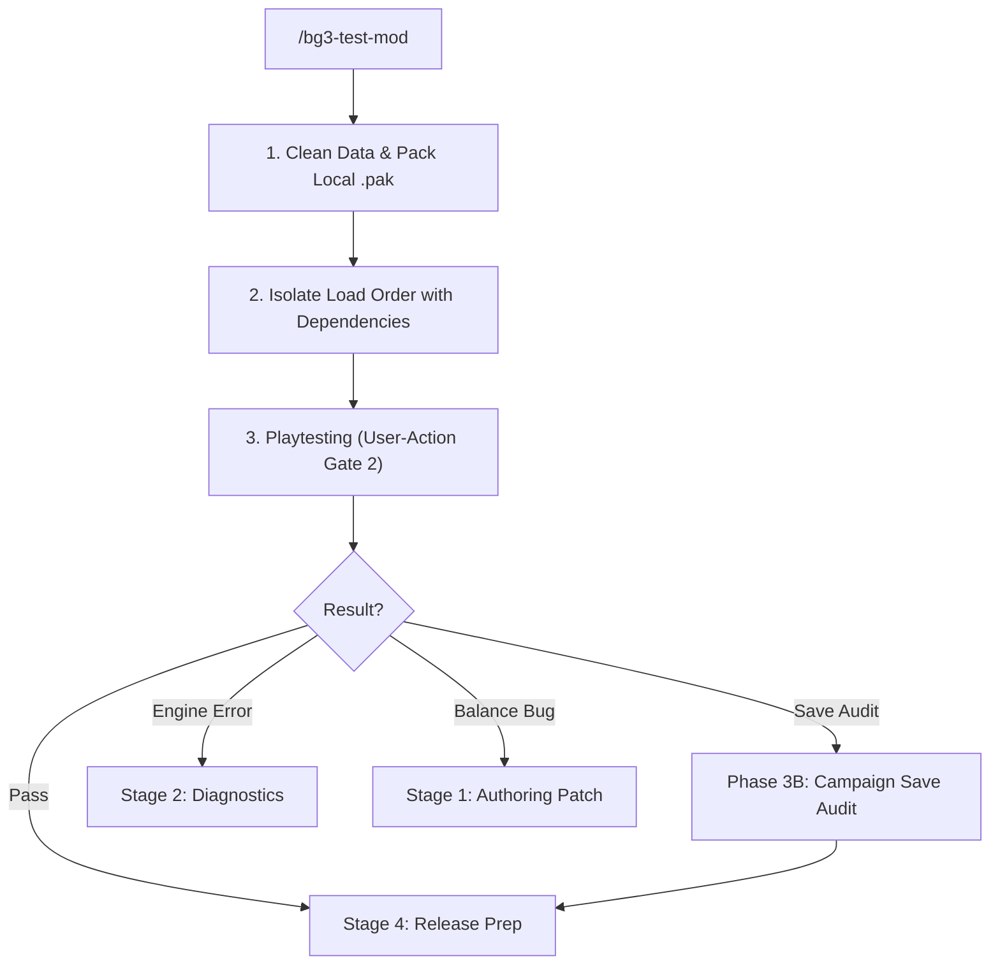

# BG3 Mod In-Game Testing & Verification (Stage 3) (`bg3-test-mod`)

Stage 3 playtesting workflow governing User-Action Gate 2. Deploys test `.pak` to `AppData/Mods/` and isolates load order.

Refer to specifications:
- Smoke Testing: [Smoke Runbook](./references/smoke_testing_runbook.md)
- Campaign Saves: [Save Audit](./references/save_audit_runbook.md)

---

> [!TIP]
> Query the studio tool registry with `python3 scripts/bg3.py tools search "<intent>" --json`.

## Workflow



### 1. Clean Data & Deploy Local `.pak`
Purge loose files and package `.pak`:
```bash
python3 scripts/bg3.py mod sync-data --clean-mod <mod-slug> --json
python3 scripts/bg3.py mod pack --mod <mod-slug> --publish-local --json
```

### 2. Configure Clean-Room Load Order (Phase 3A)
Enable target mod with dependencies per [Smoke Runbook](./references/smoke_testing_runbook.md):
```bash
python3 scripts/bg3.py loadorder --enable <mod-slug> --with-deps --isolate --json
```

### 3. Guided Playtesting & Routing
Instruct user to launch game and test acquisitions, tooltips, and mechanics:
- Standalone pass: Proceed to [`bg3-release-prep`](../bg3-release-prep/SKILL.md).
- Campaign integration: Follow [Save Audit](./references/save_audit_runbook.md).
- Engine crash / missing asset: Return to [`bg3-diagnose-mod`](../bg3-diagnose-mod/SKILL.md).
- Mechanics bug: Patch `my_mods/<slug>/`, re-deploy, and re-test.

---

## Verification Gate

Verify local deployment state before concluding:
1. Verify `sync-data --clean-mod` and `mod pack --publish-local` exit with code 0.
2. Confirm `.pak` exists in user `AppData/Mods/`.
3. Confirm load order reports 0 missing dependencies.
4. User confirms in-game playtesting or save persistence.
