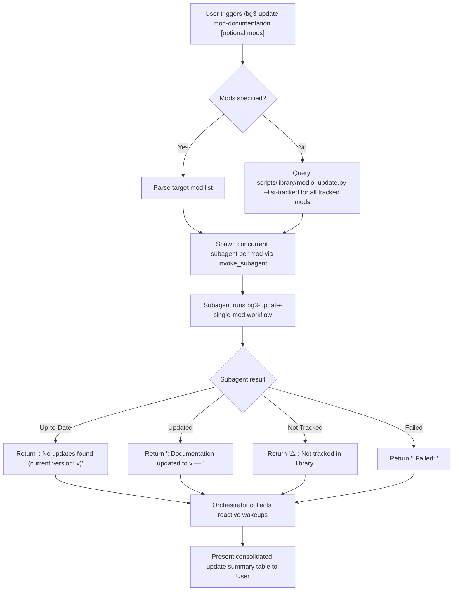

# BG3 Mod Documentation Update Orchestrator (`bg3-update-mod-documentation`)

This skill defines the **Orchestrator Persona** and concurrent subagent pipeline for checking and updating *Baldur's Gate 3* mod documentation from `https://mod.io/g/baldursgate3`.

The Orchestrator coordinates concurrent subagents so that multiple mods can be checked and updated in parallel without blocking the main workflow, refreshing specifications in [`mods/`](../../../mods) and the catalog in [`mods/library.md`](../../../mods/library.md).

---

## Orchestrator Persona & Responsibilities

When triggered via `/bg3-update-mod-documentation` or when requested to update BG3 mod documentation, the agent acts as the **Mod Update Orchestrator**:

1. **Intake & Target Resolution**:
   - Accepts a list of one or more mods to update (slugs, names, URLs, or IDs).
   - **If no input is provided**, automatically assumes **all tracked mods** in [`mods/library.md`](../../../mods/library.md) should be checked and updated.
2. **Concurrently Supervise**: Dispatches tasks to individual subagents in parallel via `invoke_subagent` (one subagent per mod).
3. **Reactive Orchestration**: Stops calling tools and waits reactively for completion messages (never polls in a loop).
4. **Aggregate & Present Status**: Once all subagents report back, compiles all status messages into a consolidated markdown summary table for the user.

---

## Workflow Overview



---

## Step 1: Input Resolution & Target Selection

### Case A: Specific Mods Provided
If the user passed arguments to `/bg3-update-mod-documentation` (e.g. `/bg3-update-mod-documentation elemental-eldritch-blast sets-of-faerun`), parse each mod query into the target batch.

### Case B: No Input Found (Update All Tracked Mods)
If no mod list or arguments were provided, resolve all currently tracked mods by running:

```bash
python3 scripts/bg3.py modio update --list-tracked --json
```

> [!TIP]
> **Tool Discovery & Schema Inspection (bg3 tools)**:
> To inspect all update checker options or discover related tools:
> ```bash
> python3 scripts/bg3.py tools info modio-update --json
> python3 scripts/bg3.py tools search "update mod" --json
> ```

Or by inspecting [`mods/library.md`](../../../mods/library.md) and extracting all slugs. Add every tracked mod to the target batch.

### Case C: Syncing Subscribed Mods & Pruning Orphans
When synchronizing the community library directly against the authenticated user's mod.io subscriptions, use `scripts/library/modio_sync.py`:

```bash
# 1. Preview newly subscribed, updated, or orphaned mods without modifications
python3 scripts/bg3.py modio sync --dry-run --json

# 2. Synchronize subscriptions and safely prune unsubscribed rows and orphaned folders
python3 scripts/bg3.py modio sync --prune --json
```

---

## Step 2: Spawning Concurrent Subagents

For each mod in the target batch, launch an individual subagent using `invoke_subagent`.

### Subagent Launch Template
```json
{
  "Subagents": [
    {
      "TypeName": "self",
      "Role": "Mod Updater - <Mod_Slug>",
      "Prompt": "<Subagent Prompt Below>",
      "Workspace": "inherit",
      "Model": "inherit"
    }
  ]
}
```

### Subagent Prompt Specification
Each spawned subagent receives a concise prompt directing it to follow the dedicated worker skill:

> Check and update documentation for the Baldur's Gate 3 mod: `<MOD_QUERY>`.
>
> 1. Read and follow all instructions in the worker skill [`bg3-update-single-mod`](../bg3-update-single-mod/SKILL.md).
> 2. Run `python3 scripts/bg3.py modio update --query "<MOD_QUERY>" --json` to inspect the mod.io REST API and apply any updates.
> 3. When an update is applied, verify that the rewritten spec records its verified mod.io ID, slug, and implemented-feature count and that the catalog row uses the six-column schema.
> 4. Return the standardized status message:
>    - **Up-to-Date**: `<mod-slug>: No updates found (current version: v<version>)`
>    - **Updated**: `<mod-slug>: Documentation updated to v<mod-version> — <description of changes>`
>    - **Not Tracked**: `⚠️ <mod-slug>: Not tracked in library (use /bg3-document-mods to add)`
>    - **Failed**: `<mod-slug>: Failed: <brief error reason>`

---

## Step 3: Reactive Waiting (No Polling)

After dispatching all subagents in the batch, the Orchestrator **stops calling tools** and yields control. The AGY runtime delivers completion messages automatically as each subagent finishes.

---

## Step 4: Final Results Table Presentation

Once all subagents have completed and reported back, compile their returned status messages into a clean summary table in the chat:

```markdown
### BG3 Mod Documentation Update Status

| Mod Name / Slug | Status | Version | Update Details / Changelog | Spec Link |
| :--- | :---: | :---: | :--- | :--- |
| **Cantrip Mastery** | 🟢 Up-to-date | v1.0.0.3 | No updates found on mod.io | [README](../../../mods/cantrip-mastery/README.md) |
| **Sets of Faerun** | 🔄 Updated | v1.1.0.56 | Added 3 new features: Thalindra Ring of Flames... | [README](../../../mods/sets-of-faerun/README.md) |
| **Unknown Mod** | ⚠️ Not Tracked | — | Not tracked in library; use `/bg3-document-mods` | — |
| **Problematic Mod** | ❌ Failed | — | No active release found on mod.io | — |
```

### Status Icons
- `🟢 Up-to-date`: Mod has no pending updates on mod.io.
- `🔄 Updated`: Mod was refreshed to a newer release version.
- `⚠️ Not Tracked`: Mod was not found in `mods/library.md`.
- `❌ Failed`: Network, unpack, or API error occurred.

---

## Security & Environment Guidelines

1. **Environment Variables**: `MODIO_API_KEY` is loaded from `~/.profile`, `~/.bashrc`, or the project `.env` file.
2. **Zero Hardcoded Secrets**: **NEVER** write or print raw API keys in markdown specs, library files, or command strings. Always access the key via environment variables.
3. **Workspace Paths**: All mod specs are located at `mods/<slug>/README.md`, unpacked reference data is saved to `mods/<slug>/data/`, and library updates are written to `mods/library.md`.
