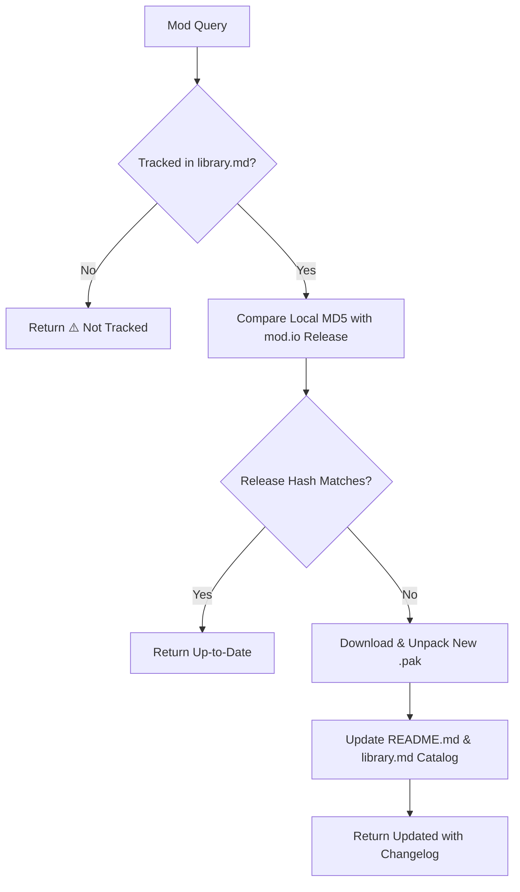

# BG3 Single Mod Update Worker (`bg3-update-single-mod`)

Worker procedure for checking and updating documentation and game assets for an individual *Baldur's Gate 3* mod from `https://mod.io/g/baldursgate3`.

Refer to resources:
- Return Status Formats: [Update Status Messages](./resources/update_status_messages.md)

---

> [!TIP]
> Query the studio tool registry with `python3 scripts/bg3.py tools search "<intent>" --json`.

## Workflow



### 1. Environment & Tracking Check
Verify `MODIO_API_KEY` is available in environment or `.env`. Ensure mod is tracked in [`mods/library.md`](../../../mods/library.md).

### 2. Check & Update Pipeline
Execute update pipeline:
```bash
python3 scripts/bg3.py modio update --query "<MOD_QUERY>" --json
```
The script compares release hashes, downloads new `.pak` packages if needed, updates `mods/<slug>/README.md`, and re-catalogs [`mods/library.md`](../../../mods/library.md).

### 3. Return Message
Format status output according to [Update Status Messages](./resources/update_status_messages.md) (Up-to-Date, Updated, Not Tracked, Failed).

---

## Verification Gate

Always verify update results before returning:
1. Verify `modio update` command exits with code 0 and valid JSON.
2. Confirm `mods/<slug>/README.md` reflects latest semantic version.
3. Validate return string conforms to schemas in [Update Status Messages](./resources/update_status_messages.md).
