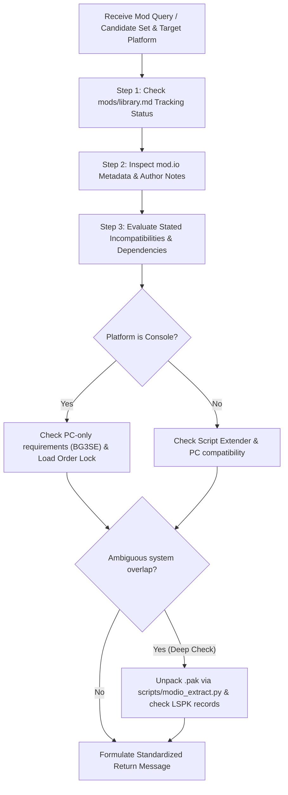

# BG3 Mod Conflict & Compatibility Checker (`bg3_check_mod_conflicts`)

This skill defines the worker subagent procedure for evaluating compatibility and detecting potential conflicts for *Baldur's Gate 3* mods.

It is designed to be invoked by the [`bg3_search_mods`](file:///home/jpstroud/projects/BaldursGate3/.agents/skills/bg3_search_mods/SKILL.md) orchestrator across two distinct modes:
1. **Mode 1 (Target vs. Tracked Library)**: Checks a single candidate mod against all mods cataloged in [`mods/library.md`](file:///home/jpstroud/projects/BaldursGate3/mods/library.md).
2. **Mode 2 (Cross-Candidate Batch)**: Checks a set of candidate search results against each other.

---

## Conflict Detection Methodology (Hybrid Check)

The subagent follows a high-efficiency **hybrid check** hierarchy:



---

## Mode 1: Candidate vs. Existing Library

### Step 1: Library Tracking Verification
1. Inspect [`mods/library.md`](file:///home/jpstroud/projects/BaldursGate3/mods/library.md) and directory names under [`mods/`](file:///home/jpstroud/projects/BaldursGate3/mods).
2. Determine if the mod is already cataloged (matching slug or title).
3. If already tracked, note:
   `Mod '<Mod Name>' is already tracked in mods/library.md.`

### Step 2: Inspection of Candidate & Library Specs
1. Fetch candidate metadata and description using `scripts/modio_search.py --query "<MOD_SLUG>" --platform "<PLATFORM>" --json --include-tracked`.
2. Inspect tracked mod specifications in [`mods/<slug>/README.md`](file:///home/jpstroud/projects/BaldursGate3/mods) to understand what systems tracked mods alter:
   - **Progressions & Rules**: Level curves (e.g. UnlockLevelCurve), spell slots, feat intervals.
   - **Classes & Subclasses**: Class progression overrides (e.g. Warlock pact boons, spell lists).
   - **Spells**: Vanilla spell modifications (e.g. Longstrider QoL, Eldritch Blast projectile overrides).
   - **Gear**: Treasure tables, container spawners, stat alteration rings (Choose Your Scores, GearUp).

### Step 3: Conflict Vectors
Check for the following common BG3 conflict sources:
* **Direct Stated Incompatibility**: Mod author explicitly lists another mod as incompatible in the description.
* **Missing Prerequisites**: Mod requires external frameworks (e.g., *Community Library*, *Compatibility Framework*, *5e Spells*, or *BG3 Script Extender*).
* **Progression Table Clashes**: Both mods replace or edit the same class/subclass node in `Progressions.lsx` without using the Compatibility Framework.
* **Vanilla Asset Overwrites**: Both mods overwrite the exact same spell, status effect, or item root template.

### Step 4: Console Platform Load Order Rule
> [!IMPORTANT]
> If the target platform is **Console** (`xboxseriesx`, `ps5`, or `console`):
> 1. **No Manual Load Order**: Console players cannot manually reorder mods or customize priority. If two mods touch overlapping systems or require a strict load order (e.g., *"Load this mod AFTER mod X"*), this represents an unresolvable conflict on console.
> 2. **No Script Extender (BG3SE)**: Any mod requiring BG3SE or native PC dlls will fail or cause crashes on console.
> 3. Whenever a load-order or system-overlap issue is detected on console, tag it explicitly with `[Console Load Order]`.

### Step 5: Automated Conflict Inspection (`scripts/check_mod_conflicts.py`)
To deterministically detect stat entry collisions, progression level overlaps, and console-incompatible DLLs, run:
```bash
python3 scripts/check_mod_conflicts.py --candidate "<MOD_SLUG>" --against-library --json
```
Or for comparing two specific candidate mods:
```bash
python3 scripts/check_mod_conflicts.py --mod1 "<MOD1>" --mod2 "<MOD2>" --json
```
The script will output exact stat collisions, progression level collisions, and DLL detections. If conflicts are detected, synthesize them into the return message below.

### Standardized Status Return (Mode 1)
Return exactly one of the following formatted responses to the Orchestrator:

* **Clean Compatibility**:
  ```text
  No conflicts found with existing mods
  ```
* **Conflict Detected**:
  ```text
  Possible conflict found: <Tracked Mod Name> - <Brief description of the issue>
  ```
* **Conflict Detected (Console Load Order)**:
  ```text
  Possible conflict found: <Tracked Mod Name> - <Brief description of issue> [Console Load Order: cannot reorder on console to ensure proper override]
  ```

---

## Mode 2: Cross-Candidate Batch Conflicts

When assigned to evaluate conflicts *between* the set of candidate mods returned by the search:

1. **Intake Candidate List**: Receive the list of selected candidate slugs/names and the target platform.
2. **Pairwise System Analysis**: Compare candidate pairs against each other:
   - Do candidate mods modify the same class or subsystem? (e.g., two different Warlock overhaul mods that both alter level 1–12 progression).
   - Do candidate mods replace the same cantrip or spell mechanics?
   - Does one candidate mod require another candidate mod to be loaded in a specific order?
3. **Console Load Order Evaluation**: On Console, any inter-dependency requiring custom load priority must be flagged with `[Console Load Order]`.

### Standardized Status Return (Mode 2)
* **Clean Batch**:
  ```text
  No conflicts found between candidate mods
  ```
* **Conflict Detected**:
  ```text
  Possible conflict found: <Candidate Mod 1> vs <Candidate Mod 2> - <Brief description of the conflict>
  ```
* **Console Conflict Detected**:
  ```text
  Possible conflict found: <Candidate Mod 1> vs <Candidate Mod 2> - <Brief description of issue> [Console Load Order: cannot reorder on console to resolve override order]
  ```

---

## Step 6: Automated Remediation & Patch Generation (`scripts/generate_compat_patch.py`)

When actionable conflicts or stat collisions are detected between two mods (or when requested by the user), offer automated patch generation:

```bash
# Generate a standalone compatibility override patch
python3 scripts/generate_compat_patch.py --mod1 <mod1> --mod2 <mod2> --strategy merge_all --patch-name "<Mod1>_<Mod2>_Patch"

# Or generate a Compatibility Framework json payload
python3 scripts/generate_compat_patch.py --mod1 <mod1> --mod2 <mod2> --format compat_framework
```

Supported resolution strategies:
- `merge_all`: Merges distinct non-conflicting properties and keeps higher-value parameters.
- `override_mod1`: Explicitly prioritizes values from Mod 1.
- `override_mod2`: Explicitly prioritizes values from Mod 2.

