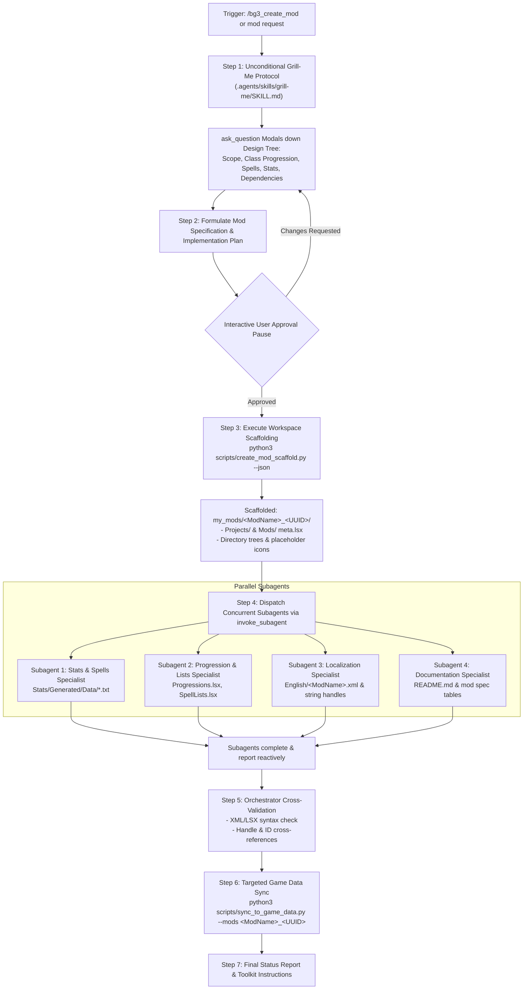

# BG3 Mod Creation Orchestrator (`bg3_create_mod`)

This skill defines the **Orchestrator Persona** and automated parallel subagent pipeline for designing, scaffolding, authoring, validating, and synchronizing custom *Baldur's Gate 3* mods.

The Orchestrator coordinates the complete lifecycle:
1. Conducts an interactive **`grill-me`** interview to resolve all design branches.
2. Drafts a technical mod plan and pauses for **interactive user approval**.
3. Scaffolds `my_mods/<ModSlug>` with internal `<ModName>_<UUID>` Larian subdirectories via [`scripts/create_mod_scaffold.py`](file:///home/jpstroud/projects/BaldursGate3/scripts/create_mod_scaffold.py).
4. Dispatches specialized **concurrent subagents in parallel** to author stats, progressions, localization, and documentation.
5. Reactively cross-validates file syntax and identifiers.
6. Synchronizes mod assets to the game's `Data/` directory via [`scripts/sync_to_game_data.py`](file:///home/jpstroud/projects/BaldursGate3/scripts/sync_to_game_data.py).

---

## Workflow Overview



---

## Step 1: Mandatory Preliminary `grill-me` Protocol

Before drafting any plan or generating UUIDs/folders, the Orchestrator **MUST unconditionally execute the local `grill-me` protocol** defined in [`.agents/skills/grill-me/SKILL.md`](file:///home/jpstroud/projects/BaldursGate3/.agents/skills/grill-me/SKILL.md).

### Interview Execution Rules
1. **Analyze Context First**: Extract any mod names, classes, spells, or mechanics mentioned in earlier conversation.
2. **Interactive `ask_question` Modals**: Walk down each branch of the mod design tree one question at a time.
   - **Branch A (Mod Identity & Theme)**: Name (PascalCase, e.g. `ArcaneProgression`, `EldritchAscension`), summary, and character fantasy.
   - **Branch B (Classes & Progression)**: Target classes/subclasses, level bounds (e.g. 1-12 vanilla vs. 13-20 `UnlockLevelCurve`), and progression unlock levels.
   - **Branch C (Spells, Passives & Abilities)**: Action economy (Action, Bonus Action, Reaction), resource costs (Ki, Spell Slots, Action Surge), and damage/status effects.
   - **Branch D (Parent Dependencies)**: Base game only (`GustavDev`) or companion frameworks like `UnlockLevelCurve` (`a2ffd0e4-c407-8642-2611-c934ea0b0a77`).
   - **Branch E (In-Game Acquisition & Item Drops)**: For equipment or item mods, identify container drop locations (Tutorial Chest on Nautiloid, Camp Chest, or Act 1-3 vendors like Arron or Dammon) for `scripts/inject_treasure_table.py`.
3. **Format Options**: Prefix the recommended option with `(Recommended)` and list it first. Format all options as direct user responses.

---

## Step 2: Mod Specification & Interactive User Approval

Once the interview reaches shared understanding, the Orchestrator synthesizes the results into a structured **Mod Implementation Plan**:

```markdown
# Mod Specification: <ModName>
- **Mod Name**: `<ModName>`
- **Category**: <Category>
- **Dependencies**: `GustavDev` [, `UnlockLevelCurve`]

### Mechanics Breakdown
| Feature | Class/Level | Type | Cost | Effect |
| :--- | :--- | :--- | :--- | :--- |
| ... | ... | ... | ... | ... |

### Target Files to Author
- `Projects/<ModName>_<UUID>/meta.lsx`
- `Mods/<ModName>_<UUID>/meta.lsx`
- `Public/<ModName>_<UUID>/Stats/Generated/Data/Spell_*.txt`
- `Public/<ModName>_<UUID>/Stats/Generated/Data/Passive.txt`
- `Public/<ModName>_<UUID>/Progressions/Progressions.lsx`
- `Public/<ModName>_<UUID>/Lists/SpellLists.lsx`
- `Localization/English/<ModName>.xml`
- `README.md`
```

> [!CAUTION]
> **Approval Gate**: Stop and yield control to the user. Do NOT scaffold directories or write mod code until the user gives explicit confirmation on the plan.

---

## Step 3: Workspace Scaffolding

After user approval, run [`scripts/create_mod_scaffold.py`](file:///home/jpstroud/projects/BaldursGate3/scripts/create_mod_scaffold.py) to establish the directory layout, metadata, and pre-allocated string handles:

```bash
python3 scripts/create_mod_scaffold.py \
  --name "<ModName>" \
  [--slug "<mod-slug>"] \
  --author "MTGHillGiant" \
  --description "<Description>" \
  [--unlock-level-curve] \
  --json
```

Capture the JSON response containing:
- `mod_slug`: Main workspace folder under `my_mods/<mod-slug>`
- `larian_folder` / `folder_name`: Larian module directory `<ModName>_<UUID>`
- `uuid`: Module UUID
- `stats_dir`, `progressions_dir`, `lists_dir`
- `localization_file`
- `allocated_handles`: Pre-generated localization UUID handles (`h...`)

---

## Step 4: Dispatch Concurrent Subagents (`invoke_subagent`)

The Orchestrator launches specialized subagents in parallel to author the mod's components concurrently:

```json
{
  "Subagents": [
    {
      "TypeName": "self",
      "Role": "Stats & Spells Specialist - <ModName>",
      "Prompt": "Author the BG3 stat entries in <stats_dir>. Mod: <ModName>, UUID: <UUID>.\nTo ensure 100% engine compliance and valid localization handle allocation, use:\n  python3 scripts/scaffold_stat_entry.py --mod <ModName> --type <weapon|armor|amulet|ring|spell_target|passivedata> --name <Id> --display-name \"<Name>\" --description \"<Desc>\" --props \"<Props>\"\nFor weapons/armor/objects, bind 3D visual models using:\n  python3 scripts/scaffold_root_template.py --mod <ModName> --item <Id> --visual-preset <greatsword|longsword|staff|plate|robe|amulet|ring|boots|cloak>\nFor custom item container/vendor drops, inject drops using:\n  python3 scripts/inject_treasure_table.py --mod <ModName> --item <ItemName> --container <tutorial_chest|camp_chest|vendor_...>\nRefer to the approved plan for exact mechanics.",
      "Workspace": "inherit",
      "Model": "flash"
    },
    {
      "TypeName": "self",
      "Role": "Progression & Lists Specialist - <ModName>",
      "Prompt": "Author progression and spell list LSX files in <public_dir>. Mod: <ModName>, UUID: <UUID>.\nTo ensure valid Larian v4.8 XML schema without crashing the level-up screen, use:\n  python3 scripts/scaffold_progression_node.py --mod <ModName> --class <Class> --level <Level> [--subclass <Subclass>] [--passives <Passives>] [--boosts <Boosts>] [--spells <Spells>] [--feat]\nEnsure valid Larian v4.8 LSX schema with proper UUIDs.\nRefer to the approved plan for exact progression assignments.",
      "Workspace": "inherit",
      "Model": "flash"
    },
    {
      "TypeName": "self",
      "Role": "Localization Specialist - <ModName>",
      "Prompt": "Author the localization XML file at <localization_file> for mod <ModName>.\nPopulate with all DisplayName and Description handles referenced by the Stats and Progressions specialists:\n<content contentuid=\"<Handle>\" version=\"1\">Text</content>\nEnsure valid XML syntax with utf-8 encoding.",
      "Workspace": "inherit",
      "Model": "flash"
    },
    {
      "TypeName": "self",
      "Role": "Documentation Specialist - <ModName>",
      "Prompt": "Update and enrich the mod documentation at <readme_file> for mod <ModName>.\nInclude:\n- Mod overview and author info\n- Level-by-level feature tables and mechanics\n- Dependencies and recommended load order\n- Toolkit import and sync instructions\nFollow the rich spec format used across the workspace.",
      "Workspace": "inherit",
      "Model": "flash"
    }
  ]
}
```

> [!TIP]
> **Subagent Tool Discovery**:
> Subagents can query and inspect the studio tooling registry dynamically at any time:
> ```bash
> python3 scripts/tools.py --search "<intent>" --json
> python3 scripts/tools.py --info <tool_name> --json
> ```

---

## Step 5: Reactive Supervision, Validation & Metadata Generation

The Orchestrator halts tool execution and waits for reactive completion messages from all subagents.

Once all subagents have reported success:
1. **Run Deterministic Mod Validator**:
   Execute [`scripts/validate_mod.py`](file:///home/jpstroud/projects/BaldursGate3/scripts/validate_mod.py):
   ```bash
   python3 scripts/validate_mod.py --mod <ModName>
   ```
   This automatically verifies:
   - XML and LSX well-formedness
   - Metadata parity between `Projects/` and `Mods/` `meta.lsx`
   - Localization handle references (`h...;1`) against `English/<ModName>.xml`
   - Spell references in `SpellLists.lsx` against local stats
   - Compliance of 512×512 PNG thumbnails and logos

2. **Export the README for Publishing**:
   Execute [`scripts/generate_mod_metadata.py`](file:///home/jpstroud/projects/BaldursGate3/scripts/generate_mod_metadata.py):
   ```bash
   python3 scripts/generate_mod_metadata.py --mod <ModName> --write
   ```
   This exports the complete templated `README.md` as `my_mods/<ModName>/modio_description.html`.

---

## Step 6: Targeted Game Data Sync

Run [`scripts/sync_to_game_data.py`](file:///home/jpstroud/projects/BaldursGate3/scripts/sync_to_game_data.py) targeting only the active mod (optionally with `--bump-build`):

```bash
python3 scripts/sync_to_game_data.py --mods <ModName>_<UUID> --bump-build
```

The script will:
1. Copy `Projects/<ModName>_<UUID>` into the game's `Data/Projects/`.
2. Copy `Mods/<ModName>_<UUID>` into the game's `Data/Mods/`.
3. Copy `Public/<ModName>_<UUID>` into the game's `Data/Public/`.
4. Mirror `Localization/English/<ModName>.xml` to both `Data/Localization/English/` and `Data/Mods/<ModName>_<UUID>/Localization/English/`.
5. Sync thumbnails and publish logos.

Optionally, package a standalone `.pak` for manual installation or sharing:
```bash
python3 scripts/pack_mod_pak.py --mod <ModName>
```

---

## Step 7: Completion Report & Toolkit Guidance

Present the user with a summary table:
- **Mod Name & UUID**: `<ModName>` (`<UUID>`)
- **Source Folder**: `my_mods/<ModName>_<UUID>`
- **Synced Files**: Total files created and mirrored
- **Toolkit Instructions**:
  1. Open Baldur's Gate 3 Toolkit.
  2. Select **File -> Open Project...** and choose `<ModName>`.
  3. Verify that stats and progressions load cleanly in the editor.
  4. Click **Publish Mod** to package for mod.io or local load orders.
