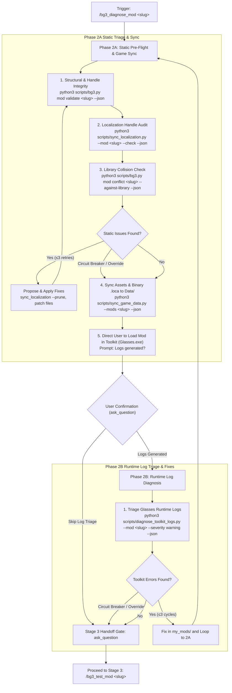

# BG3 Mod Diagnostics & Toolkit Verification (Stage 2)

This skill acts as the autonomous "AI Doctor" and **Stage 2** verification gate for *Baldur's Gate 3* mods. It follows a two-phase Shift-Left protocol:
- **Phase 2A (Static Pre-Flight, Game Sync & Toolkit Launch Gate)**: Audits syntax, localization handles, and community stat collisions in `my_mods/<slug>/`, synchronizes unpacked assets and compiled binary `.loca` to `<Game>/Data/`, and directs the user to load the mod in the BG3 Toolkit (`Glasses.exe`) to generate engine logs.
- **Phase 2B (Toolkit Runtime Log Diagnosis & Automated Remediation Loop)**: Upon user confirmation that logs are generated, triages `Glasses.exe` runtime log warnings/errors (`diagnose_toolkit_logs.py`), applies fixes in `my_mods/<slug>/`, and loops back to Phase 2A until logs are clean or overridden before offering Phase 3 testing.
- **Progressive Gate Handoff**: Passes verified mods to **Stage 3: In-Game Testing** (`/bg3_test_mod`).

## Discovery & Tooling

Inspect tool arguments, flags, and schema definitions with:

```bash
python3 scripts/tools.py --info validate
python3 scripts/tools.py --info sync-loca
python3 scripts/tools.py --info check-conflicts
python3 scripts/tools.py --info sync-game
python3 scripts/tools.py --info toolkit-logs
```

---

## Workflow Overview



---

## Execution Steps

### Step 1: Target Resolution
Determine the target mod name from the prompt (`for <mod-slug>`, `<mod-slug>`), or inspect `my_mods/`:
- If the user specifies a mod (e.g. `paladins-call`), use it.
- If unspecified and only one mod exists in `my_mods/`, select it.
- If multiple mods exist and no mod was specified, prompt the user to select one.

---

### Step 2A: Static Pre-Flight, Game Sync & Toolkit Launch Gate

#### 1. Deterministic Static Checks (Repository Workspace)
Run deterministic static checks on `my_mods/<slug>/` before touching game files:

```bash
# 1. Structural, LSX, and XML Integrity Check
python3 scripts/bg3.py mod validate <mod-slug> --json

# 2. Localization Handle Audit (check for orphaned or missing handles)
python3 scripts/sync_localization.py --mod <mod-slug> --check --json

# 3. Community Conflict & Collision Check
python3 scripts/bg3.py mod conflict <mod-slug> --against-library --json
```

#### Remediation & Loop Guardrails for Phase 2A:
- **Missing Localization Handles**: Add missing `<content contentuid="h..." version="1">Text</content>` to `Localization/English/<ModName>.xml`.
- **Orphaned Localization Handles**: Run `python3 scripts/sync_localization.py --mod <mod-slug> --prune --json` after user confirmation.
- **Stat Entry Collisions**: When colliding with a tracked mod in `mods/library.md`, rename the stat prefix or generate a compatibility patch via `python3 scripts/generate_compat_patch.py`.
- **Loop Prevention**:
  - Maximum **3 automated remediation attempts** for static errors.
  - If identical errors persist across attempts (error signature circuit breaker), halt automated fixes and use `ask_question` to prompt the user (inspect failing file manually, override and proceed, or revert changes).
- Re-run validation to ensure clean status before syncing to game data.

#### 2. Synchronize Assets & Binary `.loca` to Game Data
Once static checks pass cleanly (or after explicit user override):

```bash
python3 scripts/sync_game_data.py --mods <mod-slug> --json
```

> [!NOTE]
> `sync_game_data.py` automatically compiles `Localization/English/*.xml` into `Data/Mods/<ModName>_<UUID>/Localization/English/<ModName>.loca` so the BG3 Toolkit loads strings cleanly without crashing.

#### 3. Direct User to Generate Logs in BG3 Toolkit (Glasses.exe)
Instruct the user:
1. Launch **Baldur's Gate 3 Toolkit** (`Glasses.exe`).
2. Select **File -> Open Project...** and open `<ModName>`.
3. Verify that stats, root templates, and progressions load in the editor, allowing the game engine to generate fresh runtime log entries.

Prompt the user using `ask_question`:
- **(Recommended) Logs generated (proceed to Phase 2B diagnostics)**
- **Skip log triage (proceed directly to Phase 3 testing)**

---

### Step 2B: Toolkit Runtime Log Diagnosis & Automated Remediation Loop

Upon receiving confirmation that logs have been generated:

#### 1. Inspect Toolkit Runtime Logs
Run deterministic log triage to catch any engine warnings or script exceptions:

```bash
# Inspect latest Toolkit session with workspace mod correlation
python3 scripts/diagnose_toolkit_logs.py --mod <mod-slug> --severity warning --json

# Or filter by specific subsystem (e.g. Boosts, Stats, Thoth, Osiris)
python3 scripts/diagnose_toolkit_logs.py --subsystem Boosts --mod <mod-slug> --json

# Or stream active session logs live during user inspection
python3 scripts/diagnose_toolkit_logs.py --follow
```

#### 2. Remediate & Loop to Phase 2A
If log warnings/errors are detected:
1. Correlate line numbers, missing references, and IDs back to `my_mods/<mod-slug>/`.
2. Apply fixes directly to source files in `my_mods/<mod-slug>/`.
3. **Loop Prevention Guardrail**:
   - Limit full 2A <-> 2B diagnostic cycles to **3 iterations**.
   - If identical log error signatures persist after a patch, trip the circuit breaker and escalate to user via `ask_question`.
4. **Automatically loop back to Step 2A**:
   - Re-run static checks (`validate_mod.py`, `sync_localization.py --check`).
   - Re-sync to game data (`sync_game_data.py`).
   - Prompt the user to reload the project in `Glasses.exe` to generate fresh logs.

Repeat until logs are clean (0 warnings/errors) or the user opts to proceed.

---

### Step 3: Progressive Gate Handoff to Stage 3

Once static checks and Toolkit runtime diagnostics are clear (or skipped by user), present a concise mod health summary and transition to **Stage 3: In-Game Testing**:

```text
Mod '<ModName>' is clean and verified in the BG3 Toolkit!
- Static validation: PASS (0 errors, 0 orphaned handles)
- Conflict triage: PASS (no collisions)
- Toolkit logs: PASS (0 warnings/errors)
```

Use `ask_question` to transition:
- **Proceed to Stage 3 In-Game Testing**: Run `/bg3_test_mod <mod-slug>` to package a local test `.pak`, activate it in `modsettings.lsx`, and test in-game save loading.
- **Keep diagnosing / refine in Toolkit**: Stay in Stage 2 to adjust mechanics or inspect logs further.

