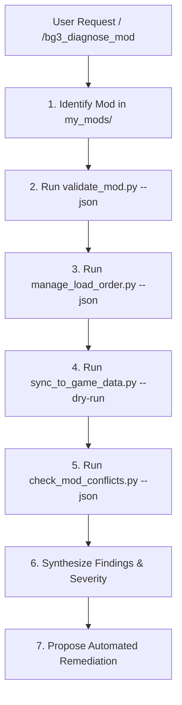

# BG3 Mod Diagnostic & Doctor Skill (`bg3_diagnose_mod`)

This skill acts as the autonomous "AI Doctor" for *Baldur's Gate 3* mods. It executes deterministic diagnostic scripts across 4 layers of mod health, analyzes the output, and interactively proposes and applies automated fixes.

---

## Trigger Conditions

Activate this skill when:
- The user runs `/bg3_diagnose_mod` or `/diagnose`.
- The user reports in-game issues:
  - *"Why is my mod not showing up in-game?"*
  - *"My mod items have 'Not Found' / missing text."*
  - *"Check if my mod has any errors or conflicts."*
  - *"Why did the game crash or fail to load my spells?"*

---

## Diagnostic Pipeline



---

## Execution Steps

### Step 1: Target Resolution
Determine the target mod name from the user's prompt or inspect `my_mods/`:
- If the user specifies a mod (e.g. `arcane-progression`), use it.
- If unspecified and only one mod exists in `my_mods/`, select it.
- If multiple mods exist, run validation across `--all` or ask the user to clarify.

### Step 2: Automated Diagnostic Battery
Run the deterministic diagnostic suite:

```bash
# 1. Structural & Handle Integrity Check
python3 scripts/validate_mod.py --mod <mod_slug> --json

# 2. In-Game Load Order Status Check
python3 scripts/manage_load_order.py --json

# 3. Game Data Synchronization Status Check
python3 scripts/sync_to_game_data.py --dry-run

# 4. Community Conflict & Collision Check
python3 scripts/check_mod_conflicts.py --candidate <mod_slug> --against-library --json

# 5. Localization Handle Orphan Audit
python3 scripts/sync_localization.py --mod <mod_slug> --check --json

# 6. Save Game & Load Order Compatibility Audit (Optional/On Request)
python3 scripts/inspect_save_game.py --audit --json
```

> [!TIP]
> **Tool Discovery & Schema Inspection**:
> To discover additional automation tools or inspect CLI flags dynamically, run:
> ```bash
> python3 scripts/tools.py --search "<intent or issue>" --json
> python3 scripts/tools.py --info <tool_name> --json
> ```

### Step 3: Synthesis & Problem Categorization

Map discovered issues to standard root causes:

| Symptom / Error | Root Cause | Automated Remediation |
| :--- | :--- | :--- |
| `Missing localization handle 'h...'` | String handle referenced in stat file not declared in `Localization/English/*.xml`. Results in `Not Found` in-game. | Add missing `<content contentuid="h..." version="1">Text</content>` to XML. |
| Mod missing from active load order | `modsettings.lsx` lacks `<node id="ModuleShortDesc">` for mod UUID. Mod will not load in-game. | `python3 scripts/manage_load_order.py --activate <UUID> <Name>` |
| Stale game Data files | Local changes in `my_mods/` not synced to `<Game>/Data`. | `python3 scripts/sync_to_game_data.py --bump-build` |
| `Version64` mismatch between Projects and Mods | `meta.lsx` desynchronization causing Toolkit load errors. | `python3 scripts/bump_mod_version.py --mod <mod_slug> --build` |
| Stat entry name collision | Community mod in `mods/` defines identical entry name in `Weapon.txt` or `Spell_*.txt`. | Rename entry prefix or use Compatibility Framework override. |

### Step 4: Presentation to User

Present diagnostics in a clear, formatted report:

```markdown
### 🩺 Mod Health Diagnosis: <Mod Name>

**Overall Health**: 🔴 Issues Detected | 🟡 Warnings Found | 🟢 Healthy

#### 1. Integrity & Localization
- [Status]: <Details on syntax, handles, and assets>

#### 2. Load Order & In-Game Activation
- [Status]: <Active / Inactive in modsettings.lsx>

#### 3. Game Data Deployment
- [Status]: <In sync / Stale files detected>

#### 4. Compatibility & Collisions
- [Status]: <Clean / Identified collisions>

---

### 🔧 Recommended Fixes:
1. **[Fix 1]**: <Description>
2. **[Fix 2]**: <Description>
```

Prompt the user to approve applying the recommended fixes automatically.
