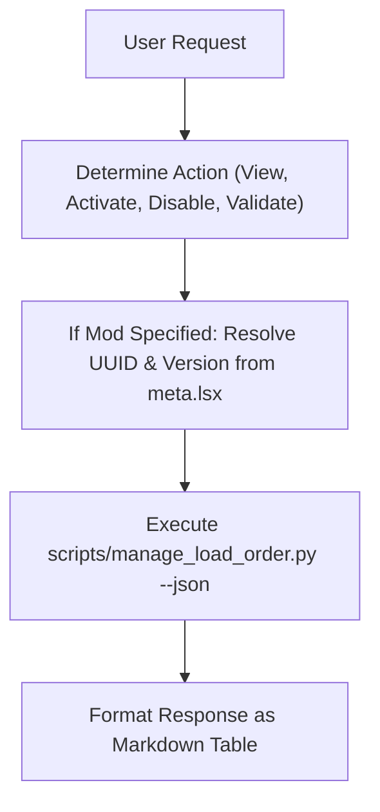

# BG3 Load Order Management Skill (`bg3_manage_load_order`)

This skill enables users to inspect and manage their active *Baldur's Gate 3* load order directly through natural language chat, backed by `scripts/manage_load_order.py`.

---

## Trigger Conditions

Activate this skill when:
- The user runs `/bg3_manage_load_order` or `/load_order`.
- The user asks:
  - *"Show me my current active load order."*
  - *"Enable my mod in-game."*
  - *"Disable Paladin's Call."*
  - *"Check if GustavDev is correctly loaded first."*

---

## Workflow



---

## Command Reference

### 1. View Current Load Order
```bash
python3 scripts/manage_load_order.py --json
```

### 2. Activate a Mod
To activate a mod from `my_mods/` or `mods/`:
1. Find the mod's UUID and Name from its `meta.lsx`.
2. Run:
```bash
python3 scripts/manage_load_order.py --activate "<UUID>" "<ModFolder>" --json
```

### 3. Disable a Mod
```bash
python3 scripts/manage_load_order.py --disable "<UUID>" --json
```

### 4. Validate Active Profile Integrity
```bash
python3 scripts/manage_load_order.py --validate
```

> [!TIP]
> **Tool Discovery & Schema Inspection**:
> To inspect all load order management and save audit options:
> ```bash
> python3 scripts/tools.py --info load-order --json
> python3 scripts/tools.py --info inspect-save --json
> python3 scripts/tools.py --search "modsettings" --json
> ```


---

## Output Presentation

When presenting the load order to the user, render an orderly markdown table:

```markdown
### 📋 Active BG3 Load Order

| # | Mod Name | Folder / Module | UUID |
|---|:---|:---|:---|
| 1 | GustavDev (Base Game) | GustavDev | 28ac9e5a-3ded-4247-aa72-46603a11b8fd |
| 2 | UnlockLevelCurve | UnlockLevelCurve | ... |
| 3 | ArcaneProgression | ArcaneProgression_cfef8d1a... | ... |

*(Backup created at `modsettings.lsx.<timestamp>.bak`)*
```
