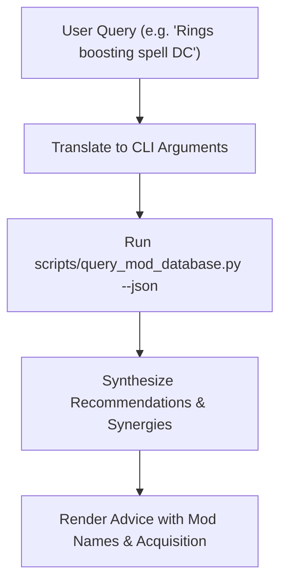

# BG3 Mod Equipment & Mechanics Advisor (`bg3_query_gear`)

This skill acts as an intelligent gear and build advisor, translating natural language requests into high-speed queries against the cataloged community mod database (`mods/`), powered by `scripts/query_mod_database.py`.

---

## Trigger Conditions

Activate this skill when:
- The user runs `/bg3_query_gear` or `/gear`.
- The user asks for gear or mechanics advice:
  - *"What modded gear increases Spell Save DC?"*
  - *"Find me good rings or amulets for a Warlock."*
  - *"Are there any weapons that deal necrotic damage?"*
  - *"Recommend BiS boots or cloaks from our tracked mods."*

---

## Query Translation Workflow



---

## Query Translation Mapping

| User Intent | CLI Command |
| :--- | :--- |
| Any items boosting a specific stat (e.g., Spell DC) | `python3 scripts/query_mod_database.py --boost "SpellSaveDC" --json` |
| Items for a specific slot (e.g., Amulet, Ring) | `python3 scripts/query_mod_database.py --slot "Amulet" --json` |
| Items with specific passives (e.g., Extra Attack) | `python3 scripts/query_mod_database.py --passive "ExtraAttack" --json` |
| Combined search (e.g., Legendary Boots) | `python3 scripts/query_mod_database.py --slot "Boots" --rarity "Legendary" --json` |
| General thematic search (e.g., Necrotic) | `python3 scripts/query_mod_database.py --search "necrotic" --json` |

---

## Presentation Guidelines

Synthesize the returned JSON into an engaging, structured build recommendation:

```markdown
### 🛡️ Recommended Mod Equipment: <Focus / Concept>

Here are the top options from your cataloged community mods:

#### 1. [Item Name] ([Rarity])
- **Slot**: `Amulet`
- **Mod**: `pact-and-power-warlock-equipment`
- **Key Effects**:
  - `SpellSaveDC(1)`: Increases difficulty class of your spells by 1.
  - `Advantage on Saving Throws`: Protects against crowd control.
- **Why it fits**: Synergizes with high-difficulty control builds.

#### 2. [Item Name] ([Rarity])
...

---

💡 *To add any of these items to early-game containers, use `python3 scripts/inject_treasure_table.py --mod <your_mod> --item <ItemID> --container tutorial_chest`.*
```
