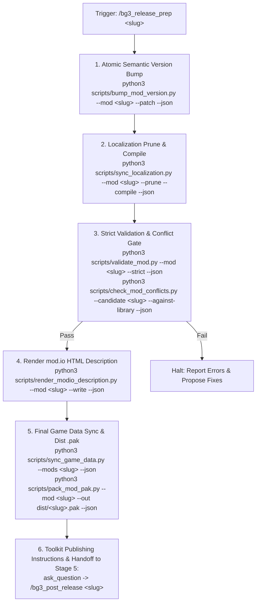

# BG3 Mod Release Preparation Assistant (Stage 4)

This skill orchestrates the **Stage 4 (Release Preparation)** pipeline for *Baldur's Gate 3* mods. Because mod publication is locked to the official Baldur's Gate 3 Toolkit and cannot be executed via the mod.io REST API directly, this workflow ensures every asset, handle, version tag, and description is 100% publication-ready before handing off to **Stage 5: Post-Release** (`/bg3_post_release`).

## Discovery & Tooling

Inspect tool arguments, flags, and schema definitions with:

```bash
python3 scripts/tools.py --info bump-version
python3 scripts/tools.py --info validate
python3 scripts/tools.py --info sync-localization
python3 scripts/tools.py --info render-description
python3 scripts/tools.py --info sync-data
python3 scripts/tools.py --info pack-pak
```

---

## Release Pipeline Architecture



---

## Step-by-Step Execution

### Step 1: Atomic Semantic Version Bump
Determine the version increment from the user (defaulting to `--patch` unless `--minor` or `--major` is requested):

```bash
python3 scripts/bump_mod_version.py --mod <mod-slug> --patch --json
```

This atomically encodes the new Version64 in `Projects/<ModName>_<UUID>/meta.lsx`, `Mods/<ModName>_<UUID>/meta.lsx`, and synchronizes the version string in `my_mods/<mod-slug>/README.md`.

---

### Step 2: Prune & Compile Localization
Ensure no orphaned handles pollute the localization table, and compile the binary `.loca` file:

```bash
python3 scripts/sync_localization.py --mod <mod-slug> --prune --compile --json
```

---

### Step 3: Strict Validation & Conflict Gate
Run strict validation to ensure:
- 0 XML/LSX syntax errors.
- 100% of referenced string handles exist in `Localization/English/*.xml`.
- Required 512×512 PNG thumbnails exist in `Projects/` and `Mods/`.
- Spell list references match defined spells.
- No collisions with tracked mods in `mods/library.md`.

```bash
python3 scripts/validate_mod.py --mod <mod-slug> --strict --json
python3 scripts/check_mod_conflicts.py --candidate <mod-slug> --against-library --json
```

> [!WARNING]
> If strict validation fails with errors, stop the release pipeline immediately, report the errors, and offer automated fixes before continuing.

---

### Step 4: Render mod.io HTML Description
Export the mod's complete root README as a GitHub Flavored Markdown / HTML description formatted specifically for mod.io:

```bash
python3 scripts/render_modio_description.py --mod <mod-slug> --write --json
```

This writes `my_mods/<mod-slug>/modio_description.html` beside the README, formatting tables, callouts, and lists cleanly for the mod.io web portal.

---

### Step 5: Game Data Synchronization & Distribution Packaging
Deploy the updated mod into the game's active `Data/` folder so the official Toolkit detects all recent changes and the compiled binary `.loca`:

```bash
python3 scripts/sync_game_data.py --mods <mod-slug> --json
```

Package a distribution `.pak` for Nexus Mods or manual archive sharing:

```bash
python3 scripts/pack_mod_pak.py --mod <mod-slug> --out "dist/<mod-slug>.pak" --json
```

---

### Step 6: Presentation & Progressive Gate Handoff to Stage 5

Present the release summary to the user:

```markdown
### 🚀 Mod Release Package Ready: <Mod Name> (v<Version>)

- **Semantic Version**: `<New Version>` (Version64: `<Encoded Int>`)
- **Validation**: [✓] Passed strict structural and handle checks
- **Assets**: [✓] 512×512 thumbnail and publish logo verified
- **Game Data**: [✓] Synced to local BG3 `Data/` directory with compiled binary `.loca`
- **Dist Archive**: [✓] `dist/<mod-slug>.pak` packaged and verified

---

#### 🛠️ BG3 Toolkit Publishing Steps:
1. Open the **Baldur's Gate 3 Toolkit** (`Glasses.exe`).
2. Open Project **`<Mod Name>`**.
3. Select **File -> Mod Project Manager**.
4. In the Project Settings, copy the contents of `my_mods/<mod-slug>/modio_description.html` into the Description field.
5. Click **Publish Mod** to submit the build to mod.io.
```

Use `ask_question` to transition to **Stage 5: Post-Release**:
- **Proceed to Stage 5 Post-Release**: Once published in the Toolkit, run `/bg3_post_release <mod-slug>` to inspect allowed tags, review profile settings, and publish the verified description and tags via the mod.io REST API.
- **Finish Release Process**: Complete workflow without updating mod.io API metadata.
