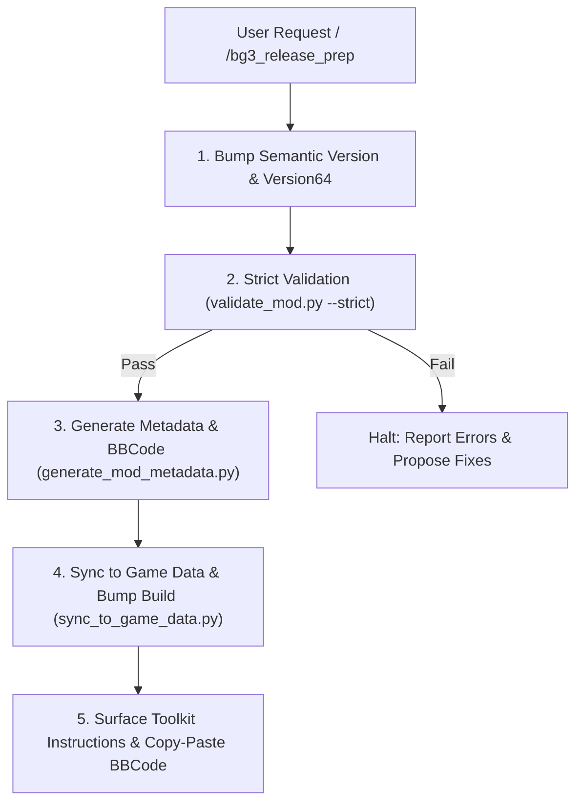

# BG3 Mod Release Preparation Assistant (`bg3_release_prep`)

This skill orchestrates the end-to-end release preparation pipeline for *Baldur's Gate 3* mods. Because mod publication is locked to the official Baldur's Gate 3 Toolkit and cannot be executed via the mod.io REST API directly, this workflow ensures every asset, handle, version tag, and description is 100% publication-ready.

---

## Trigger Conditions

Activate this skill when:
- The user runs `/bg3_release_prep` or `/release`.
- The user asks:
  - *"Prepare my mod for release on mod.io."*
  - *"Package and validate Arcane Progression for publishing."*
  - *"Ready the mod for the BG3 Toolkit."*

---

## Release Pipeline Architecture



---

## Step-by-Step Execution

### Step 1: Semantic Version Bump
Determine the version increment from the user (defaulting to `--patch` unless `--minor` or `--major` is requested):

```bash
python3 scripts/bump_mod_version.py --mod <mod_slug> --patch --json
```

This atomically encodes the new Version64 in both `Projects/<UUID>/meta.lsx` and `Mods/<UUID>/meta.lsx`.

### Step 2: Strict Mod Linting & Validation
Run strict validation to ensure:
- 0 XML/LSX syntax errors.
- 100% of referenced string handles exist in `Localization/English/*.xml`.
- Required 512×512 PNG thumbnails exist in `Projects/` and `Mods/`.
- Spell list references match defined spells.

```bash
python3 scripts/validate_mod.py --mod <mod_slug> --strict --json
```

> [!WARNING]
> If strict validation fails with errors, stop the release pipeline immediately, report the errors, and offer automated fixes before continuing.

### Step 3: Description & Metadata Generation
Generate publication-ready Markdown and BBCode formatted descriptions, change logs, and tag suggestions:

```bash
python3 scripts/generate_mod_metadata.py --mod <mod_slug> --write --json
```

This writes description files to `my_mods/<mod_slug>/metadata/` (or mod root).

### Step 4: Game Data Synchronization & Build Increment
Deploy the updated mod into the game's active `Data/` folder so the official Toolkit detects all recent changes and the incremented build number:

```bash
python3 scripts/sync_to_game_data.py --mod <mod_slug> --bump-build
```

### Step 4b: Standalone `.pak` Packaging (`scripts/pack_mod_pak.py`)
If releasing as an independent `.pak` archive for manual distribution, Nexus Mods, or local testing outside the Toolkit, package into an LSPK v18 archive:

```bash
python3 scripts/pack_mod_pak.py --mod <mod_slug> --output-dir dist/
```
This produces a byte-verified, zlib-compressed `.pak` file compatible with the BG3 Mod Manager and game engine.

---

## Step 5: Presentation to User

Present a release summary to the user:

```markdown
### 🚀 Mod Release Package Ready: <Mod Name> (v<Version>)

- **Semantic Version**: `<New Version>` (Version64: `<Encoded Int>`)
- **Validation**: [✓] Passed strict structural and handle checks
- **Assets**: [✓] 512×512 thumbnail and publish logo verified
- **Game Data**: [✓] Synced to local BG3 `Data/` directory

---

#### 🏷️ Recommended mod.io Tags:
`Classes`, `Spells`, `Level 20`, `Balance`

#### 📋 BBCode Description (Ready for BG3 Toolkit):
```bbcode
[h1]<Mod Name>[/h1]
[b]Version:[/b] <Version>

[h2]Features[/h2]
...
```

---

#### 🛠️ Final Publishing Steps:
1. Open the **Baldur's Gate 3 Toolkit**.
2. Open Project **`<Mod Name>`**.
3. Go to **File -> Mod Project Manager**.
4. Paste the generated description from above and select the recommended tags.
5. Click **Publish to mod.io**.
```
