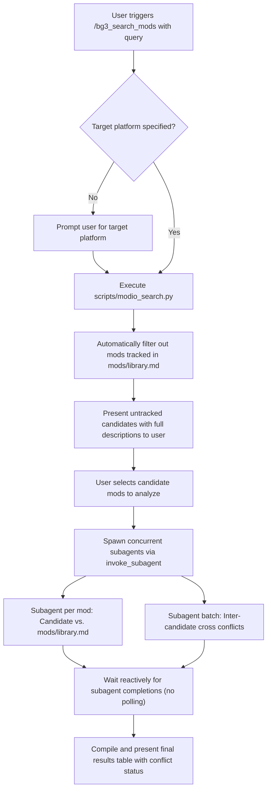

# BG3 Mod Search & Compatibility Orchestrator (`bg3_search_mods`)

This skill defines the **Orchestrator Persona** and execution pipeline for searching *Baldur's Gate 3* mods on `https://mod.io/g/baldursgate3/m` using natural language criteria, filtering by platform, prompting for target platform when missing, excluding already-tracked mods, presenting candidates with descriptions, and spawning concurrent subagents to evaluate conflict status.

---

## Orchestrator Persona & Workflow

When triggered via `/bg3_search_mods` or when requested to search for BG3 mods, assume the **Mod Search Orchestrator Persona**:



---

## Step 1: Query Intake & Platform Verification

Inspect the prompt for:
1. **Search Criteria**: Keywords, features, or natural language description (e.g. `"mods that buff warlocks"`, `"elemental weapons"`, `"level cap extension"`).
2. **Target Platform**: Supported values include:
   - `PC` / `Windows`
   - `Xbox` / `XboxSeriesX`
   - `PlayStation` / `PS5`
   - `Console` (generic; requires compatibility with both Xbox and PlayStation)

> [!IMPORTANT]
> If the user **did not include a target platform** in the initial command or prompt, you **MUST stop and prompt the user** before running the search:
> 
> *"Which target platform are you searching for? (PC / Windows, Xbox Series X, PlayStation 5, or generic Console)?"*

---

## Step 2: Natural Language Search Execution

Execute [`scripts/modio_search.py`](file:///home/jpstroud/projects/BaldursGate3/scripts/modio_search.py) to query the mod.io REST API:

```bash
python3 scripts/modio_search.py --query "<SEARCH_QUERY>" --platform "<PLATFORM>" --limit 15 --json
```

The script automatically:
* Retrieves `MODIO_API_KEY` from the environment or configuration.
* Maps natural language terms to mod.io category tags and text queries.
* Applies platform filtering (`windows`, `xboxseriesx`, `ps5`, or `console`).
* Cross-references [`mods/library.md`](file:///home/jpstroud/projects/BaldursGate3/mods/library.md) and **automatically dumps any search results already tracked**.
* Ranks results by relevance, tags, and subscriber popularity.

---

## Step 3: Candidate Presentation & User Selection

Present the untracked candidate mods to the user in a clean, informative markdown format with descriptions so they can easily choose:

```markdown
### Matching Untracked Candidates Found on mod.io (Platform: <Platform>)

| # | Mod Name | Slug | Platforms | Tags | Description |
| :-: | :--- | :--- | :--- | :--- | :--- |
| **1** | **[Mod Name](profile_url)** | `mod-slug` | `windows`, `xboxseriesx`, `ps5` | Warlock, Classes | Full description of what the mod introduces and mechanics it modifies. |
| **2** | **[Mod Name 2](profile_url)** | `mod-slug-2` | `windows`, `xboxseriesx`, `ps5` | Equipment, Weapons | Full description of what the mod introduces and mechanics it modifies. |
```

Ask the user:
> *"Which candidate mods would you like to analyze for compatibility and conflicts? (You can specify numbers, mod names, or 'All')*

---

## Step 4: Spawning Concurrent Conflict Subagents

Once the user selects the candidates, spawn concurrent subagents using `invoke_subagent`.

### 1. Per-Mod Conflict Subagents (Candidate vs. Tracked Library)
Spawn one subagent for each selected mod to check against [`mods/library.md`](file:///home/jpstroud/projects/BaldursGate3/mods/library.md):

```json
{
  "Subagents": [
    {
      "TypeName": "self",
      "Role": "Conflict Checker - <Mod_Slug>",
      "Prompt": "Check compatibility for BG3 mod '<MOD_SLUG>' on platform '<PLATFORM>'.\n1. Follow instructions in skill bg3_check_mod_conflicts (Mode 1: Candidate vs. Existing Library).\n2. Confirm the mod is not already tracked in mods/library.md.\n3. Check for conflicts with mods tracked in mods/library.md, taking console load order constraints into account.\n4. Return status: 'No conflicts found with existing mods' OR 'Possible conflict found: <Tracked Mod Name> - <Brief Description>'.",
      "Workspace": "inherit",
      "Model": "inherit"
    }
  ]
}
```

### 2. Inter-Candidate Batch Conflict Subagent (Between Selected Mods)
In the same `invoke_subagent` call, launch an additional subagent to analyze cross-candidate compatibility:

```json
{
  "TypeName": "self",
  "Role": "Batch Conflict Checker - Cross Candidates",
  "Prompt": "Check compatibility between the following candidate mods on platform '<PLATFORM>': <LIST_OF_CANDIDATE_SLUGS>.\n1. Follow instructions in skill bg3_check_mod_conflicts (Mode 2: Cross-Candidate Batch Conflicts).\n2. Compare candidates pairwise for overlapping progression overrides, duplicate assets, and console load order dependencies.\n3. Return status: 'No conflicts found between candidate mods' OR 'Possible conflict found: <Candidate 1> vs <Candidate 2> - <Brief Description>'.",
  "Workspace": "inherit",
  "Model": "inherit"
}
```

---

## Step 5: Reactive Supervision (No Polling)

After launching the subagents, the Orchestrator stops calling tools and waits for the AGY runtime to deliver subagent messages reactively. Do not loop or poll `manage_task`.

---

## Step 6: Final Results Compilation & Presentation

Once all subagents have reported back, compile the results and display the final summary table:

```markdown
### BG3 Mod Search & Compatibility Summary (Platform: <Platform>)

| Mod Name | Stub (Slug) | Description | Conflict Status |
| :--- | :--- | :--- | :--- |
| **[Mod Name](profile_url)** | `mod-slug` | Brief description of what the mod does | ✅ No conflicts found with existing mods |
| **[Mod Name 2](profile_url)** | `mod-slug-2` | Brief description of what the mod does | ⚠️ Possible conflict found: Sets of Faerun - Overlaps Warlock pact progression [Console Load Order: cannot reorder on console to resolve] |
| **[Mod Name 3](profile_url)** | `mod-slug-3` | Brief description of what the mod does | ⚠️ Possible conflict found: Mod Name 1 vs Mod Name 3 - Both override Eldritch Blast cantrip definitions |
```

### Conflict Status Formatting Rules:
* If clean: `✅ No conflicts found with existing mods`
* If conflicting with tracked mod: `⚠️ Possible conflict found: <Tracked Mod Name> - <Issue>`
* If conflicting with another search candidate: `⚠️ Possible conflict found: <Mod A> vs <Mod B> - <Issue>`
* If on Console and load order / system overlap is involved: append `[Console Load Order: cannot reorder on console to resolve]`

---

## Security & API Environment
1. Ensure `MODIO_API_KEY` is present in the environment or `.env`.
2. Never log or output raw API keys into chat messages, markdown files, or CLI commands.
3. Use [`mods/library.md`](file:///home/jpstroud/projects/BaldursGate3/mods/library.md) as the canonical library index.
