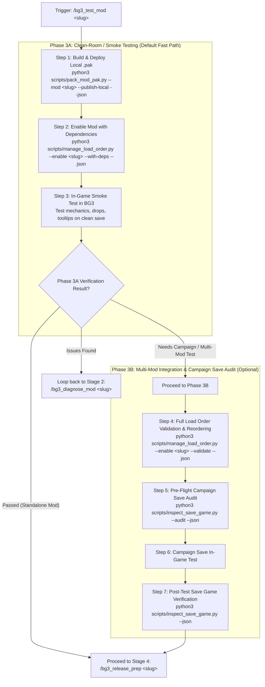

# BG3 Mod In-Game Testing & Verification (Stage 3)

This skill defines the **Stage 3 (In-Game Testing)** workflow of the custom mod lifecycle. It follows a **two-tier progressive gating architecture**:
- **Phase 3A: Clean-Room / Smoke Testing (Default)** — Packages the mod, activates it alongside declared dependencies (`--with-deps`), and guides fast functional verification on a clean/new game.
- **Phase 3B: Multi-Mod Integration & Save Audit (Optional Gate)** — Validates full profile load order rules and audits complex campaign save games for mods requiring extensive third-party integration.

## Discovery & Tooling

Inspect tool arguments, flags, and schema definitions with:

```bash
python3 scripts/tools.py --info pack-pak
python3 scripts/tools.py --info load-order
python3 scripts/tools.py --info inspect-save
```

---

## Workflow Overview



---

## Execution Steps

### Step 1: Package and Deploy Local Test `.pak`

Build a clean `.pak` archive containing automatically compiled binary `.loca` files and deploy it directly to `%LOCALAPPDATA%/Larian Studios/Baldur's Gate 3/Mods/`:

```bash
python3 scripts/pack_mod_pak.py --mod <mod-slug> --publish-local --json
```

Verify in the JSON output:
- Source directories packaged (`Mods/`, `Public/`, compiled `Localization/`)
- Repository-only files excluded (`README.md`, `modio_description.*`, root thumbnails, `.gitkeep`)
- Destination `.pak` created in game's `Mods/` directory

---

## Phase 3A: Clean-Room / Smoke Testing (Default Fast Path)

### Step 2: Configure Dependency-Aware Load Order & Pak Verification (QuickEnable)

Activate the mod while automatically verifying `.pak` archives and enabling declared prerequisites (such as `UnlockLevelCurve`):

```bash
python3 scripts/manage_load_order.py --enable <mod-slug> --with-deps --json
```

To include temporary testing companions, cheat patches (e.g. `UnlockLevelCurve - Instant XP`), or fast-progression helpers:
```bash
python3 scripts/manage_load_order.py --enable <mod-slug> --with-deps --test-dep "UnlockLevelCurve - Instant XP" --json
```
*(Or record them permanently for testing in `my_mods/<mod-slug>/.test_deps.json` via `python3 scripts/add_mod_dependency.py --mod <mod-slug> --dep "UnlockLevelCurve - Instant XP" --test-only`)*

For strict clean-room testing (disabling unrelated third-party mods to prevent mod interference):
```bash
python3 scripts/manage_load_order.py --enable <mod-slug> --with-deps --isolate --json
```

Verify in JSON output:
- `enable.status`: `enabled` or `already_active`
- `enable.pak_sync`: confirms all dependency `.pak` files exist or were synchronized/downloaded into Steam `Data/Mods/` and AppData `Mods/`.
- `enable.dependencies`: list of resolved prerequisites enabled ahead of the mod.
- `enable.test_dependencies`: list of active temporary test companions enabled ahead of the mod.
- `enable.missing_dependencies`: must be empty. If any dependencies are missing locally, halt and notify the user before launching the game.

---

### Step 3: Guided In-Game Verification (Smoke Test)

Instruct the user:
1. Launch **Baldur's Gate 3** (`bg3.exe`).
2. Start a new test game or load a clean minimal test save.
3. Check the targeted features:
   - **Acquisition**: Check container drops (Tutorial Chest / Camp Chest) or vendor inventory.
   - **Tooltips**: Verify item/spell names and descriptions display properly (no `Not Found` or raw string handles).
   - **Mechanics**: Cast spells, verify passives activate on turn start/hit, test level-up progression screens.
   - **Save & Reload**: Save the game, reload, and verify persistence.

---

### Step 4: Phase 3A Gate Handoff

Present the smoke test summary and ask the user for their in-game verification outcome via `ask_question`:

- **All tests passed! Ready for Release**: Proceed directly to **Stage 4: Release Preparation** (`/bg3_release_prep <mod-slug>`).
- **Proceed to Phase 3B (Integration & Save Audit)**: For mods requiring complex multi-mod load order tuning or verification in heavily modded campaign saves.
- **Issues or bugs detected**: Loop back to **Stage 2: Diagnostics** (`/bg3_diagnose_mod <mod-slug>`).

---

## Phase 3B: Multi-Mod Integration & Save Audit (Optional Gate)

### Step 5: Full Load Order Validation & Placement

Validate load order integrity across the entire active player profile:

```bash
python3 scripts/manage_load_order.py --enable <mod-slug> --validate --json
```

If the mod requires specific positioning relative to other community mods (e.g., after framework mods):
```bash
python3 scripts/manage_load_order.py --enable <mod-slug> --order <index> --validate --json
```

---

### Step 6: Pre-Flight Campaign Save Game Audit

Inspect the player's target campaign save to ensure compatibility across all installed mods before launching:

```bash
python3 scripts/inspect_save_game.py --audit --json
```

Optionally, run a build synergy simulation if the mod alters combat stats or spell progressions:
```bash
python3 scripts/simulate_build_synergy.py --class <Class> --level 12
```

---

### Step 7: Post-Test Save Game Verification & Stage 4 Handoff

After the user tests in their campaign save and exits (or minimizes), inspect the save file to verify module persistence:

```bash
python3 scripts/inspect_save_game.py --json
```

Confirm that the mod's UUID is recorded in the save file's module list without corruption, then hand off to **Stage 4: Release Preparation** (`/bg3_release_prep <mod-slug>`).
