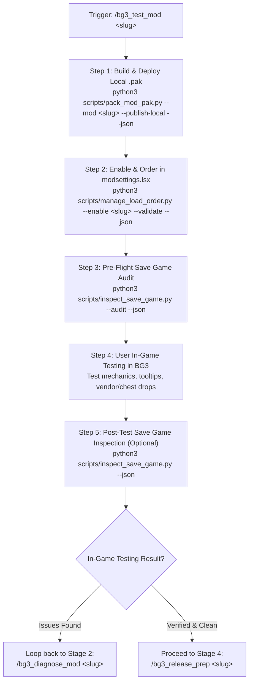

# BG3 Mod In-Game Testing & Verification (Stage 3)

This skill defines the **Stage 3 (In-Game Testing)** workflow of the custom mod lifecycle. It packages the mod into a local `.pak` archive, deploys it to the game's active profile `Mods/` directory, updates `modsettings.lsx`, performs save-game pre-flight checks, guides in-game functional verification, and gates progression to release preparation or loopback to diagnostics.

## Discovery & Tooling

Inspect tool arguments, flags, and schema definitions with:

```bash
python3 scripts/tools.py --info pack-pak
python3 scripts/tools.py --info manage-load-order
python3 scripts/tools.py --info inspect-save
```

---

## Workflow Overview



---

## Execution Steps

### Step 1: Package and Deploy Local Test `.pak`

Build a clean `.pak` archive containing automatically compiled binary `.loca` files and deploy it directly to `%LOCALAPPDATA%/Larian Studios/Baldur's Gate 3/Mods/`:

```bash
python3 scripts/pack_mod_pak.py --mod <mod-slug> --publish-local --json
```

Verify in the JSON output:
- Source directories packaged (`Mods/`, `Public/`, compiled `Localization/`)
- Repository-only files excluded (`README.md`, `modio_description.*`, root thumbnails, `.gitkeep`)
- Destination `.pak` created in game's `Mods/` directory

---

### Step 2: Configure In-Game Load Order

Activate the mod and position it safely in `modsettings.lsx`:

```bash
python3 scripts/manage_load_order.py --enable <mod-slug> --validate --json
```

If the mod requires a specific position (e.g., after framework mods like `UnlockLevelCurve`):
```bash
python3 scripts/manage_load_order.py --enable <mod-slug> --order <index> --validate --json
```

Verify that `manage_load_order.py` confirms `valid: true` and that base game roots (`GustavDev` / `GustavX`) remain at the head of the load order.

---

### Step 3: Pre-Flight Save Game Audit

Inspect the player's latest save game to ensure compatibility and detect any missing dependencies before launching:

```bash
python3 scripts/inspect_save_game.py --audit --json
```

Optionally, run a build synergy simulation if the mod alters combat stats or spell progressions:
```bash
python3 scripts/simulate_build_synergy.py --class <Class> --level 12
```

---

### Step 4: Guided In-Game Verification

Instruct the user:
1. Launch **Baldur's Gate 3** (`bg3.exe`).
2. Load an existing save file or start a new test campaign.
3. Check the targeted features:
   - **Acquisition**: Check container drops (Tutorial Chest / Camp Chest) or vendor inventory.
   - **Tooltips**: Verify item/spell names and descriptions display properly (no `Not Found` or raw string handles).
   - **Mechanics**: Cast spells, verify passives activate on turn start/hit, test level-up progression screens.
   - **Save & Reload**: Save the game, reload, and verify persistence.

---

### Step 5: Save Game Verification (Post-Test)

After the user saves and exits (or minimizes), inspect the newly written save file to verify module persistence:

```bash
python3 scripts/inspect_save_game.py --json
```

Confirm that the mod's UUID is recorded in the save file's module list without corruption.

---

### Step 6: Progressive Gate Handoff / Loopback

Present the testing summary and ask the user for their in-game verification outcome via `ask_question`:

- **All tests passed! Proceed to Stage 4**: Run `/bg3_release_prep <mod-slug>` to finalize version numbers, compile release assets, generate mod.io HTML descriptions, and package the final release `.pak`.
- **Issues or bugs detected. Loop back to Stage 2**: Run `/bg3_diagnose_mod <mod-slug>` to inspect Toolkit logs, diagnose stat collisions, and apply code fixes.
