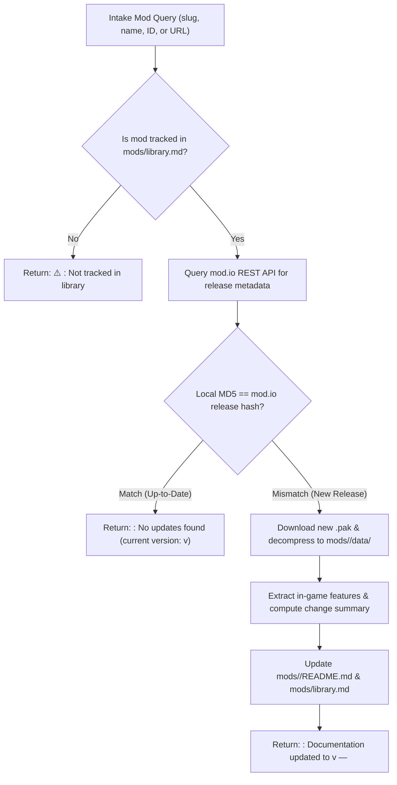

# BG3 Single Mod Update Worker (`bg3_update_single_mod`)

This skill defines the worker procedure for checking and updating documentation and game assets for an individual *Baldur's Gate 3* mod from `https://mod.io/g/baldursgate3`.

It can be triggered directly via `/bg3_update_single_mod <mod>` or invoked inside concurrent subagents dispatched by the [`bg3_update_mod_documentation`](file:///home/jpstroud/projects/BaldursGate3/.agents/skills/bg3_update_mod_documentation/SKILL.md) orchestrator.

---

## Workflow Overview



---

## Step 1: Environment & Tracking Verification

1. Ensure `MODIO_API_KEY` is loaded in the shell environment:
   ```bash
   . ~/.profile
   ```
   *(The key is also auto-detected from project `.env` or `~/.config/modio/env`).*
2. **Security Rule**: Never print, echo, or log raw API keys in bash commands, logs, or chat messages.

---

## Step 2: Execute Update Pipeline

Execute [`scripts/modio_update.py`](file:///home/jpstroud/projects/BaldursGate3/scripts/modio_update.py) with the mod query:

```bash
python3 scripts/modio_update.py --query "<MOD_QUERY>" --json
```

The script will:
1. **Validate Tracking**: Cross-reference [`mods/library.md`](file:///home/jpstroud/projects/BaldursGate3/mods/library.md) and [`mods/<slug>/`](file:///home/jpstroud/projects/BaldursGate3/mods).
2. **Fast Hash & Version Check**: Query the mod.io REST API and compare the active release file hash (`metadata_blob`) and version against local `mods/<slug>/data/meta.lsx` and `mods/<slug>/README.md`.
3. **Skip Redundant Downloads**: If the mod is up-to-date, it immediately returns without re-downloading the package.
4. **Apply New Releases**: If a new release is detected:
   - Downloads and unpacks the new `.pak` archive to `mods/<slug>/data/`.
   - Parses updated Stats, Localization, Meta, and Progression data.
   - Computes the change description: uses the mod author's mod.io changelog if available; otherwise computes an automated structural diff of features (added/modified/removed items, spells, and passives).
   - Rewrites [`mods/<slug>/README.md`](file:///home/jpstroud/projects/BaldursGate3/mods) with semantic versioning (`modfile.version`).
   - Updates the catalog entry in [`mods/library.md`](file:///home/jpstroud/projects/BaldursGate3/mods/library.md).

---

## Step 3: Standardized Return Messages

The worker subagent must return one of the following standardized messages to the caller/orchestrator:

### 1. Mod is Up-to-Date
When no newer release exists on mod.io:
```markdown
<mod-slug>: No updates found (current version: v<mod-version>)
```
*Example*:
> `elemental-eldritch-blast: No updates found (current version: v1.0.0.3)`

### 2. Mod Has Been Updated
When a new release was found, unpacked, and documented:
```markdown
<mod-slug>: Documentation updated to v<mod-version> — <description of changes>
```
*Example*:
> `sets-of-faerun: Documentation updated to v1.1.0.56 — Added 3 new features: Thalindra Ring of Flames (Ring), Thalindra Circlet (Headwear); updated mechanics on Jaegah Cleaver.`

### 3. Mod Not Tracked
When the target mod is not present in [`mods/library.md`](file:///home/jpstroud/projects/BaldursGate3/mods/library.md):
```markdown
⚠️ <mod-slug>: Not tracked in library (use /bg3_document_mods to add)
```

### 4. Failure
If an unrecoverable network, API, or decompression failure occurs:
```markdown
<mod-slug>: Failed: <brief error description>
```
