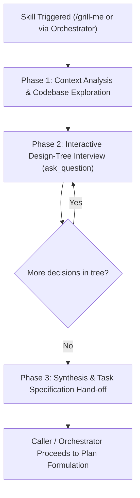

# Intent Clarification & Context Interview Protocol (`grill-me`)

This skill defines the universal procedure for interviewing the user about every aspect of their task until a crystal-clear, shared understanding is achieved.

It resolves dependencies between decisions one-by-one, walking down each branch of the design tree before creating plans or writing code.

---

## Workflow Overview

---

## Phase 1: Context Analysis & Codebase Exploration

Before asking the first question:

1. **Analyze Preceding Context**:
   - Extract the user's core goal, proposed features, and reference examples mentioned in the conversation.
   - Identify implicit assumptions, vague requirements, and missing edge cases.
2. **Codebase Exploration First Rule**:
   - If a question can be answered by exploring the codebase (e.g. checking existing directories, finding script signatures, reading configuration files), explore the codebase instead of asking the user.
3. **Formulate Initial Understanding**:
   - Formulate a 2-sentence summary of the task and identify the primary decision branches that must be resolved.

---

## Phase 2: Interactive Design-Tree Interview

Conduct the interview by walking down the branches of the design tree using the `ask_question` tool.

### Operational Guidelines

1. **Ask One Question at a Time**:
   - Never combine multiple unrelated design forks into a single modal.
   - Resolve upstream prerequisites first (e.g. architecture/scope) before downstream specifics (e.g. exact stat values or file naming).
2. **Always Provide a Recommended Choice**:
   - Prefix the best practice or workspace-aligned option with `(Recommended)`.
   - List the recommended option first in the `options` array.
3. **Format Options as User Responses**:
   - Write options in the voice of the user answering (e.g. `"(Recommended) Create a single unified mod..."` rather than `"I will create a single mod..."`).
   - Do not include an `Other` option; the UI provides a write-in response field automatically.
4. **Key Decision Categories**:
   - 🎯 **Scope & Deliverables**: Exactly what features, classes, spells, or assets are in-scope or out-of-scope?
   - ⚙️ **Technical Constraints & Mechanics**: Exact stat modifiers, resource costs, spell levels, and action economy.
   - 📦 **Dependencies & Compatibility**: Base game only (`GustavDev`), `UnlockLevelCurve`, `CompatibilityFramework`, or custom mods.
   - ⚠️ **Edge Cases & Failure Recovery**: Handling duplicate entries, load order requirements, and backward compatibility.

---

## Phase 3: Synthesis & Hand-off

Once all decision branches are resolved:

1. **Synthesize Decisions**:
   - Compile the user's answers into a concise, numbered **Task Specification** summarizing:
     - Project / Mod Identity
     - Feature Breakdown & Mechanics
     - Dependencies & Load Order
     - Target File Deliverables
2. **Hand-off to Caller / Orchestrator**:
   - If invoked as a standalone command (`/grill-me`), present the specification and ask for confirmation to proceed.
   - If invoked by an orchestrator (such as [`bg3_create_mod`](file:///home/jpstroud/projects/BaldursGate3/.agents/skills/bg3_create_mod/SKILL.md)), return the structured specification directly to the orchestrator to begin Phase 2 (Plan Creation).
