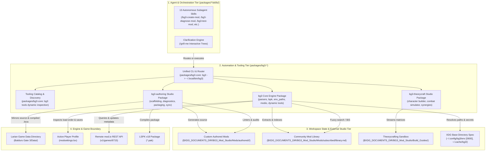

# System Architecture & Technical Design

This document details the system architecture, component layering, data pipelines, and engine structural contracts of the **Baldur's Gate 3 Mod Studio & Mod.io Toolkit**.

> [!NOTE]
> For user guides, autonomous agent slash commands, example prompts, and the CLI flags reference for all 30 studio automation tools, refer to the [Features & Functionality Guide](FEATURES.md).

---

## 1. System Topology & Multi-Tier Architecture

The studio operates across four architectural layers: the **Agent & Orchestration Tier**, the **Automation & Tooling Tier**, the **Workspace State & Data Tier**, and the **Engine & Game Boundary**.



---

## 2. Core Workflows & Data Pipelines

### 5-Stage Shift-Left & Loopback Lifecycle

Custom mod authoring follows a strict 5-stage pipeline aligned across three manual **User-Action Gates** and **Dual-Track Defect Routing**:
- **Stage 1 (Creation)**: Interactive `/grill-me` interview, autonomous workspace scaffolding, parallel subagent authoring, and comprehensive workspace static verification (LSX/XML schema, string handle parity, and library conflict pre-check).
- **Stage 2 (Diagnostics & Toolkit Staging)**: Static workspace assertion, differential game data sync to `<Game>/Data/` with compiled binary `.loca`, and **User-Action Gate 1** (`Glasses.exe` launch with `messages.log` triage and auto-remediation loop).
- **Stage 3 (Clean-Room In-Game Testing)**: Purges loose `Data/` development files, deploys local test `.pak` to `AppData/Mods/`, isolates load order in `modsettings.lsx`, and guides **User-Action Gate 2** (`bg3.exe` playtesting) with **Dual-Track Defect Routing** (engine crashes route to Stage 2 diagnostics; gameplay/mechanics bugs route to Stage 1 authoring patches).
- **Stage 4 (Release Preparation)**: Atomic `Version64` bump across `meta.lsx` and `README.md`, strict zero-tolerance lint validation, GFM HTML description rendering, `<Game>/Data/` staging for **User-Action Gate 3** (official Toolkit publishing consumes loose `Data/` assets), and optional standalone `dist/<slug>.pak` packaging. *Note: Larian strictly requires binary publishing via the official `Glasses.exe` Toolkit; headless direct `.pak` uploads to mod.io are not permitted by Larian's API.*
- **Stage 5 (Post-Release & Teardown)**: Storefront governance via mod.io REST API (2-stage tag preview, non-commercial permissions, public visibility), and mandatory development environment teardown (cleaning loose `Data/`, removing local test `.pak`, and disabling the load order entry) to transition the developer into a consumer subscriber.

```mermaid
flowchart TD
    S1["Stage 1: Creation (/bg3-create-mod)
    • /grill-me interview & specification plan
    • Autonomous scaffolding & parallel subagents
    • Static verification (LSX, string handles, conflict pre-check)"]
    
    S2["Stage 2: Diagnostics & Toolkit Staging (/bg3-diagnose-mod)
    • Toolkit staging (Data/ sync & binary .loca compilation)
    • User-Action Gate 1: Glasses.exe launch & messages.log triage
    • Automated remediation loopback"]
    
    S3["Stage 3: Clean-Room In-Game Testing (/bg3-test-mod)
    • Loose Data purge, local test .pak deploy & load order isolation
    • User-Action Gate 2: bg3.exe launch & gameplay verification
    • Dual-Track Defect Routing"]
    
    S4["Stage 4: Release Preparation (/bg3-release-prep)
    • Atomic Version64 bump & strict lint validation
    • Localization prune/compile & GFM HTML render
    • Data/ staging for User-Action Gate 3: Toolkit publishing
    • Optional standalone dist/<slug>.pak package"]
    
    S5["Stage 5: Post-Release & Teardown (/bg3-post-release)
    • Storefront governance via REST API (tags, permissions, visibility)
    • Mandatory dev teardown (purge Data/, clean .pak, disable load order)
    • Consumer subscriber live verification"]
    
    S1 -->|Stage 1 Gate| S2
    S2 -->|User-Action Gate 1 Passed| S3
    S3 -->|Playtesting Passed| S4
    S3 -.->|Engine Crash / Broken Asset (Stage 2 Loopback)| S2
    S3 -.->|Gameplay / Mechanics Bug (Stage 1 Authoring Patch)| S1
    S4 -->|User-Action Gate 3: Publish in Toolkit| S5
```

### Community Mod Discovery & Ingestion Pipeline

When exploring community mods on mod.io, the ingestion pipeline decompresses upstream packages, parses engine files, extracts item and spell definitions, and builds an indexed catalog without runtime dependencies.

```mermaid
flowchart LR
    Remote["mod.io REST API\n(v1/games/6715)"] -->|bg3 modio search\n(bg3_core.modio_search)| SearchResults["Candidate Mod\n(Platform Filtered)"]
    SearchResults -->|bg3 modio extract\n(bg3_core.modio_extract)| DL["Download Archive\n(.pak / .zip)"]
    DL --> Extract["Pure-Python Unpacker\n(bg3_core.lspk)"]
    Extract --> Parse["Larian Engine Parsers\n(bg3_core.larian_parsers)"]
    Parse --> Specs["Mods/subscribed/<slug>/README.md\n(Rich Markdown Spec)"]
    Parse --> Index["Master Catalog\n(Mods/subscribed/library.md: six columns)"]
    Index --> FastDB["bg3 query\n(bg3_core.query_mod_database)"]
```

---

## 3. Larian Engine Structural Contracts & Binary Standards

### Larian Engine Package Hierarchy

To ensure compatibility with the official Larian Toolkit and game runtime, all custom authored mods in `Mods/authored/<mod-slug>/` follow this exact four-root layout:

```text
BG3_Mod_Studio/Mods/authored/<mod-slug>/
├── Mods/<ModName>_<UUID>/
│   └── meta.lsx                      # Primary engine descriptor (ModuleInfo & dependencies)
├── Projects/<ModName>_<UUID>/
│   └── meta.lsx                      # Larian Toolkit project descriptor
├── Public/<ModName>_<UUID>/
│   ├── RootTemplates/
│   │   └── _merged.lsx               # 3D GameObject templates & visual asset links
│   ├── Stats/Generated/Data/
│   │   ├── Armor.txt                 # Armor, jewelry, and clothing stats
│   │   ├── Passive.txt               # Passives, boosts, and conditions
│   │   ├── Spell_*.txt               # Spells, cantrips, and abilities
│   │   └── Weapon.txt                # Weapons and damage profiles
│   ├── Progressions/
│   │   └── Progressions.lsx          # Class, subclass, and level progression nodes
│   └── GUI/
│       └── Icons.lsx                 # Texture atlas UV mappings for custom icons
├── Localization/
│   └── English/
│       └── <ModName>.xml             # String handles (contentuid) and English text
├── .test_deps.json                   # Optional test-only dependency manifests
├── README.md                         # Architecture notes & documentation
└── thumbnail.png                     # Standard 512x512 project thumbnail
```

### Larian 64-bit Version Encoding (`Version64`)

Larian's engine encodes semantic versioning into an unsigned 64-bit integer (`Version64`) using bitwise shifts. The formula implemented by `bg3_core.larian_parsers` and utilized by `bg3_authoring.create_mod_scaffold` (`bg3 mod scaffold`) and `bg3_authoring.bump_mod_version` (`bg3 mod bump-version`) is:

$$\text{Version64} = (\text{major} \ll 55) \mid (\text{minor} \ll 47) \mid (\text{revision} \ll 31) \mid \text{build}$$

```text
 63      55 54      47 46               31 30                         0
┌──────────┬──────────┬───────────────────┬────────────────────────────┐
│  Major   │  Minor   │     Revision      │           Build            │
│ (8 bits) │ (8 bits) │     (16 bits)     │         (31 bits)          │
└──────────┴──────────┴───────────────────┴────────────────────────────┘
```

### Pure-Python LSPK v18 Binary Packaging (`pack_mod_pak.py` / `lspk.py`)

Rather than relying on Windows-exclusive binaries (`LSLib/divine.exe`) or running through `wine`, the workspace implements a pure Python packager for Larian's **LSPK v18** format in `packages/bg3-authoring/bg3_authoring/packaging/pack_mod_pak.py` and `packages/bg3-core/bg3_core/lspk.py` (`bg3 mod pack`):

- **Zero External Dependencies**: Implemented strictly with Python's standard library `struct`, `zlib`, and `hashlib`.
- **Package Header**: Writes standard 40-byte LSPK v18 header signature (`LSPK`), file version, flags, priority, and file table metadata offset (`<4sIIII16sH`).
- **File Entry Table**: Compresses individual files using raw LZ4 block compression (`LSPK v18`), calculates uncompressed and compressed sizes, CRC32/MD5 checksums, and relative archive offsets (supports dual LZ4 and zlib decompression on extraction).
- **Automatic Loca Compilation**: Compiles XML localization entries into binary `.loca` format during packaging.
- **Cross-Platform Compatibility**: Packages created with `pack_mod_pak.py` mount identically across Linux, macOS, Windows, and game consoles (PlayStation 5, Xbox Series X|S).

---

## 4. Synchronization & File Integrity Architecture

### Idempotent Selective Synchronization (`sync_game_data.py`)

The live synchronization system (`packages/bg3-authoring/bg3_authoring/packaging/sync_game_data.py` / `bg3 mod sync-game`) mirrors source files from `$XDG_DOCUMENTS_DIR/BG3_Mod_Studio/Mods/authored/<mod-slug>/` into the game installation directory (`Baldurs Gate 3/Data/`) for in-engine testing:

1. **Selective Root Mapping**:
   - `Mods/authored/<mod-slug>/Mods/<ModName>_<UUID>/` $\to$ `Data/Mods/<ModName>_<UUID>/`
   - `Mods/authored/<mod-slug>/Projects/<ModName>_<UUID>/` $\to$ `Data/Projects/<ModName>_<UUID>/`
   - `Mods/authored/<mod-slug>/Public/<ModName>_<UUID>/` $\to$ `Data/Public/<ModName>_<UUID>/`
   - `Mods/authored/<mod-slug>/Localization/` $\to$ `Data/Localization/` and `Data/Mods/<ModName>_<UUID>/Localization/`
2. **Differential Comparison Engine**:
   - Compares file metadata (modification times and sizes) and evaluates content differences using `filecmp.cmp(shallow=False)` before writing.
   - Prevents unnecessary write cycles and reduces disk I/O when working with solid-state drives or network storage.
3. **Continuous Hot-Reload Watcher (`--watch`)**:
   - Polls mod source trees with configurable sleep intervals (default 1.0s).
   - Automatically synchronizes newly saved files so changes appear immediately in the Larian Toolkit or next game reload.
4. **Targeted Loose Data Cleanup (`--clean-mod`)**:
   - Safely cleans loose files deployed for a specific mod to avoid engine file locks or stale data collisions.

### Master Mod Indexing & Database Queries (`query_mod_database.py`)

The community mod library indexes over 2,200 unique community gear items, passives, spells, and boosts:

- **Aggregation Pipeline**: `packages/bg3-core/bg3_core/update_library_catalog.py` (`bg3 modio update-catalog`) crawls all `$XDG_DOCUMENTS_DIR/BG3_Mod_Studio/Mods/subscribed/<slug>/README.md` files, parses mod.io IDs, titles, descriptions, feature counts, and directory slugs, and compiles the categorized six-column `library.md` with relative spec links.
- **Query Optimization**: `packages/bg3-core/bg3_core/query_mod_database.py` (`bg3 query`) evaluates queries against cached catalog structures using in-memory tokenization and regex matching. Lookups complete in under 10ms, allowing agent workflows to perform real-time Best-in-Slot gear evaluation without noticeable latency.

---

## 5. Architectural Principles & Isolation

- **Zero-Dependency Philosophy**: All 65 canonical automation tools across the 3 modular workspace packages (`bg3`, `bg3-authoring`, `bg3-theorycraft`) and the unified `bg3` CLI entry point use strictly the Python 3.10+ standard library. They run out-of-the-box on Linux, WSL, and Windows without virtual environment setups or `pip install` requirements.
- **Unified 2026 CLI Suite (`bg3`)**:
  - Installed to `~/.local/bin/bg3` via `uv tool install "bg3[all]"` (or domain extras `bg3[authoring]`, `bg3[theorycraft]`).
  - Implements modern Dual-Channel stream discipline: rich, high-signal human-readable formatting in interactive terminals, and pristine, machine-parsable JSON on `stdout` when `--json` is supplied or non-interactive pipes are detected.
  - Standardizes POSIX exit codes, non-interactive confirmation guards (`--yes` / `--confirm`), and dynamic in-memory tool catalog (`bg3 tools`).
- **Safe Sandboxing & Clean-Room Isolation**:
  - Custom authored mods remain safe in `$XDG_DOCUMENTS_DIR/BG3_Mod_Studio/Mods/authored/` and tracked by version control.
  - **Dependency Isolation**: Permanent dependencies live in `meta.lsx`, while test-only dependencies live in `.test_deps.json` (`bg3 mod add-dependency <slug> --test`).
  - **Clean-Room Testing**: `bg3 loadorder isolate <slug>` isolates the target mod and its closure in `modsettings.lsx`, disabling all unrelated mods during smoke verification.
  - Theorycrafting scratchpads reside in `$XDG_DOCUMENTS_DIR/BG3_Mod_Studio/Build_Guides/` and are explicitly excluded from Git to prevent repository bloat.
  - Backup copies (`.bak`) are created automatically whenever localization handles or `modsettings.lsx` orders are mutated.
- **XDG Base Directory Compliance & Path Portability**:
  - Fully compliant with the **XDG Base Directory Specification** via `packages/bg3-core/bg3_core/env_paths.py`.
  - Credentials and environment variables are stored in `$XDG_CONFIG_HOME/bg3/env` (default: `~/.config/bg3/env`) with strict POSIX mode `0600` file permissions.
  - Application caches and temporary artifacts resolve to `$XDG_CACHE_HOME/bg3/` (default: `~/.cache/bg3/`).
  - In-repo `.env` and `.cache` files are completely eliminated from lookup hierarchies.
  - Global `--config <path>` override allows targeting arbitrary configuration files in CI/CD or container environments.
  - Introspection commands (`bg3 env paths`, `bg3 env check`, `bg3 env setup`) provide immediate status and health reporting.
  - Path resolvers transparently handle POSIX, Windows UNC, and WSL `/mnt/c/` drive mount variations.
