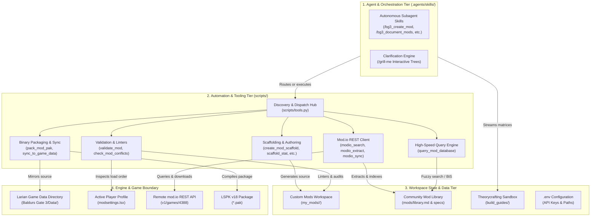
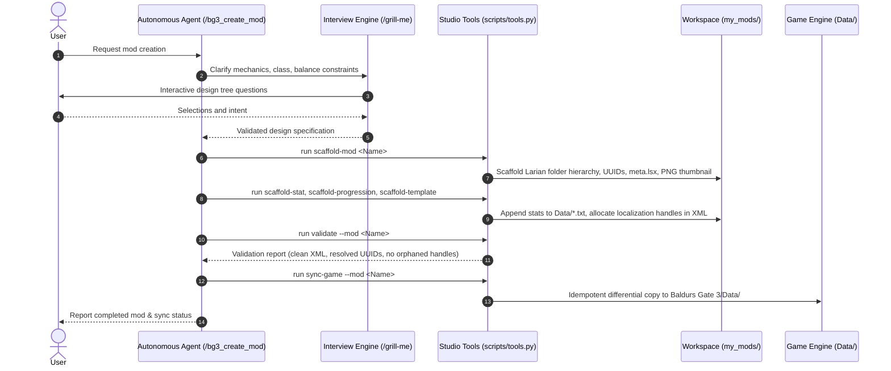
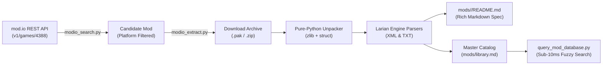

# System Architecture & Technical Design

This document details the system architecture, component layering, data pipelines, and engine structural contracts of the **Baldur's Gate 3 Mod Studio & Mod.io Toolkit**.

> [!NOTE]
> For user guides, autonomous agent slash commands, example prompts, and the CLI flags reference for all 24 studio tools, refer to the [Features & Functionality Guide](docs/FEATURES.md).

---

## 1. System Topology & Multi-Tier Architecture

The studio operates across four architectural layers: the **Agent & Orchestration Tier**, the **Automation & Tooling Tier**, the **Workspace State & Data Tier**, and the **Engine & Game Boundary**.



---

## 2. Core Workflows & Data Pipelines

### Subagent Mod Authoring Lifecycle

The creation and deployment pipeline combines conversational requirement clarification, automated scaffolding, deterministic stat insertion, localization handle allocation, strict validation, and continuous game synchronization.



### Community Mod Discovery & Ingestion Pipeline

When exploring community mods on mod.io, the ingestion pipeline decompresses upstream packages, parses engine files, extracts item and spell definitions, and builds an indexed catalog without runtime dependencies.



---

## 3. Larian Engine Structural Contracts & Binary Standards

### Larian Engine Package Hierarchy

To ensure compatibility with the official Larian Toolkit and game runtime, all custom authored mods in `my_mods/<mod-slug>/` follow this exact four-root layout:

```text
my_mods/<mod-slug>/
├── Mods/<ModName>_<UUID>/
│   └── meta.lsx                      # Primary engine descriptor (ModuleInfo & dependencies)
├── Projects/<ModName>_<UUID>/
│   └── meta.lsx                      # Larian Toolkit project descriptor
├── Public/<ModName>_<UUID>/
│   ├── RootTemplates/
│   │   └── _merged.lsx               # 3D GameObject templates & visual asset links
│   ├── Stats/Generated/Data/
│   │   ├── Armor.txt                 # Armor, jewelry, and clothing stats
│   │   ├── Passive.txt               # Passives, boosts, and conditions
│   │   ├── Spell_*.txt               # Spells, cantrips, and abilities
│   │   └── Weapon.txt                # Weapons and damage profiles
│   ├── Progressions/
│   │   └── Progressions.lsx          # Class, subclass, and level progression nodes
│   └── GUI/
│       └── Icons.lsx                 # Texture atlas UV mappings for custom icons
├── Localization/
│   └── English/
│       └── <ModName>.xml             # String handles (contentuid) and English text
├── README.md                         # Architecture notes & documentation
└── thumbnail.png                     # Standard 512x512 project thumbnail
```

### Larian 64-bit Version Encoding (`Version64`)

Larian's engine encodes semantic versioning into an unsigned 64-bit integer (`Version64`) using bitwise shifts. The formula implemented by `scripts/create_mod_scaffold.py` and `scripts/bump_mod_version.py` is:

$$\text{Version64} = (\text{major} \ll 55) \mid (\text{minor} \ll 47) \mid (\text{revision} \ll 31) \mid \text{build}$$

```text
 63      55 54      47 46               31 30                         0
┌──────────┬──────────┬───────────────────┬────────────────────────────┐
│  Major   │  Minor   │     Revision      │           Build            │
│ (8 bits) │ (8 bits) │     (16 bits)     │         (31 bits)          │
└──────────┴──────────┴───────────────────┴────────────────────────────┘
```

### Pure-Python LSPK v18 Binary Packaging (`pack_mod_pak.py`)

Rather than relying on Windows-exclusive binaries (`LSLib/divine.exe`) or running through `wine`, the workspace implements a pure Python packager for Larian's **LSPK v18** format:

- **Zero External Dependencies**: Implemented strictly with Python's standard library `struct`, `zlib`, and `hashlib`.
- **Package Header**: Writes standard 128-byte LSPK v18 signature (`LSPK`), file version, and file table metadata offset.
- **File Entry Table**: Compresses individual files with `zlib`, calculates uncompressed and compressed sizes, CRC32/MD5 checksums, and relative archive offsets.
- **Cross-Platform Compatibility**: Packages created with `pack_mod_pak.py` mount identically across Linux, macOS, Windows, and game consoles (PlayStation 5, Xbox Series X|S).

---

## 4. Synchronization & File Integrity Architecture

### Idempotent Selective Synchronization (`sync_to_game_data.py`)

The live synchronization system mirrors source files from `my_mods/<mod-slug>/` into the game installation directory (`Baldurs Gate 3/Data/`) for in-engine testing:

1. **Selective Root Mapping**:
   - `my_mods/<mod-slug>/Mods/<ModName>_<UUID>/` $\to$ `Data/Mods/<ModName>_<UUID>/`
   - `my_mods/<mod-slug>/Projects/<ModName>_<UUID>/` $\to$ `Data/Projects/<ModName>_<UUID>/`
   - `my_mods/<mod-slug>/Public/<ModName>_<UUID>/` $\to$ `Data/Public/<ModName>_<UUID>/`
   - `my_mods/<mod-slug>/Localization/` $\to$ `Data/Localization/` and `Data/Mods/<ModName>_<UUID>/Localization/`
2. **Differential Comparison Engine**:
   - Compares file metadata (modification times and sizes) and evaluates content differences using `filecmp.cmp(shallow=False)` before writing.
   - Prevents unnecessary write cycles and reduces disk I/O when working with solid-state drives or network storage.
3. **Continuous Hot-Reload Watcher (`--watch`)**:
   - Polls mod source trees with configurable sleep intervals (default 1.0s).
   - Automatically synchronizes newly saved files so changes appear immediately in the Larian Toolkit or next game reload.

### Master Mod Indexing & Database Queries (`query_mod_database.py`)

The community mod library (`mods/`) indexes over 2,200 unique community gear items, passives, spells, and boosts:

- **Aggregation Pipeline**: `scripts/update_library_catalog.py` crawls all `mods/<slug>/README.md` files, parses markdown tables and metadata headers, and compiles the unified `mods/library.md`.
- **Query Optimization**: `scripts/query_mod_database.py` evaluates queries against cached catalog structures using in-memory tokenization and regex matching. Lookups complete in under 10ms, allowing agent workflows to perform real-time Best-in-Slot gear evaluation without noticeable latency.

---

## 5. Architectural Principles & Isolation

- **Zero-Dependency Philosophy**: All 24 tools in `scripts/` use strictly the Python 3.10+ standard library. They run out-of-the-box on Linux, WSL, and Windows without virtual environment setups or `pip install` requirements.
- **Safe Sandboxing**:
  - Custom authored mods remain safe in `my_mods/` and tracked by version control.
  - Theorycrafting scratchpads reside in `build_guides/` and are explicitly excluded from Git to prevent repository bloat.
  - Backup copies (`.bak`) are created automatically whenever localization handles or `modsettings.lsx` orders are mutated.
- **Path Portability**: Path resolvers inspect `.env` configurations (`BG3_DATA_DIR`) and environment variables to handle POSIX, Windows UNC, and WSL `/mnt/c/` drive mount variations seamlessly.
