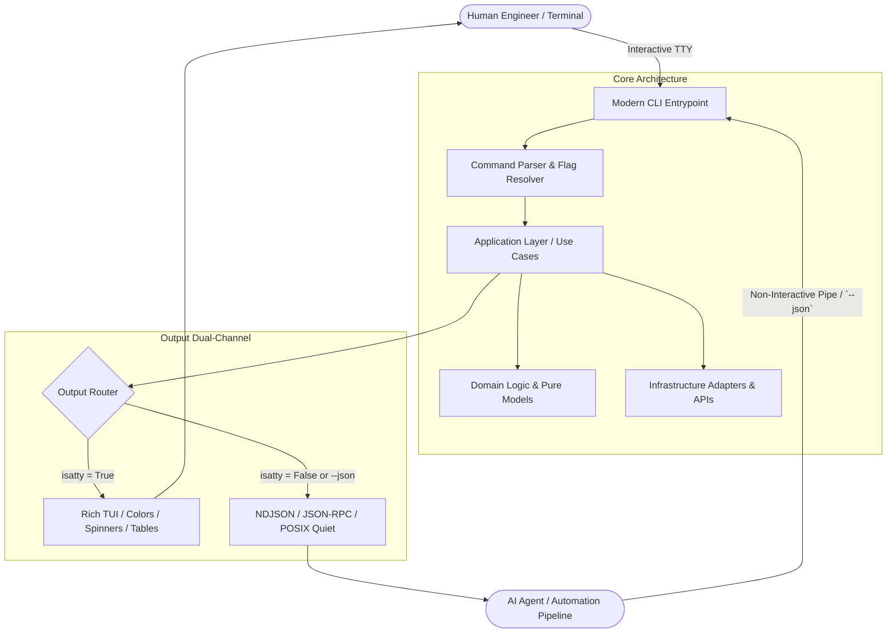
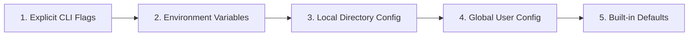

# 2026 CLI Project Design & Philosophy
*Industry Best Practices, Architecture, and Interface Standards for Modern Command-Line Systems*

---

## 1. Executive Summary & The 2026 Paradigm Shift

Command-line interfaces (CLIs) in 2026 serve two distinct, equally critical classes of consumers: **human operators** (software engineers, SREs, systems analysts) and **autonomous machine agents** (AI coding assistants, orchestration engines, CI/CD runners).

Historical CLI design focused almost entirely on human terminal readability or raw bash string wrangling. The contemporary standard mandates a **Dual-Consumer Architecture**: tools that deliver rich, contextual visual experiences in interactive terminals, while maintaining deterministic, structured, machine-parsable execution pathways for autonomous workflows.



---

## 2. CLI Design Philosophy & Interface Ergonomics

### The Modern UNIX Philosophy (Updated for 2026)
1. **The Rule of Silence vs. The Rule of Clarity**:
   - In interactive mode: Provide immediate, high-signal visual feedback, meaningful progress indicators, and actionable status summaries.
   - In headless or piped mode: Write nothing to `stdout` unless specifically requested. Emit data streams cleanly without headers, decorative dividers, or ANSI escape codes.
2. **Strict Stream Discipline**:
   - `stdout` (File Descriptor 1) is reserved exclusively for **primary command data** (payloads, tables, emitted JSON, stream results).
   - `stderr` (File Descriptor 2) is strictly for **diagnostics, operational logs, progress spinners, alerts, and warnings**.
   - *Rule*: Piping `tool run | jq .` must never fail due to informational logging or progress bar updates written to `stdout`.
3. **Dual-Mode Rendering Engine**:
   - Automatically detect terminal capability via `sys.stdout.isatty()` (or equivalent TTY probing).
   - Provide explicit override flags: `--output=json|text|table` and `--json`.
   - Support `NO_COLOR` and `FORCE_COLOR` specifications across all output rendering.

### Command Grammar & Ergonomics
- **Verb-Noun vs. Noun-Verb Consistency**:
  - Prefer **Noun-Verb** (`git remote add`, `docker container list`, `kubectl pod get`) for large multi-command suites.
  - Group domain entities intuitively (`mycli user create`, `mycli user list`, `mycli config set`).
- **Idempotency & Safe Defaults**:
  - Mutating operations must support idempotent application wherever possible (e.g., creating an existing resource updates or skips without hard crash).
  - Destructive commands (`delete`, `purge`, `reset`) must require explicit confirmation in interactive TTYs, or a mandatory `--yes` / `-y` flag when non-interactive.
- **Progressive Disclosure**:
  - The default `--help` screen must fit comfortably within standard terminal heights without paging (under 40 lines).
  - Hide specialized, low-level debug commands behind subcommand groups or `--help --all` switches.
- **Autonomous Agent Compatibility**:
  - Always support `--non-interactive` (or honor `CI=true` / absence of TTY) to suppress interactive prompts and fail early with actionable exit codes rather than hanging indefinitely waiting for stdin.
  - Provide a `--dry-run` flag on all mutating commands to permit pre-flight safety audits by agents and humans alike.

---

## 3. Project Architecture (Python 2026 Standards)

Modern production CLIs demand strict separation of concerns. The CLI framework (e.g., Click, Typer) is an **input/output adapter**, not the application itself.

### Layered Clean Architecture for CLIs

```
src/
└── my_project/
    ├── __init__.py
    ├── __main__.py          # Entrypoint for `python -m my_project`
    ├── cli/                 # Presentation / CLI Adapter Layer
    │   ├── main.py          # Root CLI app, global flags, sub-command registration
    │   ├── commands/        # Subcommand modules (e.g., user.py, deploy.py)
    │   ├── ui/              # Terminal rendering (Rich consoles, themes, tables)
    │   └── formatters/      # Data formatters (JSON, YAML, CSV serializers)
    ├── application/         # Orchestration / Use Case Layer
    │   ├── use_cases/       # Pure business workflows (e.g., sync_catalog.py)
    │   └── dto.py           # Data Transfer Objects
    ├── domain/              # Pure Domain Layer (No external dependencies)
    │   ├── models/          # Domain entities & value objects
    │   └── exceptions.py    # Domain-specific error hierarchies
    └── infrastructure/      # Adapter / External IO Layer
        ├── config/          # Configuration loaders (XDG, TOML, env vars)
        ├── storage/         # Local databases, file state, keyrings
        └── clients/         # External HTTP/RPC clients
```

### Key Architectural Guidelines
- **Zero Business Logic in CLI Handlers**: Command functions in `cli/commands/` must only parse parameters, call an application use case, and route the resulting domain models to the appropriate UI formatter.
- **Blazing Fast Startup Time (<100ms Target)**:
  - Defer heavy third-party imports (e.g., `boto3`, `pandas`, `torch`, heavy network SDKs) inside command handlers or use dynamic lazy loading.
  - The root `mycli --help` or `mycli --version` execution must complete in under 50–100ms.
- **Typed Parameter Schemas**:
  - Utilize modern tools like **Typer** (built on Click and Pydantic) to enforce strict static typing and auto-generate shell completions.

---

## 4. Tool Functionality, Scope & Boundaries

### The Single Responsibility Principle in CLI Ecosystems
- **Focused Scope**: A CLI tool should excel at a unified operational domain. Avoid creating monolithic "kitchen-sink" CLIs that attempt to solve disjointed problems.
- **Hierarchy Depth Limit**:
  - Limit command hierarchy to a maximum of **2 levels** (`tool <resource> <action>`).
  - Example: `mycli project create` is clean; `mycli workspace project target environment deploy` indicates an over-engineered command tree that should be simplified with parameters or flags.
- **CLI as a Consumer of an SDK/Library**:
  - Architectural rule: Any capability offered by the CLI should be importable as a pure Python library API.
  - If a user needs to automate a sequence, they should be able to either script the CLI or import `my_project.application` directly without invoking subprocesses.

---

## 5. Modern Configuration, State & Secret Management

Handling configuration and state in 2026 requires adherence to standardized system paths, strict resolution hierarchies, and secure credential storage.

### The XDG Base Directory Specification
Never pollute the user's `$HOME` directory with ad-hoc dotfiles (`~/.myapp`). Always respect the [XDG Base Directory Specification](https://specifications.freedesktop.org/basedir-spec/basedir-spec-latest.html):

| Directory Type | Default Fallback Path | Purpose |
| :--- | :--- | :--- |
| **Configuration** (`$XDG_CONFIG_HOME`) | `~/.config/<tool_name>/` | User-edited settings, `config.toml` |
| **Application Data** (`$XDG_DATA_HOME`) | `~/.local/share/<tool_name>/` | Persistent data files, schemas, templates |
| **State / Sessions** (`$XDG_STATE_HOME`) | `~/.local/state/<tool_name>/` | History, cached tokens, logs, undo logs |
| **Cache** (`$XDG_CACHE_HOME`) | `~/.cache/<tool_name>/` | Non-essential caches, temporary downloads |

> [!TIP]
> On macOS and Windows, standard cross-platform libraries (such as `platformdirs`) map these to platform-native equivalents (e.g., `~/Library/Application Support` and `%LOCALAPPDATA%`).

### Configuration Precedence Hierarchy
Configuration values must be resolved in a deterministic, cascading order:



1. **Explicit CLI Flags** (e.g., `--port 8080`)
2. **Environment Variables** (e.g., `MYTOOL_PORT=8080`)
3. **Local Project Configuration** (e.g., `.mytool.toml` or `pyproject.toml [tool.mytool]` in the current directory)
4. **Global User Configuration** (e.g., `$XDG_CONFIG_HOME/mytool/config.toml`)
5. **Baked-in Application Defaults**

### Secret Handling Hygiene
- **Never Store Plaintext Secrets**: API keys, bearer tokens, and credentials must never reside unencrypted in `config.toml` files.
- **Preferred Secret Mechanisms**:
  1. Process Environment Variables (e.g., `MYTOOL_API_KEY`)
  2. OS Keyring / Credential Manager (via Python's `keyring` library or libsecret/macOS Keychain)
  3. External Secret Vault integration (1Password CLI, HashiCorp Vault, AWS Secrets Manager)
  4. Encrypted session tokens with restrictive POSIX file permissions (`0600`) in `$XDG_STATE_HOME`.

---

## 6. Error Handling, Exit Codes & Diagnostics

### Standardized Exit Code Taxonomy
Exit codes convey machine-readable status to shell scripts and orchestrators. Conforming to POSIX and BSD `sysexits.h` standards is vital:

| Exit Code | Constant / Meaning | When to Use |
| :---: | :--- | :--- |
| `0` | `EX_OK` | Successful termination. |
| `1` | `EX_GENERAL` | Generic execution failure / unhandled domain error. |
| `2` | `EX_USAGE` | CLI argument misuse, invalid flags, missing required arguments. |
| `64` | `EX_USAGE_SYNTAX` | Command-line syntax error. |
| `65` | `EX_DATAERR` | Invalid input data, malformed payloads, validation failure. |
| `66` | `EX_NOINPUT` | Input file / target resource does not exist or unreadable. |
| `69` | `EX_UNAVAILABLE` | External service, API, or required subsystem is down. |
| `75` | `EX_TEMPFAIL` | Temporary failure (suggests an automated retry might succeed). |
| `77` | `EX_NOPERM` | Insufficient permissions / authentication failure. |
| `130` | `SIGINT` | Terminated by user via Ctrl+C. |

### Human vs. Machine Error Diagnostics
- **Human Presentation**:
  - Clear, colored error summary on `stderr`.
  - Actionable guidance: Explain *why* it failed and provide a concrete *remediation suggestion* (e.g., "Did you mean `mycli init`? Run `mycli auth login` to renew credentials.").
  - Hide stack traces by default; reveal only when `--verbose` or `--debug` is explicitly supplied.
- **Machine / JSON Mode**:
  - When `--json` is active, errors on `stderr` or the response envelope should conform to structured error schemas (e.g., JSON Problem Details or RFC 7807):
    ```json
    {
      "error": {
        "code": "AUTH_EXPIRED",
        "message": "Authentication token expired on 2026-10-16T18:00:00Z",
        "remediation": "Run 'mycli auth login' to re-authenticate.",
        "retryable": false
      }
    }
    ```

---

## 7. Testing, Distribution & Quality Assurance

### Testing Modern CLIs
- **Unit Testing**: Test the pure Domain and Application layers independently of the CLI framework.
- **CLI Runner Isolation**:
  - Test command invocation using Click's `CliRunner` or Typer's testing harnesses.
  - Verify `stdout`, `stderr`, and exit codes independently.
  - Use snapshot testing (e.g., `syrupy` or `pytest-regressions`) for formatted terminal output, while disabling color codes (`NO_COLOR=1`).
- **End-to-End Pipeline Verification**: Test non-interactive pipe scenarios:
  ```bash
  mycli data export --json | jq '.items[0].id'
  ```

### Packaging & Fast Distribution
- **Modern Packaging Standards**: Built using PEP 621 compliant `pyproject.toml` with fast build backends (Hatch, Flit, or `uv`).
- **Zero-Friction Installation**:
  - Support `uv tool install <my-cli>` and `pipx install <my-cli>` for isolated, global installation.
  - For zero-dependency environments, provide compiled standalone binaries via PyInstaller, Nuitka, or PyOxidizer.
- **Shell Completions**: Include built-in commands to install completions automatically for Bash, Zsh, Fish, and PowerShell (`mycli completion install`).
