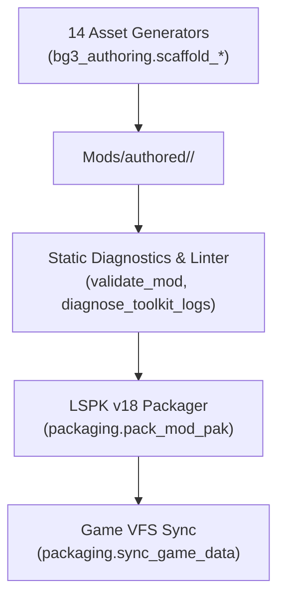

# bg3-authoring

Mod authoring, asset scaffolding, static diagnostics, and packaging toolchain for the **Baldur's Gate 3 Mod Studio** workspace.

---

## Domain Architecture & Scope

`bg3-authoring` provides end-to-end tooling for creating, linting, packaging, and debugging custom *Baldur's Gate 3* mods. It generates Patch 8 compliant Larian XML structures, deterministic UUIDv4 identifiers, and localized string handles (`h...g...`), enforcing clean separation between authored source mods and the game's Virtual File System (VFS).

---

## Subpackages & Core Capabilities

### 1. Asset Scaffolding Subsystem
Modular scaffolding engines producing standard Larian engine structures and returning typed `ScaffoldResult` contracts:
- `create_mod_scaffold.py`: Generates canonical 4-root mod directory layouts (`Mods/`, `Projects/`, `Public/`, `Localization/`) and project thumbnails.
- `scaffold_asset.py`: Facade router providing unified dispatch across all asset generators.
- `scaffold_mechanics.py`: Classes, subclasses, progressions, feats, action resources, spell lists, level maps, default values, and stats.
- `scaffold_visuals.py`: 3D GameObject root templates and appearance visuals.
- `scaffold_atlas.py`: Texture atlas UV coordinate mapping and `Icons.lsx`.
- `scaffold_character.py`: Custom races, origins, appearances, and tags.
- `scaffold_common.py`: Shared XML formatting, path resolution, placeholder PNG generation, and `ScaffoldResult` mapping dataclass.

### 2. Diagnostics & Compatibility
- `diagnostics/validate_mod.py`: Deep static validation checking XML/LSX syntax, UUID collisions, missing string handles, and required folder layouts.
- `diagnostics/sync_localization.py`: String handle audit, localization synchronization, and binary `.loca` compilation.
- `diagnostics/diagnose_toolkit_logs.py`: Automated triage of Larian Toolkit and engine runtime crash logs with actionable fix recommendations.
- `generate_compat_patch.py`: Compatibility override patch and CF payload generator for resolving conflicting mods.
- `inject_treasure_table.py`: Injects custom mod items into standard world drop containers and vendor tables.
- `add_mod_dependency.py`: Dependency registration in `meta.lsx` and `.test_deps.json`.

### 3. Packaging & Synchronization (`bg3_authoring.packaging`)
- `packaging/pack_mod_pak.py`: Pure-Python LSPK v18 binary compiler that writes 40-byte headers, compresses files using raw LZ4 block compression (`LSPK v18`), compiles XML localization into binary `.loca`, and outputs deployable `.pak` archives.
- `packaging/sync_game_data.py`: Idempotent differential file synchronizer that mirrors mod assets into the game's `Data/` directory for live in-engine playtesting.
- `packaging/common.py`: Centralized exclusion rules and file filtering predicates for distribution builds.

---

## CLI Integration

Authoring commands are routed through the unified `bg3` CLI:

### Common Commands:
- `bg3 mod create <Name> --type Standard` — Create a new mod scaffold.
- `bg3 mod scaffold <asset-type> --mod <ModSlug> ...` — Scaffold new game assets.
- `bg3 mod validate <ModSlug>` — Run strict pre-commit validation.
- `bg3 mod pack <ModSlug> --publish-local` — Compile LSPK `.pak` and deploy to local mods folder.
- `bg3 mod sync-game --mods <ModSlug> [--watch]` — Hot-reload source files into the game runtime.
- `bg3 mod patch --mod1 <ModA> --mod2 <ModB>` — Generate compatibility patches.
