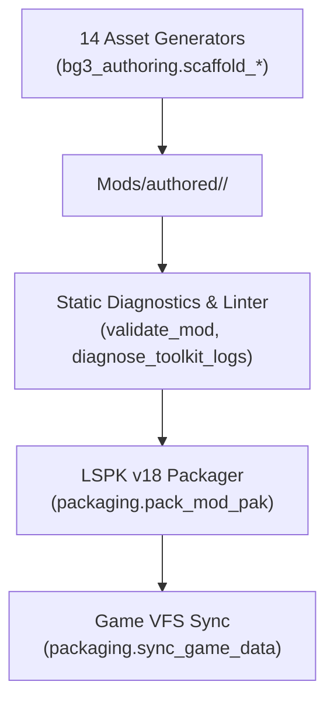

# bg3-authoring

Mod authoring, asset scaffolding, static diagnostics, and packaging toolchain for the **Baldur's Gate 3 Mod Studio** workspace.

---

## Domain Architecture & Scope

`bg3-authoring` provides end-to-end tooling for creating, linting, packaging, and debugging custom *Baldur's Gate 3* mods. It generates Patch 8 compliant Larian XML structures, deterministic UUIDv4 identifiers, and localized string handles (`h...g...`), enforcing clean separation between authored source mods and the game's Virtual File System (VFS).



---

## Subpackages & Core Capabilities

### 1. Asset Scaffolding Generators
14 specialized generator modules creating standard Larian engine structures:
- `create_mod_scaffold.py`: Generates the canonical 4-root mod directory layout (`Mods/`, `Projects/`, `Public/`, `Localization/`).
- `scaffold_class_description.py`: Scaffolds classes, subclasses, ProgressionDescriptions, and parent progression wiring.
- `scaffold_feat.py`: Generates feats, FeatDescriptions, and localization string tables.
- `scaffold_spell_list.py`: Scaffolds standalone SpellLists and PassiveLists.
- `scaffold_level_map.py`: Configures LevelMapValues scaling curves across character levels 1–20.
- `scaffold_action_resource.py`: Creates custom action points, spell slots, and resource replenish conditions.
- `scaffold_progression_node.py`: Appends level-up progressions into `Progressions.lsx`.
- `scaffold_root_template.py`: Generates 3D GameObject root templates for items and equipment.
- `scaffold_stat_entry.py`: Scaffolds Weapons, Armor, Spells, Passives, and StatusData text entries.
- `scaffold_icon_uvs.py`: Computes texture atlas UV coordinates for custom spell and item icons.

### 2. Diagnostics & Compatibility (`bg3_authoring.diagnostics`)
- `validate_mod.py`: Deep static validation checking XML/LSX syntax, UUID collisions, missing string handles, and required folder layouts.
- `generate_compat_patch.py`: Compatibility override patch and CF payload generator for resolving conflicting mods.
- `diagnose_toolkit_logs.py`: Automated triage of Larian Toolkit and engine runtime crash logs with actionable fix recommendations.

### 3. Packaging & Synchronization (`bg3_authoring.packaging`)
- `pack_mod_pak.py`: Pure-Python LSPK v18 binary compiler that writes 40-byte headers, compresses files using LZ4 block compression (LSPK v18), compiles XML localization into binary `.loca`, and outputs deployable `.pak` archives.
- `sync_game_data.py`: Idempotent differential file synchronizer that mirrors mod assets into the game's `Data/` directory for live in-engine playtesting.

---

## CLI Console Entrypoint

This package registers the `bg3-mod` console script (also routed via the main `bg3` router):

```toml
[project.scripts]
bg3-mod = "bg3_authoring.cli:main"
```

### Common Commands:
- `bg3 mod scaffold <asset-type> --mod <ModSlug> ...` — Scaffold new game assets.
- `bg3 mod validate <ModSlug>` — Run strict pre-commit validation.
- `bg3 mod conflict <path> --against-library` — Check progression collisions.
- `bg3 mod pack <ModSlug> --publish-local` — Compile LSPK `.pak` and deploy to local mods folder.
- `bg3 mod sync-game --mods <ModSlug> [--watch]` — Hot-reload source files into the game runtime.
- `bg3 save inspect latest` — Audit save-game mod dependencies before launching the game.
