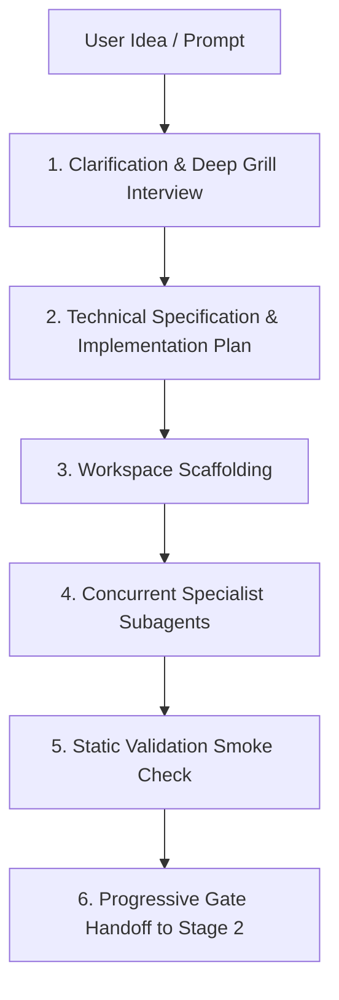

# BG3 Mod Creator Orchestrator (`bg3-create-mod`)

Top-level orchestration skill for Stage 1 of the BG3 mod creation lifecycle. Translates creative concepts into fully authored, statically verified mods inside `my_mods/<ModSlug>`.

Refer to companion resources:
- Interview Protocol: [Design Interview Protocol](./references/grill_me_interview_protocol.md)
- Subagent Prompts: [Subagent Launch Templates](./resources/subagent_templates.md)
- Shift-Left Rules: [Mod Architecture Rules](../../../../../docs/ARCHITECTURE.md)

---

> [!TIP]
> Query the studio tool registry with `bg3 tools search "<intent>" --json`.

## Workflow

### 1. Design Interview & Plan Approval
Conduct structured design interview following [Design Interview Protocol](./references/grill_me_interview_protocol.md). Formulate technical specification and await explicit user approval before scaffolding.

### 2. Workspace Scaffolding
After approval, run the scaffolding tool:
- Execute `bg3 mod create "<ModName>" [--slug "<slug>"] --description "<Desc>" [--unlock-level-curve] --json`

### 3. Concurrent Subagent Dispatch
Launch the 4 specialist subagents in parallel following [Subagent Launch Templates](./resources/subagent_templates.md) (Stats & Spells, Progression & Lists, Localization, Documentation). Ensure all subagents inherit model configuration (`Model: "inherit"`). Await reactive completion notifications without polling.

---

## Verification Gate

Once subagents complete, run read-only static verification before handoff:
1. Validate mod structure and XML schemas: `bg3 mod validate <mod-slug> --json`
2. Audit localization handle integrity: `bg3 mod sync-loca <mod-slug> --check --json`
3. Check for stat collisions against tracked library: `bg3 mod conflict <mod-slug> --against-library --json`

Verify:
- XML/LSX schema adherence and valid localization handles.
- Zero collisions with `Mods/subscribed/library.md`.

After clean validation, prompt user to transition to **Stage 2 Diagnostics** ([`bg3-diagnose-mod`](../bg3-diagnose-mod/SKILL.md)).
