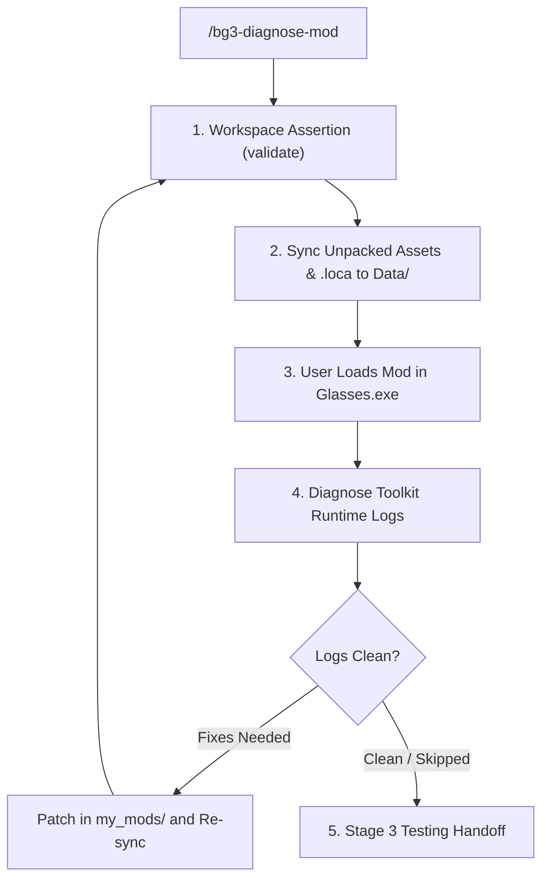

# BG3 Mod Diagnostics & Toolkit Verification (Stage 2) (`bg3-diagnose-mod`)

Stage 2 verification gate and diagnostic doctor for *Baldur's Gate 3* mods. Coordinates User-Action Gate 1 (Toolkit diagnostics) and runtime log remediation.

Refer to deep triage reference:
- Log Analysis & Circuit Breakers: [Log Triage Reference](./references/runtime_log_triage.md)

---

> [!TIP]
> Query the studio tool registry with `bg3 tools search "<intent>" --json`.

## Workflow

### Phase 2A: Workspace Assertion & Game Data Sync
1. Run rapid static pre-flight validation on `my_mods/<slug>/`:
   - Execute `bg3 mod validate <mod-slug> --json`
2. Synchronize unpacked assets and compiled binary `.loca` to `<Game>/Data/`:
   - Execute `bg3 mod sync-game --mods <mod-slug> --json`
3. Instruct user to open `<ModName>` in Baldur's Gate 3 Toolkit (`Glasses.exe`) to generate engine runtime logs.

### Phase 2B: Runtime Log Diagnosis
1. Inspect generated Toolkit logs per [Log Triage Reference](./references/runtime_log_triage.md):
   - Execute `bg3 mod diagnose-logs <mod-slug> --severity warning --json`
2. Apply targeted fixes in `my_mods/<mod-slug>/`, re-sync, and confirm resolution (bounded by 3-iteration circuit breaker).

---

## Verification Gate

Always verify mod diagnostics state before transitioning:
1. Verify `bg3 mod validate` exits with code 0.
2. Confirm game synchronization (`sync-game`) exits with code 0 and binary `.loca` compiled.
3. Confirm Toolkit logs show 0 warnings or user explicitly skipped runtime log triage.
4. Prompt user to transition to **Stage 3: In-Game Testing** ([`bg3-test-mod`](../bg3-test-mod/SKILL.md)).
