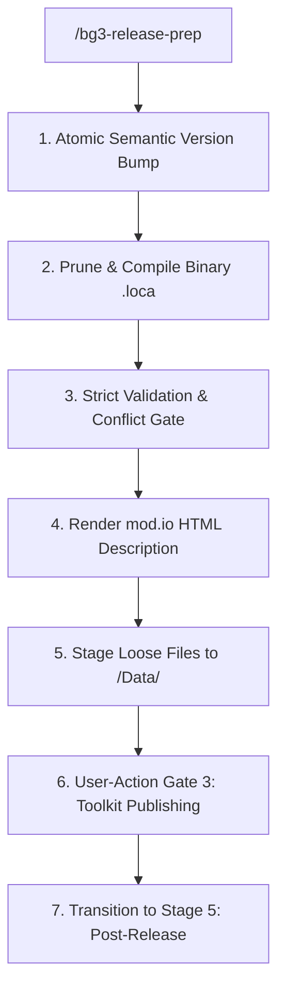

# BG3 Mod Release Preparation Assistant (Stage 4) (`bg3-release-prep`)

Stage 4 pipeline for *Baldur's Gate 3* mods, preparing loose development files and HTML descriptions for User-Action Gate 3 (`Glasses.exe` publishing).

---

> [!TIP]
> Query the studio tool registry with `bg3 tools search "<intent>" --json`.

## Workflow

### 1. Semantic Bump & Localization Compilation
- Bump semantic version: `bg3 mod bump-version <mod-slug> --patch --json`
- Prune and compile binary localization: `bg3 mod sync-loca <mod-slug> --prune --compile --json`

### 2. Strict Validation & Description Rendering
- Strict schema validation: `bg3 mod validate <mod-slug> --strict --json`
- Library conflict pre-check: `bg3 mod conflict <mod-slug> --against-library --json`
- Render mod.io storefront HTML description: `bg3 mod render-desc <mod-slug> --write --json`

### 3. Game Data Staging & Packaging
Sync loose development files and `.loca` to `<Game>/Data/`:
- Sync assets to game: `bg3 mod sync-game --mods <mod-slug> --json`
- Optional package for Nexus Mods / distributions: `bg3 mod pack <mod-slug> --out "dist/<mod-slug>.pak" --json`

*Note: In accordance with official Larian requirements, mod binary publishing to mod.io is performed directly through the Baldur's Gate 3 Toolkit (`Glasses.exe`).*

---

## Verification Gate

Verify release preparation before Toolkit publishing:
1. Confirm validation and conflict commands exit with code 0.
2. Confirm `my_mods/<mod-slug>/modio_description.html` exists and is non-empty.
3. Confirm 512×512 PNG icons exist and binary `.loca` is compiled.
4. Guide user through Toolkit publishing, then transition to [`bg3-post-release`](../bg3-post-release/SKILL.md).
