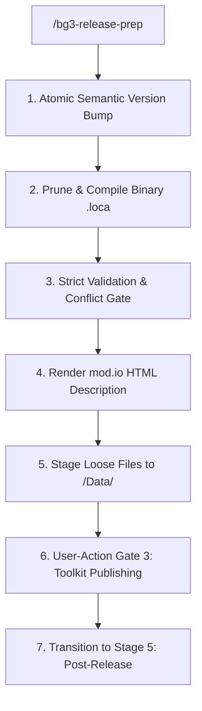

# BG3 Mod Release Preparation Assistant (Stage 4) (`bg3-release-prep`)

Stage 4 pipeline for *Baldur's Gate 3* mods, preparing loose development files and HTML descriptions for User-Action Gate 3 (`Glasses.exe` publishing).

---

> [!TIP]
> Query the studio tool registry with `bg3 tools search "<intent>" --json`.

## Workflow



### 1. Semantic Bump & Localization Compilation
Run the release preparation recipe:
```bash
bg3 mod bump-version <mod-slug> --patch --json
bg3 mod sync-loca <mod-slug> --prune --compile --json
```

### 2. Strict Validation & Description Rendering
Execute strict schema validation, library conflict check, and render mod.io storefront HTML description:
```bash
bg3 mod validate <mod-slug> --strict --json
bg3 mod conflict <mod-slug> --against-library --json
bg3 mod render-desc <mod-slug> --write --json
```

### 3. Game Data Staging & Packaging
Sync loose development files and `.loca` to `<Game>/Data/`:
```bash
bg3 mod sync-game --mod <mod-slug> --json
bg3 mod pack <mod-slug> --out "dist/<mod-slug>.pak" --json
```

*Note: In accordance with official Larian requirements, mod binary publishing to mod.io is performed directly through the Baldur's Gate 3 Toolkit (`Glasses.exe`).*

---

## Verification Gate

Verify release preparation before Toolkit publishing:
1. Confirm validation and conflict commands exit with code 0.
2. Confirm `Mods/authored/<mod-slug>/modio_description.html` exists and is non-empty.
3. Confirm 512×512 PNG icons exist and binary `.loca` is compiled.
4. Guide user through Toolkit publishing, then transition to [`bg3-post-release`](../bg3-post-release/SKILL.md).
