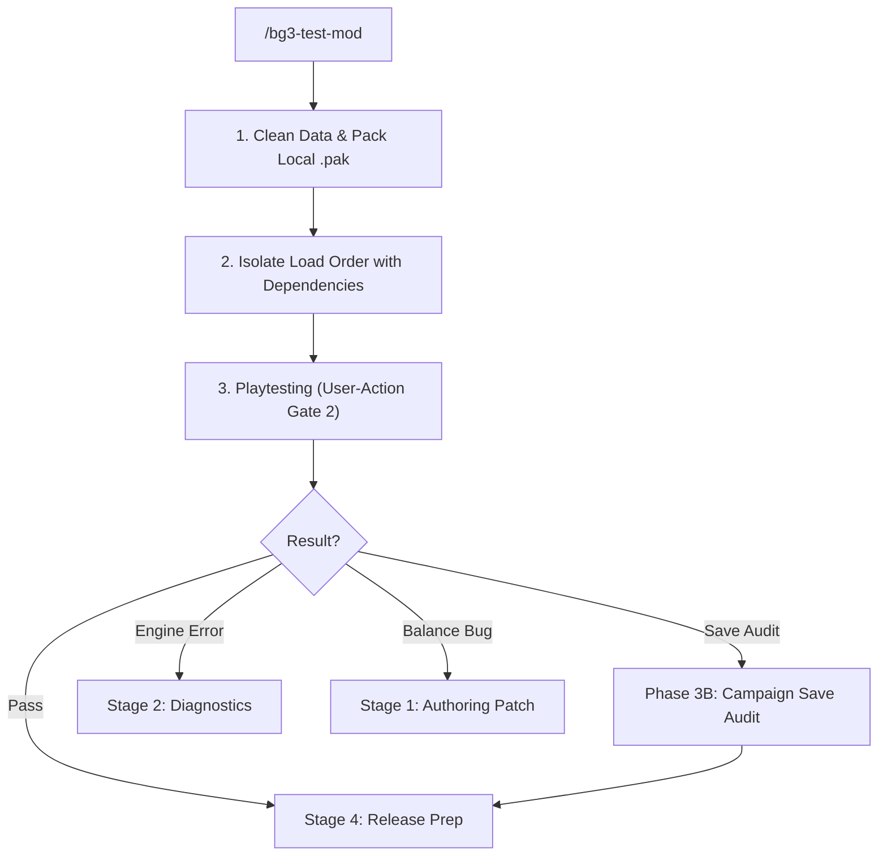

# BG3 Mod In-Game Testing (`bg3-test-mod`)

Drives Stage 3 clean-room in-game playtesting: purging loose `Data/` development assets, packaging a local `.pak` to `AppData/Mods/`, configuring an isolated `modsettings.lsx` profile, and routing defects via dual-track resolution.

Refer to companion resources:
- Clean-Room Protocol: [Smoke Testing Runbook](./references/smoke_testing_runbook.md)
- Save Audit Protocol: [Campaign Save Audit](./references/save_audit_runbook.md)
- Lifecycle Gates: 5-Stage mod creation workflow and dual-track defect routing (docs/MOD_CREATION_WORKFLOW.md)

---

> [!TIP]
> Query the studio tool registry with `bg3 tools search "<intent>" --json`.

## Workflow

### 1. Clean Data & Deploy Local `.pak`
Purge loose files and package `.pak`:
- Clean loose development files: `bg3 mod sync-game --clean-mod <mod-slug> --json`
- Package and deploy locally: `bg3 mod pack <mod-slug> --publish-local --json`

### 2. Configure Clean-Room Load Order (Phase 3A)
Enable target mod with dependencies per [Smoke Runbook](./references/smoke_testing_runbook.md):
- Execute `bg3 loadorder enable "<mod-slug>" --with-deps --isolate --json`

### 3. Guided Playtesting & Routing
Instruct user to launch game and test acquisitions, tooltips, and mechanics:
- Standalone pass: Proceed to [`bg3-release-prep`](../bg3-release-prep/SKILL.md).
- Campaign integration: Follow [Save Audit](./references/save_audit_runbook.md).
- Engine crash / missing asset: Return to [`bg3-diagnose-mod`](../bg3-diagnose-mod/SKILL.md).
- Mechanics bug: Patch `my_mods/<slug>/`, re-deploy, and re-test.

---

## Verification Gate

Verify local deployment state before concluding:
1. Verify `bg3 mod pack <mod-slug> --publish-local` exits with code 0.
2. Confirm `.pak` exists in user `AppData/Mods/`.
3. Confirm `modsettings.lsx` lists the mod and declared dependencies.
