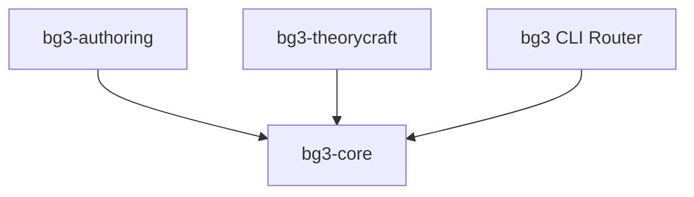

# bg3-core

Foundational runtime, binary parsers, cross-platform path resolution, and mod.io REST API client for the **Baldur's Gate 3 Mod Studio** workspace.

---

## Domain Architecture & Scope

`bg3-core` serves as the foundational, leaf-level dependency package in the monorepo DAG. It is designed to be completely independent of higher-level domain packages (`bg3-authoring` and `bg3-theorycraft`), providing low-level binary engines and runtime utilities that require zero external binary tools (such as LSLib's `divine.exe`, Wine, or .NET runtimes).



---

## Core Modules & Exported Interfaces

| Module | Core Responsibility | Key Exported Symbols |
| :--- | :--- | :--- |
| `bg3_core.larian_parsers` | Larian binary formats, version encoding, and localization | `encode_version64()`, `decode_version64()`, `parse_loca_bytes()`, `compile_xml_bytes_to_loca()`, `split_larian_items()` |
| `bg3_core.lspk` | Pure-Python LSPK v18 archive reader and unpacker | `LspkArchive`, `lz4_block_decompress()`, `lz4_frame_or_block_decompress()`, `decompress_pak_file_data()` |
| `bg3_core.env_paths` | Cross-platform state, cache, config, and game path detection | `get_xdg_config_home()`, `get_xdg_cache_home()`, `get_xdg_data_home()`, `detect_bg3_appdata_dirs()`, `detect_bg3_install_dir()` |
| `bg3_core.cli_common` | Stream separation, POSIX exit codes, and JSON envelopes | `OutputEmitter`, `ConsoleColor`, `ExitCode`, `format_json_response()`, `confirm_action()` |
| `bg3_core.modio_client` | Authenticated mod.io v1 REST client | `ModioClient`, `ModioError`, `resolve_modio_token()` |
| `bg3_core.tools` | Dynamic CLI argument parser introspection and registry | `build_parser_ast_registry()`, `search_tools()`, `verify_registry()`, `audit_skills()` |
| `bg3_core.cli` | Central unified router for all workspace domains | `main()`, `build_parser()`, `dispatch_command()` |

---

## CLI Console Entrypoint

This package registers the primary console script for the entire studio:

```toml
[project.scripts]
bg3 = "bg3_core.cli:main"
```

### Common Commands Driven by `bg3-core`:
- `bg3 tools list` — Discover all registered tools across packages.
- `bg3 tools search <query>` — Search tools by semantic intent.
- `bg3 tools info <tool>` — Inspect tool arguments and schemas.
- `bg3 tools verify --audit-skills` — Programmatic health audit of agent skills.
- `bg3 modio search <query>` — Search remote community mods on mod.io.
- `bg3 modio sync` — Synchronize subscribed mods and download `.pak` packages.
- `bg3 loadorder list` — Inspect active `modsettings.lsx` load order.

---

## Cross-Platform Storage Architecture

All state directories comply strictly with the XDG Base Directory specification on Linux/macOS and APPDATA specifications on Windows:

- **Configuration**: `$XDG_CONFIG_HOME/BG3_Mod_Studio` (or `%APPDATA%\BG3_Mod_Studio`)
- **Cache**: `$XDG_CACHE_HOME/BG3_Mod_Studio` (or `%LOCALAPPDATA%\BG3_Mod_Studio`)
- **User Content**: `$XDG_DOCUMENTS_DIR/BG3_Mod_Studio/Mods/`
- **Game VFS**: Automatically detects Steam Native, Proton (`compatdata/1086940/pfx`), WSL, and Windows installations.
