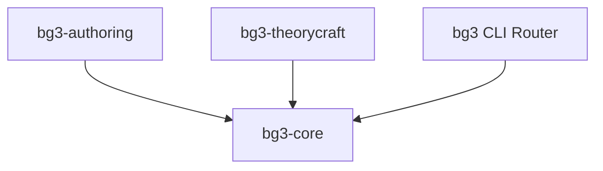

# bg3 (Core Runtime & CLI Dispatcher)

Foundational runtime, in-process CLI dispatcher, binary parsers, cross-platform path resolution, and mod.io REST API client for the **Baldur's Gate 3 Mod Studio** workspace. Distributed as the `bg3` package on PyPI.

---

## Domain Architecture & Scope

`bg3-core` serves as the foundational, leaf-level dependency package in the monorepo DAG. It is designed to be completely independent of higher-level domain packages (`bg3-authoring` and `bg3-theorycraft`), providing low-level binary engines and runtime utilities that require zero external binary tools (such as LSLib's `divine.exe`, Wine, or .NET runtimes).



---

## Core Modules & Exported Interfaces

| Module | Core Responsibility | Key Exported Symbols |
| :--- | :--- | :--- |
| `bg3_core.binary.larian_parsers` | Larian binary formats, version encoding, and localization | `DEFAULT_VERSION64`, `decode_version64()`, `calculate_version64()`, `compile_xml_bytes_to_loca()`, `split_larian_items()`, `safe_xml_fromstring()`, `safe_xml_parse()` |
| `bg3_core.binary.lspk` | Pure-Python LSPK v18 archive reader, builder, and unpacker | `LspkArchive`, `build_lspk_archive()`, `lz4_block_decompress()`, `lz4_frame_or_block_decompress()`, `decompress_pak_file_data()` |
| `bg3_core.binary.lsf` | LSF binary document serializer, deserializer, and AST node model | `LsfDocument`, `LsfNode`, `LsfAttribute` |
| `bg3_core.exceptions` | Unified domain exception hierarchy dual-inheriting standard Python exceptions | `BG3Error`, `BG3BinaryError`, `BG3PackagingError`, `BG3ProfileError`, `BG3CatalogError`, `BG3EnvironmentError` |
| `bg3_core.profile.manage_load_order` | Mod order validation, activation, dependency resolution, and quarantine | `build_load_order_parser()`, `main()` |
| `bg3_core.profile.save_inspector` | Save game metadata extraction, AST audit, and mod pruning | `extract_save_metadata()`, `audit_against_modsettings()`, `prune_missing_mods_from_save()` |
| `bg3_core.profile.manage_saves` | Savegame discovery, backup, retention purging, and rescue | `discover_save_games()`, `handle_clean_missing()` |
| `bg3_core.profile.check_mod_conflicts` | Static conflict detector and cross-mod compatibility analyzer | `compare_two_mods()`, `compare_candidate_against_catalog()`, `check_native_dlls()`, `find_missing_local_dependencies()` |
| `bg3_core.modio.modio_client` | Authenticated mod.io v1 REST client | `ModioClient`, `ModioError`, `get_oauth_token()`, `get_api_key()` |
| `bg3_core.modio.query_mod_database` | SQLite mod database indexer, equipment parser, and query engine | `build_or_load_index()`, `parse_mod_stat_entries()` |
| `bg3_core.cli.router` | Central unified router and subparser dispatcher for all workspace domains | `main()`, `build_parser()`, `dispatch_command()` |
| `bg3_core.cli.tools` | Dynamic CLI argument parser introspection and registry | `build_parser_ast_registry()`, `search_tools()`, `verify_registry()`, `audit_skills()` |
| `bg3_core.cli.common` | Stream separation, POSIX exit codes, and JSON envelopes | `OutputEmitter`, `ConsoleColor`, `ExitCode`, `format_json_response()`, `confirm_action()` |
| `bg3_core.env_paths` | Cross-platform state, cache, config, game path detection, and mod dir resolution | `resolve_mod_dir()`, `get_xdg_config_home()`, `get_xdg_cache_home()`, `get_xdg_data_home()`, `detect_bg3_appdata_dirs()`, `detect_bg3_install_dir()` |

---

## Distribution & CLI Console Entrypoint

This package is distributed as `bg3` and provides the primary console script for the entire studio, with optional extras for domain toolsets:

```bash
uv tool install "bg3[all]"          # Complete studio suite
uv tool install "bg3[authoring]"    # Mod authoring and packaging
uv tool install "bg3[theorycraft]"  # Theorycrafting and DPR simulation
uv tool install bg3                 # Core runtime, load order, and mod.io client
```

```toml
[project.scripts]
bg3 = "bg3_core.cli:main"
```

### Common Commands Driven by `bg3-core`:
- `bg3 tools list` — Discover all registered tools across packages.
- `bg3 tools search <query>` — Search tools by semantic intent.
- `bg3 tools info <tool>` — Inspect tool arguments and schemas.
- `bg3 tools verify --audit-skills` — Programmatic health audit of agent skills.
- `bg3 modio search <query>` — Search remote community mods on mod.io.
- `bg3 modio sync` — Synchronize subscribed mods and download `.pak` packages.
- `bg3 loadorder list` — Inspect active `modsettings.lsx` load order.
- `bg3 save inspect latest` — Inspect save metadata and audit mod requirements.
- `bg3 save clean-missing` — Prune missing mods to rescue corrupted saves.
- `bg3 mod conflict <slug> --against-library` — Detect stat, progression, or root template collisions against subscribed mods.

---

## Cross-Platform Storage Architecture

All state directories comply strictly with the XDG Base Directory specification on Linux/macOS and APPDATA specifications on Windows:

- **Configuration**: `$XDG_CONFIG_HOME/bg3/env` (or `%APPDATA%\bg3\env`)
- **Cache**: `$XDG_CACHE_HOME/bg3/` (or `%LOCALAPPDATA%\bg3\`)
- **User Content**: `$XDG_DOCUMENTS_DIR/BG3_Mod_Studio/Mods/`
- **Game VFS**: Automatically detects Steam Native, Proton (`compatdata/1086940/pfx`), WSL, and Windows installations.
