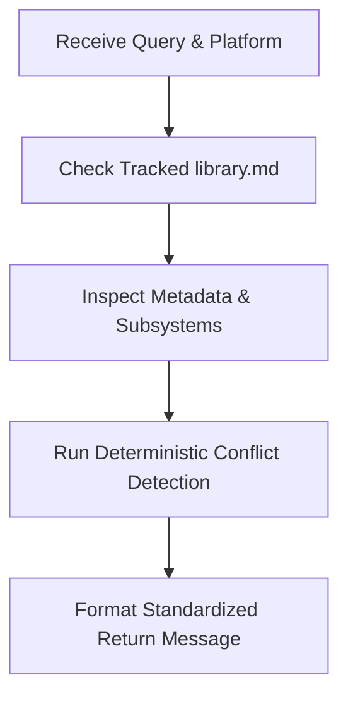

# BG3 Mod Conflict & Compatibility Checker (`bg3-check-mod-conflicts`)

Evaluates compatibility and detects potential conflicts for *Baldur's Gate 3* mods. Invocable by the [`bg3-search-mods`](../bg3-search-mods/SKILL.md) orchestrator or directly.

Refer to domain specifications:
- Methodology & Vectors: [Conflict Methodology](./references/conflict_methodology.md)
- Message Formats & Patches: [Remediation Templates](./resources/remediation_patch_template.md)

---

> [!TIP]
> Query the studio tool registry with `bg3 tools search "<intent>" --json`.

## Workflow

### 1. Hybrid Conflict Inspection
Run deterministic inspection against cataloged workspace mods or candidate pairs:
- **Candidate vs Tracked Library**: Execute `bg3 mod conflict "<MOD_SLUG>" --against-library --json`
- **Candidate vs Candidate**: Execute `bg3 mod conflict "<MOD1>" --mod2 "<MOD2>" --json`

### 2. Remediation & Patch Generation
When actionable stat or progression collisions occur, compatibility patch scaffolding is available via the `bg3-authoring` toolkit:
- **Authoring Dependency**: Requires the `bg3-authoring` package (`pip install bg3-authoring` or `pip install bg3-mod-studio`).
- **Scaffold Patch Mod**: Execute `bg3 mod patch --mod1 <mod1> --mod2 <mod2> --name "<Mod1><Mod2>Patch" --mode standalone --json`
- **Scaffold CF Integration**: Execute `bg3 mod patch --mod1 <mod1> --mod2 <mod2> --mode cf --json`

---

## Verification Gate

Always verify automated conflict output and status formatting before returning:
1. Verify `bg3 mod conflict` exits with code 0 and valid JSON.
2. Confirm console tags (`[Console Load Order]`) are applied when target platform is console.
3. Validate return messages match schemas in [Remediation Templates](./resources/remediation_patch_template.md).
