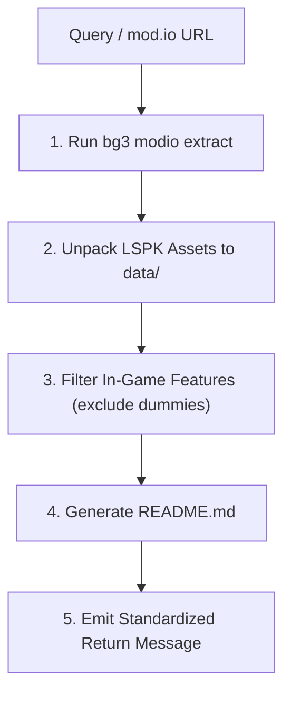

# Single BG3 Mod Documentation Specialist (`bg3-document-single-mod`)

Downloads, unpacks, analyzes, and documents an individual Baldur's Gate 3 community mod from [mod.io](https://mod.io/g/baldursgate3). Emits structured documentation into `$XDG_DOCUMENTS_DIR/BG3_Mod_Studio/Mods/subscribed/<slug>/README.md`.

Refer to companion resources:
- Specification Format: [README Template](./resources/single_mod_readme_template.md)
- Return Formats: [Return Message Templates](./resources/return_message_templates.md)

---

> [!TIP]
> Query the studio tool registry with `bg3 tools search "<intent>" --json`.

## Workflow

### 1. Extraction & Data Unpacking
Verify `MODIO_API_KEY` is set in configuration, then run extraction:
- Execute `bg3 modio extract "<MOD_QUERY>" --write-spec --json`
- This downloads the package, unpacks LSPK v18 assets, and scaffolds a structured markdown specification.

### 2. Feature Filtering & Schema Verification
Cross-check extracted features against the criteria in [README Template](./resources/single_mod_readme_template.md). Exclude dummy templates or WIP stubs. Confirm that all granted abilities and passives detail full mechanical formulas and effects.

### 3. Return Status
Emit standardized status per [Return Message Templates](./resources/return_message_templates.md).

---

## Verification Gate

Always verify document generation before concluding:
1. Verify `bg3 modio extract` command exits with code 0 and valid JSON.
2. Confirm `Mods/subscribed/<slug>/README.md` exists and contains the complete Rich Features table.
3. Confirm dummy entries (`IsDummy "1"`) are excluded from documented features.
