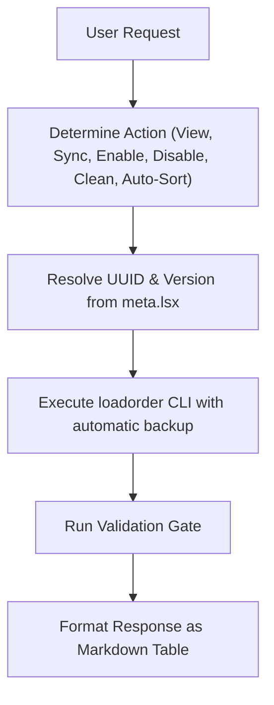

# BG3 Load Order Management Skill (`bg3-manage-load-order`)

Inspects and manages the active *Baldur's Gate 3* load order directly through natural language or slash command, modifying `modsettings.lsx`.

---

> [!TIP]
> Query the studio tool registry with `uv run bg3 tools search "<intent>" --json`.

## Workflow

### 1. View & Sync Load Order
- List current profile load order: `uv run bg3 loadorder list --json`
- Synchronize local mods into active load order profile: `uv run bg3 loadorder sync --yes --json`
- Clean missing or removed mods from active profile: `uv run bg3 loadorder clean --yes --json`
- Topologically auto-sort active mods based on dependencies: `uv run bg3 loadorder auto-sort --json`

### 2. Mod Activation & Deactivation
- Enable at end of load order with dependencies: `uv run bg3 loadorder enable "<mod_slug_or_UUID>" --with-deps --json`
- Disable a mod safely: `uv run bg3 loadorder disable "<mod_slug_or_UUID>" --json`

### 3. Output Presentation
Present active mods as a structured table with index, mod name, folder, and UUID.

---

## Verification Gate

Always verify load order integrity before concluding:
1. Validate profile rules: `uv run bg3 loadorder validate --json`
2. Confirm command exits with code 0 and valid JSON.
3. Confirm `GustavDev` (or Patch 8 core system modules) reside in canonical positions.
4. Verify automatic backup was created at `modsettings.lsx.<timestamp>.bak`.
