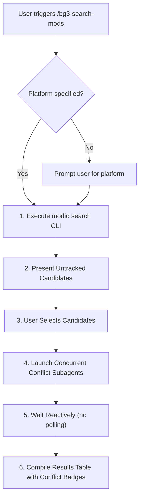

# BG3 Mod Search & Candidate Orchestrator (`bg3-search-mods`)

Natural language search and discovery orchestrator for Baldur's Gate 3 community mods on [mod.io](https://mod.io/g/baldursgate3). Pre-filters cataloged mods and coordinates conflict evaluations.

Refer to companion resources:
- Ranking & Scoring: [Search Rubric](./references/search_ranking_rubric.md)
- Conflict Subagents: [Conflict Subagents](./resources/conflict_subagent_template.json)

---

> [!TIP]
> Query the studio tool registry with `bg3 tools search "<intent>" --json`.

## Workflow

### 1. Platform Check & Search
Ensure target platform is specified (prompt user if missing). Execute search:
- Execute `bg3 modio search "<QUERY>" --platform "<PLATFORM>" --limit 15 --json`
- The tool automatically filters out mods already cataloged in `Mods/subscribed/library.md`.

### 2. Candidates & Concurrent Subagents
Present untracked candidates per [Search Rubric](./references/search_ranking_rubric.md). Once selected, launch concurrent subagents per [Conflict Subagents](./resources/conflict_subagent_template.json) to evaluate [`bg3-check-mod-conflicts`](../bg3-check-mod-conflicts/SKILL.md). Ensure all subagents inherit model configuration (`Model: "inherit"`). Await reactive completion notifications without polling.

### 3. Results Compilation
Synthesize subagent return strings into a markdown table with conflict status badges.

---

## Verification Gate

Verify search and subagent results before delivery:
1. Confirm search command exits with code 0 and valid JSON.
2. Confirm untracked filtering verified against `Mods/subscribed/library.md`.
3. Validate that conflict strings follow schemas in [Search Rubric](./references/search_ranking_rubric.md).
