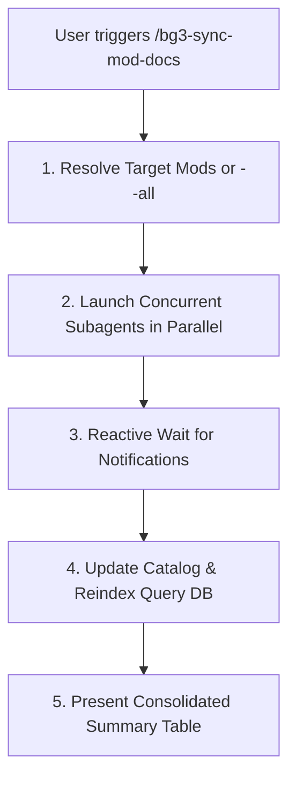

# BG3 Mod Documentation & Update Orchestrator (`bg3-sync-mod-docs`)

Coordinates concurrent worker subagents to fetch, unpack, validate, document, and update *Baldur's Gate 3* mods from `https://mod.io/g/baldursgate3`. Supports ingesting new mods, checking updates across tracked mods, or auditing all subscriptions.

Refer to specifications:
- Subagent Launch Schema: [Subagent Launch Template](./resources/sync_subagent_template.json)
- Catalog Columns & Categories: [Catalog Specification](./references/library_catalog_spec.md)
- Synchronization Flow: [Subscription Sync Guide](./references/catalog_sync_flow.md)

---

> [!TIP]
> Query the studio tool registry with `bg3 tools search "<intent>" --json`.

## Workflow

### 1. Batch Resolution & Subagent Dispatch
Resolve target mods from user input:
- Targeted mod titles, slugs, or numeric IDs.
- Check all tracked mods: `bg3 modio update --list-tracked --json`
- Inspect subscriptions: `bg3 modio sync --dry-run --json`

Launch one worker subagent per mod in parallel using the schema defined in [Subagent Launch Template](./resources/sync_subagent_template.json), directing each worker to follow [`bg3-sync-single-mod`](../bg3-sync-single-mod/SKILL.md). Ensure all subagents inherit model configuration (`Model: "inherit"`).

Stop calling tools and await reactive completion notifications without polling.

### 2. Catalog & Reindex
Once all subagents report status, update the master catalog and warm the query cache:
- Update master catalog: `bg3 modio update-catalog --write --json`
- Reindex high-speed query database: `bg3 query --reindex --json`

### 3. Summary Presentation
Deliver an executive summary table detailing mod name, status (`🟢 Up-to-date`, `🔄 Updated`, `✨ Created`, `❌ Failed`), category, and relative spec link.

---

## Verification Gate

Always verify catalog and cache updates before concluding:
1. Verify `update-catalog` and `query --reindex` exit with code 0.
2. Confirm all documented mods appear in `Mods/subscribed/library.md` under correct categories.
3. Validate that relative links to `mods/<slug>/README.md` resolve to existing files.
