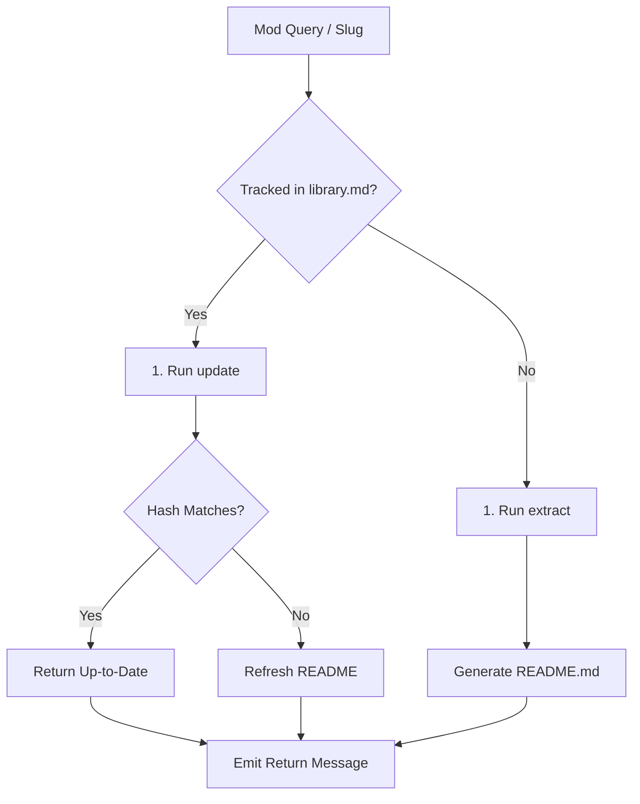

# Single BG3 Mod Documentation & Update Specialist (`bg3-sync-single-mod`)

Downloads, unpacks, analyzes, documents, or updates an individual Baldur's Gate 3 community mod from [mod.io](https://mod.io/g/baldursgate3). Emits structured documentation into `Mods/subscribed/<slug>/README.md`.

Refer to companion resources:
- Specification Format: [README Template](./resources/single_mod_readme_template.md)
- Return Formats: [Status Message Schemas](./resources/sync_status_messages.md)

---

> [!TIP]
> Query the studio tool registry with `bg3 tools search "<intent>" --json`.

## Workflow



### 1. Ingestion / Update Pipeline
Verify `MODIO_API_KEY` is configured in `~/.config/bg3/env`. Determine action:

```bash
# For tracked mods
bg3 modio update "<MOD_QUERY>" --json

# For new mods
bg3 modio extract --query "<MOD_QUERY>" --write-spec --json
```

### 2. Feature Filtering & Schema Verification
Cross-check extracted features against [README Template](./resources/single_mod_readme_template.md). Exclude dummy templates (`IsDummy "1"`). Confirm abilities and passives detail mechanical formulas and effects.

### 3. Return Status
Emit standardized status according to [Status Message Schemas](./resources/sync_status_messages.md).

---

## Verification Gate

Always verify document generation before concluding:
1. Verify `bg3 modio extract` or `bg3 modio update` exits with code 0.
2. Confirm `Mods/subscribed/<slug>/README.md` exists and contains features table.
3. Confirm dummy entries (`IsDummy "1"`) are excluded from documented features.
