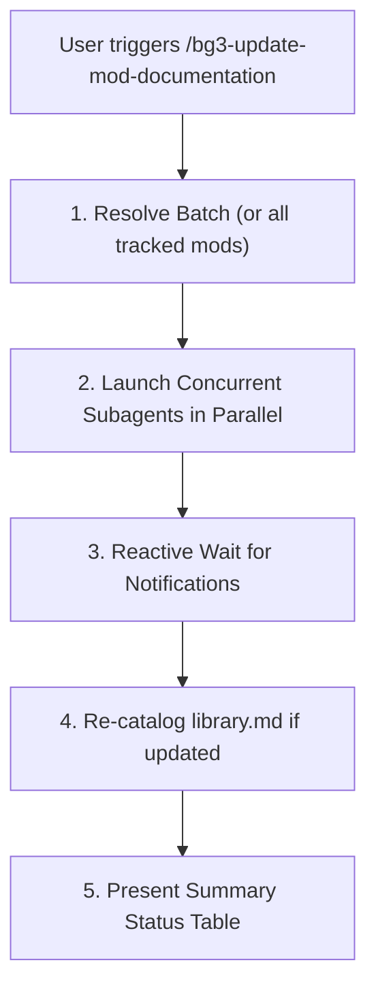

# BG3 Mod Documentation Update Orchestrator (`bg3-update-mod-documentation`)

Coordinates concurrent worker subagents to check and update *Baldur's Gate 3* mod documentation from `https://mod.io/g/baldursgate3`.

Refer to specifications:
- Subagent Template: [Update Subagent Template](./resources/update_subagent_template.json)

---

> [!TIP]
> Query the studio tool registry with `uv run bg3 tools search "<intent>" --json`.

## Workflow

### 1. Batch Resolution & Subagent Dispatch
Accept targeted slugs or inspect all tracked mods:
- List tracked mods: `uv run bg3 modio update --list-tracked --json`
- Launch one worker subagent per mod using the schema in [Update Subagent Template](./resources/update_subagent_template.json), following [`bg3-update-single-mod`](../bg3-update-single-mod/SKILL.md). Ensure all subagents inherit model configuration (`Model: "inherit"`).

Stop calling tools and await reactive completion notifications without polling.

### 2. Catalog & Table Compilation
When any mod is updated, refresh the catalog:
- Update master catalog: `uv run bg3 modio update-catalog --write --json`
- Render the consolidated update status table with status indicators (`🟢 Up-to-date`, `🔄 Updated`, `⚠️ Not Tracked`, `❌ Failed`).

---

## Verification Gate

Always verify documentation updates before concluding:
1. Verify `update --list-tracked` or `update-catalog` commands exit with code 0.
2. Confirm all updated mods have valid six-column rows in `Mods/subscribed/library.md`.
3. Validate that relative links to `mods/<slug>/README.md` resolve correctly.
