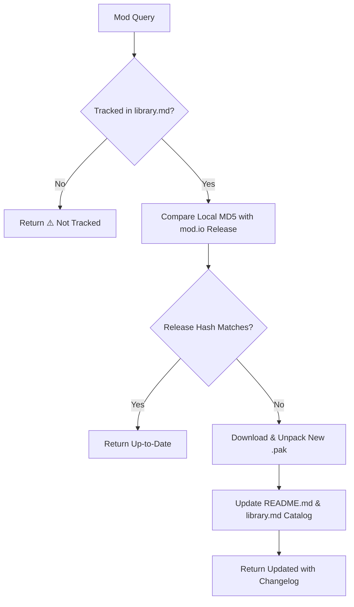

# Single BG3 Mod Update Specialist (`bg3-update-single-mod`)

Checks for upstream mod.io releases for an individual Baldur's Gate 3 community mod, updates local data archives, and refreshes the markdown specification at `$XDG_DOCUMENTS_DIR/BG3_Mod_Studio/Mods/subscribed/<slug>/README.md`.

Refer to companion resources:
- Update Status Schema: [Update Status Messages](./resources/update_status_messages.md)

---

> [!TIP]
> Query the studio tool registry with `bg3 tools search "<intent>" --json`.

## Workflow

### 1. Environment & Tracking Check
Verify `MODIO_API_KEY` is available in configuration (`~/.config/bg3/env`). Ensure mod is tracked in `Mods/subscribed/library.md`.

### 2. Check & Update Pipeline
Execute update pipeline:
- Execute `bg3 modio update "<MOD_QUERY>" --json`
- The tool compares release hashes, downloads new `.pak` packages if needed, updates mod README specifications, and updates `Mods/subscribed/library.md`.

### 3. Return Message
Format status output according to [Update Status Messages](./resources/update_status_messages.md) (Up-to-Date, Updated, Not Tracked, Failed).

---

## Verification Gate

Always verify update results before returning:
1. Verify `bg3 modio update` command exits with code 0 and valid JSON.
2. Confirm `Mods/subscribed/<slug>/README.md` reflects latest semantic version.
3. Validate return string conforms to schemas in [Update Status Messages](./resources/update_status_messages.md).
