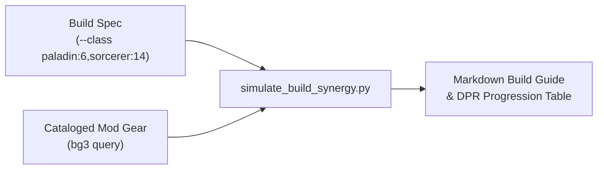

# bg3-theorycraft

Combat modeling, multiclass build simulation, and theorycrafting engine for the **Baldur's Gate 3 Mod Studio** workspace.

---

## Domain Architecture & Scope

`bg3-theorycraft` enables deep mechanical analysis of *Baldur's Gate 3* character builds across levels 1 through 20. It models D&D 5e / Larian rulesets including action economy, resource budgets, spell slot progression matrices, hit probabilities, and Damage-Per-Round (DPR) distributions against varying target Armor Classes.



---

## Core Capabilities

### 1. Multiclass Synergy & DPR Simulation (`simulate_build_synergy.py`)
- **Progression Modeling**: Simulates 1–20 character level progression across single-class and complex multiclass combinations (e.g. Paladin 6 / Sorcerer 14).
- **Damage-Per-Round (DPR) Calculations**: Computes expected sustained and burst DPR values against target Armor Classes ranging from AC 10 through AC 25.
- **Action Economy & Resource Budgets**: Models standard Actions, Bonus Actions, Reactions, and class-specific action resources (Channel Oath, Superiority Dice, Sorcery Points, Ki).
- **Hit Probability & Crits**: Evaluates advantage/disadvantage mechanics, critical hit ranges (e.g. Champion, equipment boosts), and Savage Attacker dice distributions.
- **Spell Slot Matrices**: Computes multiclass spellcaster levels and slot allocations according to 5e rules.

### 2. Best-in-Slot (BiS) Community Gear Integration
Interfaces with `bg3_core.query_mod_database` to analyze cataloged equipment from community mods:
- Search equipment by stat bonuses, spell save DC increases, extra attacks, and unique passives.
- Map item synergies to turn-1 opening combat sequences.

---

## CLI Console Entrypoint

This package registers the `bg3-build` console script (also routed via the main `bg3` router):

```toml
[project.scripts]
bg3-build = "bg3_theorycraft.cli:main"
```

### Common Commands:
- `bg3 build simulate --class paladin:6,sorcerer:14` — Generate level 1–20 multiclass synergy table.
- `bg3 build simulate --class fighter:12 --gear "GWM,Balduran Greatsword" --dpr` — Calculate DPR across AC 10–25.
- `bg3 query "SpellSaveDC"` — Query cataloged mod items providing Spell Save DC bonuses.
