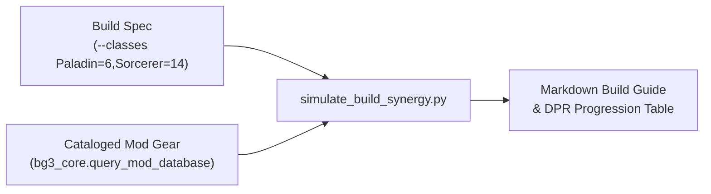

# bg3-theorycraft

Combat modeling, multiclass build simulation, and theorycrafting engine for the **Baldur's Gate 3 Mod Studio** workspace.

---

## Domain Architecture & Scope

`bg3-theorycraft` enables deep mechanical analysis of *Baldur's Gate 3* character builds across levels 1 through 20. It models D&D 5e / Larian rulesets including action economy, resource budgets, spell slot progression matrices, hit probabilities, and Damage-Per-Round (DPR) distributions against varying target Armor Classes.



---

## Core Capabilities

### 1. Multiclass Synergy & DPR Simulation (`simulate_build_synergy.py`)
- **Progression Modeling**: Simulates 1–20 character level progression across single-class and complex multiclass combinations (e.g. Paladin 6 / Sorcerer 14).
- **Damage-Per-Round (DPR) Calculations**: Computes expected sustained and burst DPR values against target Armor Classes ranging from AC 10 through AC 25 (`--ac-curve`).
- **Action Economy & Resource Budgets**: Models standard Actions, Bonus Actions, Reactions, Extra Attack scaling, Action Surge, and class-specific action resources (Channel Oath, Superiority Dice, Sorcery Points, Ki, Rage).
- **Hit Probability & Crits**: Evaluates Advantage and Disadvantage mechanics (`--advantage`, `--disadvantage`), critical hit ranges (e.g. Champion, equipment boosts), and analytical Savage Attacker dice distributions (`--savage-attacker`).
- **Spell Slot Matrices**: Computes multiclass spellcaster levels, 9-level spell slot allocations according to 5e rules, and Warlock Pact Magic slots.

### 2. Best-in-Slot (BiS) Community Gear Integration
Interfaces directly with `bg3_core.query_mod_database` to analyze cataloged equipment from community mods:
- Search equipment by stat bonuses, spell save DC increases, attack bonuses, damage riders, and critical threshold reductions.
- Dynamically applies stat overrides (e.g., Amulet of Greater Health setting Constitution to 23).
- Maps item synergies directly to Turn 1 combat sequences.

---

## CLI Integration

Theorycrafting commands are routed through the unified `bg3` CLI suite:

### Common Commands:
- `bg3 build simulate --classes "Paladin=6,Sorcerer=14"` — Generate level 1–20 multiclass synergy table.
- `bg3 build simulate --classes "Fighter=12" --gear "GWM,Balduran Greatsword" --dpr-sequence melee_burst --ac-curve` — Calculate DPR distribution curve across AC 10–25.
- `bg3 build simulate --classes "Ranger=12" --weapon-damage "1d8+3" --dpr-sequence ranged_burst` — Calculate Turn 1 ranged burst DPR sequence.
- `bg3 build simulate --classes "Paladin=2,Sorcerer=18" --advantage --savage-attacker` — Calculate burst DPR with Advantage and Savage Attacker dice rerolls.
- `bg3 sim --classes "Wizard=20" --json` — Top-level shorthand alias emitting machine-readable build metrics.

### Supported CLI Flags:
- `--classes`: Comma-separated class breakdowns (e.g. `"Paladin=6,Sorcerer=14"`).
- `--stats`: Comma-separated ability scores (e.g. `"Str=16,Dex=14,Con=14,Int=10,Wis=10,Cha=20"`).
- `--gear`: Comma-separated mod item IDs or display names.
- `--weapon-damage`: Override base weapon damage dice expression (e.g. `"2d6+2"`, `"1d8+3"`).
- `--dpr-sequence`: Sequence to evaluate (`melee_burst`, `eldritch_blast`, or `ranged_burst`).
- `--target-ac`: Single target Armor Class for primary DPR evaluation (default: 18).
- `--roll-mode`: Roll probability distribution (`normal`, `advantage`, `disadvantage`).
- `--advantage`: Shorthand for `--roll-mode advantage`.
- `--disadvantage`: Shorthand for `--roll-mode disadvantage`.
- `--savage-attacker`: Enables exact analytical Savage Attacker damage dice rerolls.
- `--ac-curve`: Computes and displays DPR and hit chance across all ACs from 10 to 25.
- `--json`: Outputs structured JSON for integration with agent skills and tools.

---

## Programmatic Library Usage

`bg3_theorycraft` exposes a strongly-typed domain model API (`models.py`) with full backward-compatible dictionary mapping:

```python
import bg3_theorycraft as tc

# Simulate build synergy
result: tc.SimulationResult = tc.simulate_build(
    classes={"paladin": 6, "sorcerer": 14},
    stats={"Str": 16, "Dex": 10, "Con": 14, "Int": 10, "Wis": 10, "Cha": 20},
    dpr_sequence="melee_burst",
    roll_mode="advantage",
    savage_attacker=True,
    include_ac_curve=True,
)

# Strongly-typed attribute access
print(f"Proficiency Bonus: +{result.proficiency_bonus}")
print(f"Effective Spell DC: {result.effective_spell_save_dc}")
print(f"Turn 1 Expected DPR: {result.turn_1_dpr.expected_dpr:.2f} damage")
print(f"Action Budget: {result.action_budget.actions} action, {result.action_budget.bonus_actions} bonus")
print(f"Sorcery Points: {result.resource_pools.sorcery_points}")

# Dictionary subscripting backwards-compatibility
print(f"Subscript access: {result['effective_spell_save_dc']}")
```
